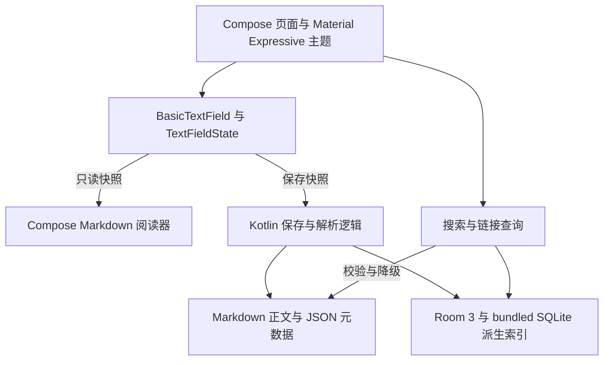

# Looma 个人 Markdown 笔记与知识管理工具需求分析规格说明书

> 2026-10-28 更新。本文是正式应用的需求目标，不是已完成功能清单。当前选定纯 Kotlin Compose 源码编辑与独立阅读，保留原需求编号，替换原即时渲染要求。技术理由见 [技术选型](technical-selection.md)，实测范围见 [核实记录](verification-record.md)。

## 1. 背景与问题陈述

Markdown 凭借纯文本、开放无专利限制、可跨平台无损迁移等特征，已成为计算机与理工科学生、科研人员及知识工作者记录课程笔记与个人知识的首选格式。然而在 Android 移动端生态中，现存工具往往在“便捷性”与“数据自主权”之间产生断层，主要存在以下五大痛点：

### 1.1 移动端需要可靠的编辑与清晰的阅读

用户需要在手机上记录 Markdown，也需要查看排版后的内容。本版采用源码编辑与独立阅读，编辑时始终保留 Markdown 标记，阅读时展示标题、列表和代码块。两种模式共用同一份源文本，阅读器不回写正文。即时渲染不再作为本版目标。

### 1.2 笔记规模增长后知识难以高效检索与重新发现
高校学生与知识工作者在学期累积或多项目并进后，笔记数量通常迅速突破数千篇。依靠传统的树状目录结构与单一文件名查找效率极低。用户经常仅模糊记得正文中包含某个专业名词（如 `TIME_WAIT` 或 `Zero-Copy`），却遗忘了所属文件路径与标题。移动端亟需轻量、毫秒级响应、支持中英文连续文本匹配的 **本地全文检索（Full-text Search, FTS）** 引擎。

### 1.3 传统树状层级无法映射网状复杂的知识拓扑
传统文件目录（如 `计算机网络/TCP.md`）仅能表示单一归属关系，无法表达跨学科、跨章节的非线性联系。例如“TCP 状态机”、“Linux Socket API”与“分布式高并发”之间存在网状依赖关系。若缺少双向链接（WikiLink）与反向引用追踪（Backlink），碎片化笔记极易退化为相互孤立的信息孤岛。

### 1.4 私有数据格式与云端绑定威胁用户数据所有权
部分知识管理工具（如 Notion、某些云笔记）将正文强绑定于专有格式（Block 结构）或远程云端数据库。一旦服务终止、网络断连、账户被封禁或策略变更，用户将付出极高的数据导出与迁移成本。用户需要数据真正驻留在本地文件系统中的 **Local-first（本地优先）** 软件架构。

### 1.5 移动场景下弱网与无网环境的不确定性
学生在上课教室、自习室弱网区域、地下通勤轨道交通及旅途中，移动网络极易波动或中断。依赖云端协同或每次搜索均需请求远程接口的软件往往出现卡顿、白屏甚至数据写入丢失。核心写作与知识检索流程必须完全基于本地离线闭环运行。

---

## 2. 产品定位与目标

### 2.1 产品定位
Looma 是一款 **面向高校学生为主、知识工作者为辅的 Android-first、本地优先（Local-first）的 Markdown 个人笔记与知识管理工具**。软件坚持以开放标准的 Markdown 纯文本作为底层永久存储，通过原生源码编辑、独立阅读、正文标签、本地全文搜索以及双向链接，在 Android 移动端实现零配置、沉浸式、高可靠的个人知识管理。

### 2.2 产品目标 (Objectives)
* **OBJ-01 可靠记录与阅读**：使用原生控件编辑 Markdown 源码，一次点击切换到阅读模式。切换时保留正文、选区与本次会话的撤销历史。
* **OBJ-02 毫秒级知识找回**：在数千篇笔记规模下，通过本地 FTS5 引擎实现标题与正文关键词的亚秒级检索。
* **OBJ-03 建立网状知识联系**：通过轻量语法解析建立双向链接与反向引用面板，帮助用户无缝梳理知识网络。
* **OBJ-04 绝对数据自主与可携性**：用户笔记 100% 存储为标准 UTF-8 Markdown 文件，不依赖任何私有数据库或远程账户，随拷随用。
* **OBJ-05 全功能离线闭环**：全生命周期的笔记创建、编辑、检索、关联及导出均可在断网状态下完整执行。

---

## 3. 目标用户与使用场景

### 3.1 用户画像分析

| 用户角色 | 核心特征与痛点 | 关键诉求 |
| :--- | :--- | :--- |
| **主要用户：高校学生**<br>（计算机、理工科及文史类） | ① 课堂与自习节奏快，需快速记录重点；<br>② 手机为第一随身设备，经常身处弱网自习室与地铁；<br>③ 课程多、知识跨度大，期末复习时急需按关键词快速串联知识；<br>④ 厌恶复杂的服务器搭建、插件配置与订阅收费。 | ① 即开即写，自动防丢；<br>② 亚秒级本地中英双语全文检索；<br>③ 简单的 `#Tag` 与 `[[WikiLink]]` 语法；<br>④ 现代 Android 视觉（Material 3），界面轻盈。 |
| **次要用户：知识工作者**<br>（研发工程师、研究学者） | ① 拥有长期积累的技术卡片与研究片段；<br>② 强调原子化笔记与双链反向穿梭；<br>③ 对数据隐私极其敏感，坚决抵制未经审计的私有云同步；<br>④ 会使用外接键盘或折叠屏进行高效文本整理。 | ① 严密的 Backlink 反向链接拓扑导航；<br>② 完美兼容标准 CommonMark 与 GFM 格式；<br>③ 结构清晰的 ZIP 导出归档与索引自愈能力；<br>④ 键盘快捷键（Ctrl+S/Ctrl+F）映射与无障碍支持。 |

### 3.2 典型使用场景 (Use Cases / Scenarios)

* **SCN-01 课堂碎片记录与课后复习找回**
  学生在专业课上，点击主屏快捷方式 1 秒内进入新建界面，输入 `#计算机网络` 标签，正文提及 `[[TCP 拥塞控制]]`。输入停顿后后台自动安全落盘。期末复习时，在检索框键入 `慢启动`，即刻穿透正文命中该笔记，并通过 Backlinks 查看所有引用了该协议的算法笔记。
* **SCN-02 通勤地铁全离线无感操作**
  用户在信号完全屏蔽的地下列车中，浏览、修改上万字的课程实验报告并进行中英文搜索。所有 CRUD、全文索引更新均在本地完成，无任何网络依赖报错，电池消耗平稳。
* **SCN-03 知识库跨设备无损迁移**
  用户需要更换手机或将笔记同步至 PC 端。用户点击“导出完整知识库”，系统打包生成标准 ZIP 压缩包（包含相对层级的 `.md` 文件与元数据）。解压至桌面端（如 Obsidian / VS Code）后，正文和标记完整保留。扩展语法的显示由目标工具决定。
* **SCN-04 存储意外故障下的数据自愈重建**
  由于系统清理软件误删了应用内部数据库或 Room 缓存，底层 Markdown 文本文件安然无恙。应用启动后检测到索引丢失，自动提示“从 Markdown 事实源重建知识库”。用户一键触发，系统在数十秒内重新解析全部纯文本，Tag、FTS 与双链索引完美复原。
* **SCN-05 知识工作者卡片文献梳理（深度网状导航）**
  研究者在折叠屏或平板设备上阅读技术文献，建立了一组概念卡片。通过侧边栏或底部抽屉呼出 Backlink 反向链接面板，清晰查阅当前概念被哪些上位理论与下位案例所引用，点击条目实现笔记间的即时穿梭跳转。
* **SCN-06 视障与行动障碍辅助访问场景（无障碍支持）**
  视障学生开启 Android 系统级 TalkBack 屏幕朗读服务。应用所有交互按钮（新建、搜索、保存状态指示、双链锚点）均朗读精准语义。所有触控按钮不低于 48dp × 48dp，大字号缩放时不出现文本折叠遮挡。

---

## 4. 输入 / 输出数据格式规范 (I/O Data Specification)

为确保数据可移植性、消除跨平台二义性并作为系统测试的法定客观依据，对系统涉及的所有输入、存储与输出数据建立严格的格式约束。

### 4.1 笔记文件物理存储与编码规范
* **字符编码**：统一强制为 **UTF-8（无 BOM）**。导入包含 UTF-8 BOM 或 GBK 编码的文件时，系统应自动转码为标准 UTF-8 无 BOM 保存。
* **行尾换行符**：读取时兼容支持 `LF (\n)` 与 `CRLF (\r\n)`；应用内部保存与导出时统一规范化写入为 UNIX 标准 **`LF (\n)`**。
* **文件扩展名**：标准识别 `.md` 与 `.markdown`（导出时统一命名为 `.md`）。

### 4.2 文件命名与字符校验规则
* **长度限制**：文件名长度限制在 1 ~ 255 个 UTF-8 字节（对应中文字符约 80 字以内）。
* **非法字符集定义**：严禁在文件名与笔记标题中包含以下字符：
  ```text
  \  /  :  *  ?  "  <  >  |  \0 (空字符)
  ```
* **控制字符与首尾限制**：禁止 ASCII 控制字符 (0x00 ~ 0x1F)；禁止文件名以空格或英文句点 `.` 开头或结尾。
* **保留关键字拦截**：跨平台导入时自动校验并重命名 Windows 保留文件名（如 `CON`, `PRN`, `AUX`, `NUL`, `COM1-9`, `LPT1-9` 等）。

### 4.3 故障模式与文件名冲突处理策略 (Failure Handling)
* **非法字符自动过滤与提示**：用户在编辑标题时若输入上述非法字符，UI 触发非阻塞式行内高亮警告；在生成对应本地文件时，系统自动将非法字符映射转义为下划线 `_`。
* **同名冲突解决策略**：当外部导入 `.md` 文件或另存为笔记出现同名时，系统 **严禁任何静默覆盖行为**，弹出模态决策弹窗提供三项选择：
  1. *自动重命名（默认推荐）*：在新文件名末尾追加自增序号，格式为 `原文件名 (1).md`、`原文件名 (2).md`，确保双份数据完整保留；
  2. *覆盖现有文件*：先将原文件原子备份为 `.md.bak` 临时文件，新内容写入并落盘校验通过后再移除备份；
  3. *跳过此文件*：放弃当前单篇导入，继续处理导入队列后续文件。
* **路径穿越防御**：解析相对路径导入时，若路径包含 `../` 导致越界逃逸出笔记根目录，系统强制将其截断并拉平至根目录，防止越权覆盖系统文件。

### 4.4 时间戳格式与时区规范
* **内部持久化**：统一采用 UTC 毫秒级 Unix 时间戳（`Int64` 整数，如 `1774780800000`）。
* **元数据及导出呈现**：遵循 **ISO-8601** 国际标准格式，显式标注本地时区偏移量：
  ```text
  YYYY-MM-DDTHH:mm:ss±HH:mm
  示例：2026-09-28T14:30:00+08:00
  ```

### 4.5 标签（Tag）语法与解析规范
* **语法格式**：正文中以井号开头的单级标签 `#标签名` 或多级层级标签 `#父标签/子标签`。
* **合法字符集**：必须符合正则表达式：
  ```regex
  ^#[A-Za-z0-9_\-\u4e00-\u9fa5]+(/[A-Za-z0-9_\-\u4e00-\u9fa5]+)*$
  ```
  即仅允许汉字、大小写字母、数字、下划线、短横线与层级分隔斜杠。
* **上下文定界规则**：为避免与 Markdown 标题语法（`# 一级标题`）及 URL 网页锚点混淆：
  * `#` 前面必须是行首、空格、换行或常见标点符号；
  * `#` 后面必须紧跟合法标签字符，**严禁紧跟空格**（如 `# Title` 判定为一级标题，而非标签）；
* **大小写与折叠规则**：标签检索与统计实施大小写不敏感折叠（Case-folding，如 `#Android` 与 `#android` 归并在同一标签分类下，展示保留首创者大小写形式）。

### 4.6 双向链接（WikiLink）语法与解析规范
* **基本形态**：标准语法 `[[笔记名称]]`；别名形态 `[[笔记名称|自定义显示别名]]`。
* **合法字符与排除项**：双链内部禁止换行，禁止嵌套中括号，禁止包含 `|`（除别名分隔符外）、`#`、`^` 等语法保留符。
* **目标匹配与重名冲突解析机制**：
  * 解析时在知识库文件名索引中进行 **大小写不敏感（Case-insensitive）** 精确匹配；
  * 若目标笔记存在且唯一，标记为有效链接并高亮；
  * 若目标不存在，链接渲染为 `unresolved`（灰色下划线），点击触发“目标不存在，是否立即创建该笔记？”交互；
  * 若发生多目录同名冲突，系统优先匹配同目录笔记，或在点击时列出同名笔记候选列表供用户指定。

### 4.7 导出包（Export Bundle）目录结构规范
当用户触发“导出知识库”时，系统将生成标准的 ZIP 压缩归档文件，其内部结构定义如下：
```text
Looma_Backup_20260928T143000.zip
├── notes/                        # Markdown 笔记正文主目录（保留用户自建层级）
│   ├── 计算机网络/
│   │   ├── TCP三次握手.md
│   │   └── TIME_WAIT.md
│   └── 线性代数卡片.md
├── attachments/                  # 本地图片及多媒体静态资源
│   ├── img_20260928_001.png
│   └── architecture_diag.svg
└── manifest.json                 # 导出包元数据清单与校验索引
```
`manifest.json` 采用 JSON 格式输出，内容架构如下：
```json
{
	"generator": "Looma v1.1",
	"exportTimestamp": "2026-09-28T14:30:00+08:00",
	"schemaVersion": "1.0",
	"totalNotes": 256,
	"totalAttachments": 12,
	"notesIndex": [
		{
			"relativePath": "notes/计算机网络/TIME_WAIT.md",
			"sha256": "e3b0c44298fc1c149afbf4c8996fb92427ae41e4649b934ca495991b7852b855",
			"tags": ["计算机网络", "TCP"],
			"outboundLinks": ["TCP三次握手"]
		}
	]
}
```

---

## 5. 运行环境基线与外部依赖规范

本节明确界定系统的运行技术基准与依赖边界，确保各项性能与功能指标具备可验证、可判定的前提。

### 5.1 Android 运行环境基线

| 项目 | 当前基线 | 验证范围 |
|---|---|---|
| 最低系统 | API 26 | 构建配置已采用，低版本运行待验证 |
| 编译与目标系统 | compileSdk 37、targetSdk 37 | 两轮原型构建通过 |
| 工具链 | JDK 21、Java 字节码 17、AGP 9.1.1、Gradle 9.3.1、Compose 插件 2.3.20 | 原型固定组合，不宣称是最新版本 |
| 实际运行环境 | Pixel_10 AVD、Android API 37 | 未覆盖真机、API 26 或完整设备矩阵 |
| 性能验收设备 | 骁龙 778G、天玑 8100 同级，RAM 至少 6 GB | 仍是计划，原型没有性能成绩 |

### 5.2 外部技术组件依赖矩阵

| 部分 | 选定组件 | 约束与状态 |
|---|---|---|
| 界面 | Jetpack Compose、Material3 1.5.0-beta02 | 方案 B 布局，优先 Expressive 组件，使用系统 Dynamic Color |
| 编辑 | Foundation `BasicTextField`、`TextFieldState`、`undoState` | 原生源码编辑，原型解析到 Foundation 1.12.0 |
| 阅读 | `multiplatform-markdown-renderer-m3:0.39.2` | 独立 Compose 阅读页，不通过 WebView 执行 HTML 或 JavaScript |
| 派生索引 | Room 3.0.3、`sqlite-bundled:2.7.1`、`BundledSQLiteDriver` | 第一轮已完成最小建表与查询，产品集成与性能待验证 |
| 并发 | Kotlin Coroutines、Flow | 编辑状态在主线程管理，文件读写与索引操作放入后台任务 |

完整依赖解析与证据见 [技术选型](technical-selection.md) 和 [核实记录](verification-record.md)。正式方案不依赖 Vditor、CodeMirror、WebKit 或 KaTeX。数学公式阅读能力另行评估。

### 5.3 存储访问模型与权限声明规范
* **私有工作区目录（默认）**：
  * 应用数据主目录选用 Android 应用专属外部存储空间：`Context.getExternalFilesDir(Environment.DIRECTORY_DOCUMENTS)`。
  * **权限声明**：在 Android 8.0+ 上读写此目录 **无需任何运行时危险权限**（无需申请 `READ_EXTERNAL_STORAGE` 或高危 `MANAGE_EXTERNAL_STORAGE`），充分保护用户隐私并降低安装门槛。
* **公共存储与外部导入导出（SAF 模型）**：
  * 当用户主动发起单篇导入或完整知识库备份导出时，全面采用 Android 官方推荐的 **存储访问框架（Storage Access Framework, SAF）**；
  * 使用 `ActivityResultContracts.OpenDocument` 调起系统选择器，并在当前 URI 授权范围内通过 `ContentResolver` 读取。一次性导入不默认要求持久化授权，授权失效时提示重新选择。

---

## 6. 核心业务规则 (Business Rules)

* **BR-01 单一事实源原则 (Source of Truth)**：本地文件系统中的 `.md` 文本文件是系统正文的唯一事实源。任何数据库损坏均不得导致正文数据丢失。
* **BR-02 索引派生性原则 (Derived Data)**：Room 数据库中的 Search 索引、Tag 关联表、WikiLink/Backlink 图谱纯属从 Markdown 中提取的派生数据。
* **BR-03 自愈优于覆盖原则**：当数据库索引与本地 Markdown 文件存在状态不一致时，无条件以 Markdown 文件解析为准，系统提供一键重建能力。
* **BR-04 写入原子性原则**：先写临时文件并同步，再原子替换正文，同步相关目录并提交元数据。禁止截断覆盖原文件。进程中断、替换后失败与掉电分别验证，不把正常写入探针当作任意故障下的保证。
* **BR-05 保存语义真实性原则**：仅当 Markdown 文件在物理介质上完成原子落盘操作后，UI 方可向用户呈现“已保存”状态；内存更新、ViewModel 状态变更一律不得伪装为“已保存”。
* **BR-06 语法宽容性原则**：编辑器无法理解的自定义 Markdown 扩展标记、HTML 嵌入或未知语法，必须原样保存在源文件中，严禁系统静默清洗或删除。
* **BR-07 悬空链接合法性原则**：指向不存在笔记的 WikiLink（未解析死链）是合法的探索性知识占位符，系统必须允许其长期存在并标示为 unresolved，禁止抛出未捕获异常。
* **BR-08 零网络核心可用原则**：所有核心功能（增删改查、全文搜索、双链跳转、数据导出与索引自愈）必须在 100% 离线断网环境下稳定可用。
* **BR-09 跨平台兼容清洗原则**：输入文件名包含保留字符时，系统执行自动转义与友好拦截，严禁由于操作系统底层抛出 I/O Exception 而导致应用闪退。
* **BR-10 零账号无感使用原则**：本系统 V1 阶段严禁引入任何用户登录、身份认证、手机号绑定或强制云端授权逻辑。
* **BR-11 误删防灾缓冲原则**：删除笔记不得直接在底层执行不可逆物理清除，必须提供即时撤销机制并默认移入回收站。
* **BR-12 最小授权透明原则**：应用严禁在 Manifest 中声明与核心功能无关的网络外联权限或设备指纹读取权限。

---

## 7. 功能需求规格说明 (Functional Requirements)

### 7.1 优先级划分标准与分布统计
本规格严格采用 **MoSCoW 规范** 重构三级优先级：
* **高优先级 (High / P0 - Must Have)**：系统核心骨架，必须在 V1 交付，缺少则核心记录与知识检索闭环无法运转；
* **中优先级 (Medium / P1 - Should Have)**：重要体验功能，对知识梳理与操作安全性具有显著价值，允许在首个 Alpha 验证后快速跟进；
* **低优先级 (Low / P2 - Could Have)**：进阶体验与视觉锦上添花特性，不影响核心功能运转，若资源受限可安全降级。

---

### 7.2 笔记管理域 (Note Management)

| 需求 ID | 需求描述 | 优先级 | 降级理由 / 权重分析 | 来源 / 依据 |
| :--- | :--- | :---: | :--- | :--- |
| **FR-NOTE-01** | 用户能够新建空白 Markdown 笔记，并实时录入标题与正文。 | **高** | 核心录入闭环起点，不可降级。 | SCN-01 / Markor |
| **FR-NOTE-02** | 用户能够按更新时间、创建时间或文件名升序/降序浏览笔记列表。 | **高** | 基础知识导航视图，不可降级。 | SCN-01 / Joplin |
| **FR-NOTE-03** | 用户能够打开已有笔记，编辑 Markdown 源码或切换到原生阅读页。 | **高** | 基础浏览与编辑入口。 | SCN-01、OBJ-01 |
| **FR-NOTE-04** | 用户能够修改笔记标题与正文，修改标题时自动同步重命名底层 `.md` 文件。 | **高** | 保持文件系统与标题映射一致。 | BR-01 / SCN-03 |
| **FR-NOTE-05** | 用户能够删除指定笔记；系统提供 5 秒 Snackbar 即时撤销功能，超时后文件移入本地回收站（保留 30 天可恢复）。 | **高** | 消除原“有效撤销”二义性，保障防误删可靠性。 | BR-11 / Nouto |
| **FR-NOTE-06** | 系统自动在底层文件元数据中记录并维护笔记创建时间戳与最后修改时间戳。 | **中** | 辅助知识排序与检索加权，暂不阻塞纯文本记录。 | SCN-01 / SCN-04 |
| **FR-NOTE-07** | 用户能够进入“回收站”视图，查看已软删除笔记，支持单篇永久彻底粉碎或一键还原至原工作目录。 | **中** | 防灾管理进阶视图，V1 核心创建可先独立运转。 | BR-11 / Joplin |
| **FR-NOTE-08** | 用户能够查看当前笔记的实时统计信息（汉字字数、英文单词数、预估阅读耗时）。 | **低** | 属于辅助型只读面板，对知识存储无刚性影响。 | 竞品调研-Typora |

---

### 7.3 Markdown 编辑域 (Markdown Editing)

| 需求 ID | 需求描述 | 优先级 | 降级理由 / 权重分析 | 来源 / 依据 |
| :--- | :--- | :---: | :--- | :--- |
| **FR-EDIT-01** | 提供原生 Markdown 源码编辑与独立阅读模式，一次点击切换。阅读器只读取当前快照，不回写正文。 | **高** | 当前已确认的编辑交互，不要求即时渲染。 | OBJ-01、技术选型 |
| **FR-EDIT-02** | 阅读页支持六级 ATX 标题、粗体、斜体、删除线、列表、任务列表、引用、代码、表格、分割线、链接与本地图片。源码中的未知语法和 HTML 原样保留，阅读器不执行脚本。 | **高** | CommonMark 与 GFM 基础语法及本地附件须逐项验收，公式归入 FR-EDIT-10。 | BR-06、AC-EDIT-01 |
| **FR-EDIT-03** | 编辑页始终显示原始 Markdown 标记。进入阅读后再返回，正文、方向性选区与本次会话的撤销历史保持一致。 | **高** | 原型存在选区折叠问题，正式实现须修复。 | BR-01、AC-EDIT-01 |
| **FR-EDIT-04** | 系统实现智能防抖（Debounce）自动保存：用户停止输入达到 2 秒后自动异步触发原子落盘。 | **高** | 消除移动端手动保存负担，防丢核心机制。 | OBJ-03 / SCN-01 |
| **FR-EDIT-05** | 应用内退出或换篇前获取最新正文并等待保存完成。onPause、onStop 触发加急异步保存，不阻塞主线程，也不保证进程终止前必然完成。 | **高** | 异常退出恢复最近成功提交的版本。 | BR-04、BR-05、Spike 6 |
| **FR-EDIT-06** | 保存因存储满等外部故障失败时，系统严禁呈现“已保存”标识，必须保留编辑态并弹出阻塞式重试警告。 | **高** | 严守保存语义一致性，杜绝假保存导致数据丢失。 | BR-05 / SCN-02 |
| **FR-EDIT-07** | 完全兼容 Android 中文 IME 输入法（拼音/手写/双拼）、选词确认、长按光标定点、原生复制/剪切/粘贴面板。 | **高** | 移动端文字录入基本生命线，必须通过真机验证。 | Spike 2 |
| **FR-EDIT-08** | 编辑器支持本次会话内多步撤销与重做，至少 100 步及连续输入分组作为验收目标。换篇返回后保留历史，不要求跨进程恢复历史。 | **中** | 原型仅验证基础操作，100 步与分组策略尚未验收。 | AC-EDIT-01、Spike 1 |
| **FR-EDIT-09** | 编辑器顶部或输入法上方提供 Markdown 常用语法快速输入辅助工具栏（加粗、列表、标签、双链快捷插符）。 | **中** | 提升手机软键盘输入效率，属于操作便利层。 | 竞品调研-Markleaf |
| **FR-EDIT-10** | 提供独立的数学公式预览与语法错误提示。具体原生渲染组件另行评估，未支持时保留公式源码。 | **低** | 本版不预设 KaTeX 或 WebView 实现。 | 高校写作场景 |

---

### 7.4 标签分类域 (Tag System)

| 需求 ID | 需求描述 | 优先级 | 降级理由 / 权重分析 | 来源 / 依据 |
| :--- | :--- | :---: | :--- | :--- |
| **FR-TAG-01** | 系统支持从正文中自动提取符合规范的正文标签（如 `#计算机网络`、`#CS/OS`）。 | **高** | 核心知识聚合机制，免去手动配置元数据。 | SCN-01 / Obsidian |
| **FR-TAG-02** | 标签提取规则严格排除 Markdown 标题（`# Title`）与代码块内的注释行，并执行大小写折叠去重。 | **高** | 确保标签提取高精确度，杜绝语法解析误报。 | 4.5 节规范 / BR-02 |
| **FR-TAG-03** | 笔记保存后，系统异步增量更新本地 Room Tag 关系索引库。 | **高** | 实现按标签即时筛选知识，保持毫秒级响应。 | BR-02 / SCN-01 |
| **FR-TAG-04** | 系统提供全局标签总览面板，展示当前知识库包含的所有标签及其关联笔记数量。 | **中** | 知识宏观浏览视图，次于正文检索。 | 竞品调研-Joplin |
| **FR-TAG-05** | 用户在标签面板点击指定标签，能够按该标签快速过滤展示所有相关笔记清单。 | **中** | 标签交互落地闭环。 | SCN-01 / SCN-05 |
| **FR-TAG-06** | 支持将多级标签（如 `#课业/软工/复习`）自动解析并按树状折叠目录树展示。 | **低** | 知识进阶层级管理，可在 V1.1 迭代完善。 | 竞品调研-Obsidian |

---

### 7.5 全文检索域 (Full-text Search, FTS)

| 需求 ID | 需求描述 | 优先级 | 降级理由 / 权重分析 | 来源 / 依据 |
| :--- | :--- | :---: | :--- | :--- |
| **FR-SEARCH-01** | 用户能够输入单关键词或以空格分隔的多个关键词，对全库笔记执行全文检索。 | **高** | 全文检索入口，不可降级。 | OBJ-02、SCN-01 |
| **FR-SEARCH-02** | 全文检索范围同时覆盖笔记文件名、标题及全文 Markdown 正文，正文匹配项享有合理相关度评分。 | **高** | 解决“只记正文不记标题”的核心痛点。 | 1.2 节 / SCN-01 |
| **FR-SEARCH-03** | 支持中文单字、两字、多字及 ASCII 英文大小写不敏感的连续文本匹配。英文前缀作为子串可以命中，不承诺中文词典分词或语义搜索。 | **高** | 长词用 trigram 候选，短词用转义 LIKE，最终按原文校验。 | CHG-04、Spike 5 |
| **FR-SEARCH-04** | 点击检索命中结果列表项，能够直接打开目标笔记，并自动平滑滚动定位至关键词首发位置。 | **高** | 完成知识找回操作闭环。 | SCN-01 / Joplin |
| **FR-SEARCH-05** | 搜索结果列表中显式高亮展示匹配关键词，并截取包含该词的前后 30 个字作为上下文正文摘要。 | **中** | 帮助用户在列表阶段提前判别有效性。 | 竞品调研-Obsidian |
| **FR-SEARCH-06** | 笔记编辑并落盘后，系统在后台异步协程中自动增量刷新对应的 FTS 索引项，延迟不超过 1 秒。 | **中** | 保证检索结果即时性，若排队短时延迟不致命。 | BR-02 / NFR-PERF-05 |
| **FR-SEARCH-07** | 检索支持基础布尔逻辑操作符（AND / OR / NOT）及引号精准短语匹配。 | **低** | 进阶检索语法，主要面向高阶极客，V1 可仅空格 AND。 | 竞品调研-Joplin |

---

### 7.6 双向链接与反向引用域 (WikiLink & Backlink)

| 需求 ID | 需求描述 | 优先级 | 降级理由 / 权重分析 | 来源 / 依据 |
| :--- | :--- | :---: | :--- | :--- |
| **FR-LINK-01** | 系统自动识别正文中形如 `[[笔记名称]]` 及 `[[笔记名称\|显示别名]]` 的双向链接语法并解析为超链接。 | **高** | 网状知识图谱连接基础，不可降级。 | OBJ-03 / SCN-01 |
| **FR-LINK-02** | WikiLink 在阅读页显示为带下划线的可点击文本。编辑页保留原始标记，不要求边输入边转成链接。 | **高** | 当前原型仍按普通文本展示，正式阅读扩展待实现。 | FR-UI-01、AC-LINK-01 |
| **FR-LINK-03** | 点击已成功解析的 WikiLink，系统在当前窗口或新会话中秒级打开对应的目标笔记。 | **高** | 核心知识穿梭流，不可降级。 | SCN-01 / SCN-05 |
| **FR-LINK-04** | 当 WikiLink 目标笔记不存在时，系统不得崩溃，样式降级呈现为 `unresolved`（虚线灰色下划线）。 | **高** | 消除原“不得导致异常”模糊表述，防御断链。 | BR-07 / AC-LINK-02 |
| **FR-LINK-05** | 点击处于 `unresolved` 状态的双向链接时，系统弹出友好确认弹窗，允许用户一键基于该名称创建新笔记。 | **中** | 自顶向下网状知识构建关键体验，简化操作。 | 竞品调研-Obsidian |
| **FR-LINK-06** | 当前笔记底部或侧边提供独立的 **Backlinks（反向引用）** 面板，自动列出所有引用了当前笔记的来源笔记。 | **中** | 建立完整双向回路，知识卡片整理核心需求。 | SCN-05 / Markleaf |
| **FR-LINK-07** | 点击 Backlinks 列表中的来源项，可直接跳转反查来源笔记，并展示引用所在的段落预览。 | **中** | 知识回溯穿梭闭环。 | SCN-05 / SCN-01 |
| **FR-LINK-08** | 用户重命名某篇笔记标题时，系统自动扫描全库并提示“是否级联更新其他笔记中的相关 `[[旧标题]]` 引用”。 | **低** | 属于高级重构工具，用户手动维护在初期可接受。 | 竞品调研-Obsidian |

---

### 7.7 数据管理与可迁移性域 (Data Management & Portability)

| 需求 ID | 需求描述 | 优先级 | 降级理由 / 权重分析 | 来源 / 依据 |
| :--- | :--- | :---: | :--- | :--- |
| **FR-DATA-01** | 用户能够通过 Android SAF 框架单选或多选外部 `.md` 文件导入本地知识库，同名文件按 4.3 节规则处理。 | **高** | 外部存量资产引入核心路径。 | OBJ-04 / SCN-03 |
| **FR-DATA-02** | 用户能够导出单篇笔记为标准 `.md` 文件至系统任意公共目录（Downloads 等）。 | **高** | 单篇分享与迁移基础功能。 | OBJ-04 / Markor |
| **FR-DATA-03** | 用户能够一键导出完整知识库，系统按照 4.7 节规范打包为标准 ZIP 归档包，包含附件与校验清单。 | **高** | 数据自主权彻底实现，规避平台锁定。 | OBJ-04 / SCN-03 |
| **FR-DATA-04** | 所有笔记的 CRUD 操作完全基于本地物理介质执行，严禁向任何未授权外部网络端点发起同步上传。 | **高** | 核心架构原则，彻底合并原重复条目。 | BR-01 / BR-08 |
| **FR-DATA-05** | 系统提供“索引全库自愈重建”功能：当派生索引损坏时，重新全量扫描本地 Markdown 并在内存/Room 中自愈。 | **高** | 数据自愈基石，确保派生数据毁损时正文永固。 | BR-03 / SCN-04 |
| **FR-DATA-06** | 导入批处理过程中，若单篇文件因编码错乱或损坏解析失败，系统跳过报错并记录日志，严禁中止整个导入流程。 | **中** | 批量导入容错保障，提升鲁棒性。 | 4.3 节 / AC-DATA-02 |
| **FR-DATA-07** | 系统支持从包含标准目录结构的 ZIP 知识库备份包中完整解压并逆向恢复整个知识库与附件。 | **低** | 完整冷备份恢复功能，可依托手动解压替代。 | SCN-04 / 竞品调研 |

---

### 7.8 Android UI 与交互域 (UI & Interaction)

| 需求 ID | 需求描述 | 优先级 | 降级理由 / 权重分析 | 来源 / 依据 |
| :--- | :--- | :---: | :--- | :--- |
| **FR-UI-01** | 核心人机触控热区严格遵循 Android 无障碍标准，所有可点击控件最小尺寸不小于 48dp × 48dp。 | **高** | 消除触控误触，满足工业级移动端交互规范。 | NFR-ACC-02 / M3 规范 |
| **FR-UI-02** | 关键破坏性与异常操作（删除、保存失败、导入异常）均通过标准 Snackbar / Dialog 给予即时明确反馈。 | **高** | 杜绝静默失败，消除原模糊描述。 | BR-05 / BR-11 |
| **FR-UI-03** | 核心操作流精简高效：从任意一级主界面出发，完成“新建空白笔记”或“激活检索框”的点击手势次数 ≤ 2 次。 | **高** | 消除原“不超过 2 次”模糊表述，量化判定路径。 | OBJ-01 / SCN-01 |
| **FR-UI-04** | 适配 Android 边缘到边缘（Edge-to-edge）沉浸式布局，精准避让系统状态栏、打孔屏摄像头与底部手势导航条。 | **中** | 提升现代化现代原生 Android 质感。 | M3 设计规范 |
| **FR-UI-05** | 沿用方案 B 布局，优先使用 Material Expressive 组件，支持跟随系统切换深色与浅色主题。 | **中** | 保留统一布局与色彩角色。 | 用户选型、NFR-ACC-03 |
| **FR-UI-06** | 完整适配 Android 14 Predictive Back（预测性返回手势）交互，提供优雅的页面退出与缩放过渡动画。 | **中** | 现代化系统级手势集成，不影响核心逻辑。 | Android 14 规范 |
| **FR-UI-07** | Android 12 起默认使用系统 Dynamic Color，并同步应用于编辑、阅读与操作控件。旧系统使用静态回退。 | **高** | 用户明确要求，已从低优先级调整为必需能力。 | 用户选型、UI-THEME-02 |
| **FR-UI-08** | 针对折叠屏与平板大屏设备，自动适配双栏/分栏自适应布局（左侧文件与双链，右侧即时编辑区）。 | **低** | 大屏进阶适配，V1 优先保证手机单栏极致流畅。 | SCN-05 / 竞品调研 |

---

## 8. 非功能需求规格说明 (Non-Functional Requirements)

### 8.1 性能需求 (Performance)

以下数值是待验收目标。当前原型没有真机性能测量结果，源码长文探针不计为性能验收。

* **NFR-PERF-01 进程冷启动响应时间**
  在基准测试机型（高通骁龙 778G / 6GB RAM）上，系统处于冷启动状态下（应用进程首次创建），从点击桌面图标到主界面完全渲染就绪且可响应触控事件的耗时：
  $$\text{TTI}_{\text{ColdStart}} \le 2.0\text{ s (P95)} \quad (\text{Median} \le 1.5\text{ s})$$
* **NFR-PERF-02 大规模知识库检索响应时延**
  在本地知识库包含 **5,000 篇笔记**（平均单篇正文 1,500 字符，总词量约 750 万字）的数据集下，键入关键词后检索返回首屏结果并高亮渲染展示的耗时：
  $$T_{\text{Search}} \le 500\text{ ms (P95)} \quad (\text{Median} \le 300\text{ ms})$$
* **NFR-PERF-03 普通笔记加载与可编辑就绪时间**
  对于 **普通笔记（文件大小 ≤ 50 KB 且正文字符数 < 10,000 字）**，从用户点击列表项至源码绘制完成、焦点与输入连接可用的耗时：
  $$T_{\text{Open}} \le 500\text{ ms (P95)} \quad (\text{Median} \le 350\text{ ms})$$
* **NFR-PERF-04 长篇笔记连续编辑与输入吞吐能力**
  对于 **长篇笔记（正文字符数 ≥ 50,000 字，文件大小约 200~300 KB）**，以 5 字符/秒的速度进行连续中文输入或删除时：
  * 输入事件到光标位移及文字上屏的时延 $T_{\text{InputLatency}} \le 50\text{ ms (P95)}$；
  * 主线程 UI 帧率保持 $\ge 55\text{ FPS}$，杜绝严重掉帧卡顿，连续编辑 30 分钟无 ANR。
* **NFR-PERF-05 自动保存主线程阻塞上限**
  触发防抖自动保存与原子写入时，所有文件 I/O 与 SQLite 索引更新必须被调度在 `Dispatchers.IO` 后台协程执行，占用主线程（Main Thread）的时间：
  $$T_{\text{MainThreadBlock}} \le 50\text{ ms (最大峰值不得超过 100 ms)}$$
* **NFR-PERF-06 全库派生索引全量自愈耗时**
  针对包含 **5,000 篇标准笔记** 的知识库执行“索引全库自愈重建”，从启动解析到 FTS、Tags 与 Links 索引完全落盘并可供查询的总耗时：
  $$T_{\text{Rebuild}} \le 60\text{ s}$$

---

### 8.2 可靠性与容错需求 (Reliability & Fault Tolerance)

* **NFR-REL-01 文件提交与故障恢复**
  正文先写临时文件并同步，再执行原子替换和元数据提交。在指定设备的故障注入中，恢复结果必须是完整旧版或完整新版，不能出现半写文件。替换后确认失败标记为待核验，不承诺旧版本仍在。进程中断与真实掉电分别记录结果。

* **NFR-REL-02 派生数据单向毁损隔离**
  Room 数据库物理文件损坏或被用户手动删除时，系统正文数据完整度不受任何破坏。应用启动后检测到数据库异常，能够在 $\le 5\text{ s}$ 内自动进入降级安全模式并弹出重建向导。
* **NFR-REL-03 单文件异常隔离容错**
  导入或解析遇到包含未闭合标签、损坏编码或超长单行的异常 `.md` 文件时，解析引擎应将其降级为纯文本显示，**不得导致宿主 Activity 抛出未捕获异常而崩溃闪退**。
* **NFR-REL-04 平均无故障运行时间 (MTBF)**
  在连续编辑、检索与后台保存的高频压力测试下，平均无故障连续运行时间 $\text{MTBF} \ge 120\text{ 小时}$。
* **NFR-REL-05 崩溃自愈与状态恢复时限**
  当系统发生意外崩溃或被系统因低内存强行回收后，重新拉起应用时，能恢复最近一次正常保存的内容，恢复耗时 $\le 2.0\text{ s}$。

---

### 8.3 易用性需求 (Usability)

* **NFR-USE-01 零门槛即开即用**
  用户首次下载安装后，从启动应用到成功创建并保存第一篇笔记，中间 **严禁出现任何注册、登录、选择云存储、配置 Token 或拉取插件的拦截阻碍**。
* **NFR-USE-02 核心操作步数极致压缩**
  消除模糊表述，量化设定：从应用首页到“进入新建写作态”、“呼出检索输入框”、“查看当前笔记反向链接”三大高频路径，用户所需的手势交互操作步数（Tap/Click Count）严格 $\le 2$ 步。
* **NFR-USE-03 防灾容错保护机制**
  所有不可逆数据清除操作（如删除笔记、重置知识库）必须具备二次模态确认对话框或具备 $\ge 5\text{ 秒}$ 的即时 Snackbar 撤回时间窗口。
* **NFR-USE-04 人性化错误反馈规范**
  面向用户的提示信息严禁直接裸露技术调用栈（如 `NullPointerException` 或 `SQLiteConstraintException`），必须统一转换为面向用户角色的业务描述（如“保存失败：外部存储空间不足，请清理后重试”）。

---

### 8.4 数据可移植性需求 (Portability)

* **NFR-PORT-01 纯文本开放格式无损通用性**
  导出文件为标准 UTF-8 Markdown，可由其他文本编辑器打开，未知语法保留原文。不要求不同阅读器对扩展语法显示完全一致。
* **NFR-PORT-02 语法开放与零私有锁定**
  所有核心知识标记（#Tag、[[WikiLink]]）全部以开放文本字符串显式内嵌在 Markdown 正文中，严禁将标签仅作为私有数据库字段维护。
* **NFR-PORT-03 标准归档与跨操作系统兼容**
  导出的知识库 ZIP 包必须严格遵循跨平台通用 ZIP 压缩标准，文件路径采用 UTF-8 编码，消除 Windows/macOS/Linux 解压时的乱码与斜杠路径解析异常。

---

### 8.5 安全与隐私需求 (Security & Privacy)

* **NFR-SEC-01 零网络外联与数据主权自闭环**
  系统 V1 运行时严禁建立任何向外的 TCP/UDP 网络连接，严禁接入任何第三方商业统计 SDK、分析埋点 SDK 或广告插件。
* **NFR-SEC-02 原生阅读内容安全**
  编辑和阅读均不创建 WebView，不执行正文中的 JavaScript、HTML 事件或 iframe。无法展示的语法保留在源码中，不通过外部网页补全。
* **NFR-SEC-03 附件与文件访问边界**
  本地附件只从工作区允许的目录读取。规范化路径后拒绝路径穿越和不支持的类型。远程图片不自动下载，正文不得触发任意文件读取或系统命令。
* **NFR-SEC-04 外部链接协议限制**
  仅在用户点击时，通过 `Intent.ACTION_VIEW` 打开校验过的 `http` 或 `https` 链接。其他协议拒绝处理，没有可用浏览器时显示可理解的提示。

---

### 8.6 无障碍需求 (Accessibility)

* **NFR-ACC-01 屏幕朗读服务深度适配**
  界面中所有非文本可交互元素（包括浮动新建按钮 FAB、搜索图标、返回箭头、保存状态指示灯、反向链接条目）必须配置语义明确的 `contentDescription`，完全适配 Android TalkBack 朗读服务。
* **NFR-ACC-02 触控热区尺寸合规性**
  所有可点击图标、按钮及列表条目的物理触控热区（Touch Target Size）严格 $\ge 48\text{dp} \times 48\text{dp}$，满足 WCAG 2.1 移动触控可达性准则。
* **NFR-ACC-03 视觉无障碍对比度与字体动态缩放**
  * 浅色与深色模式下，正文文本与背景色的对比度严格 $\ge 4.5:1$（常规字）与 $\ge 3.0:1$（大标题），符合 WCAG 2.1 AA 级标准；
  * 完全支持 Android 系统级无障碍字体缩放（1.0x ~ 2.0x 动态放大），布局容器自动伸缩自适应换行，严禁发生文字截断或重叠。

---

### 8.7 可维护性需求 (Maintainability)

* **NFR-MAINT-01 编辑状态与持久化分离**
  Compose 管理编辑与阅读状态，Kotlin 业务逻辑管理保存、解析与搜索。文件和数据库通过仓储访问。阅读器不得修改编辑源文本，业务逻辑不依赖 DOM、JS 消息或编辑器插件协议。

* **NFR-MAINT-02 关键业务逻辑单元测试覆盖度**
  对于 Markdown 标签提取解析器、WikiLink 解析器、时间戳转换工具及文件名清洗模块，单元测试行覆盖率（Line Coverage）必须达到 $\ge 90\%$。

---

## 9. 核心验收标准 (Acceptance Criteria, BDD 规范)

### 9.1 笔记管理域验收用例

* **AC-NOTE-01 笔记全生命周期与时间戳记录**
  * **Given** 用户处于应用首页，本地工作区为空；
  * **When** 用户点击底部新建按钮，输入标题 `软工需求导论`，正文键入 `软件工程是指导计算机软件开发和维护的工程学科。`，并等待 2 秒后点击系统返回手势；
  * **Then** 首页笔记列表中出现 `软工需求导论`；打开该笔记，正文完整无误；底层文件系统生成 `软工需求导论.md`，其文件创建时间与修改时间与设备时钟偏差 $\le 2\text{ 秒}$。
* **AC-NOTE-02 笔记删除、Snackbar 撤销与回收站防误删**
  * **Given** 知识库中存在笔记 `数据结构复习.md`；
  * **When** 用户在列表项上执行左滑删除操作；
  * **Then** 该笔记从当前列表消失，底部立即弹出 Snackbar 提示：“将在 5 秒后移入回收站”，右侧带有“撤销”按钮；
  * **When** 用户在 5 秒倒计时内点击“撤销”按钮；
  * **Then** 笔记立即恢复回原列表，底层文件未被删除；
  * **When** 用户再次删除该笔记并等待 5 秒超时后，进入侧边栏“回收站”；
  * **Then** 回收站内可见 `数据结构复习.md`，点击“恢复”按钮后该笔记完好移回主工作区。
* **AC-NOTE-03 重命名笔记与底层文件级联变更**
  * **Given** 存在笔记 `旧标题.md`；
  * **When** 用户在编辑态将标题修改为 `新标题` 并触发保存；
  * **Then** 列表标题更新为 `新标题`，底层文件系统中的 `旧标题.md` 自动原子重命名为 `新标题.md`，原内容无损。

---

### 9.2 编辑器与中文输入域验收用例

* **AC-EDIT-01 源码编辑与独立阅读切换**
  * **Given** 编辑页包含标题、加粗、删除线、引用链接定义、未知语法和 emoji；
  * **When** 用户选中文字，通过工具栏加粗，并执行撤销与重做；
  * **Then** 源码只发生预期修改，选区不拆分 UTF-16 代理对；
  * **When** 用户进入阅读再返回编辑，然后换篇并重新打开；
  * **Then** 阅读页展示受支持的排版，源文本、方向性选区与本次会话的历史保持一致。阅读失败不清空正文。
* **AC-EDIT-02 防抖保存与提交结果**
  * **Given** 当前笔记有未保存修改；
  * **When** 用户停止输入达到 2 秒；
  * **Then** 系统开始后台保存，只有当前版本收到成功提交结果后才显示 **已保存**；
  * **When** 保存旧版本时用户继续输入，或写入发生错误；
  * **Then** 旧结果不得清除新的未保存状态。失败保留编辑内容，替换前失败保留旧文件，替换后结果不确定则核验操作记录；
  * **When** 用户在应用内离开编辑页；
  * **Then** 导航等待最新版本提交，失败时保留当前会话。系统强制终止不保证尚未提交内容可恢复。

* **AC-EDIT-03 Android 中文 IME 混输兼容性**
  * **Given** 用户在 Android 设备上使用系统自带中文输入法（如 Gboard 或百度输入法）；
  * **When** 用户在编辑器内连续输入拼音 `jisuanji` 并从候选栏选中 `计算机`，紧接着在无空格情况下直接键入英文单词 `Network`，随后进行长按选中与删除；
  * **Then** 中文字符与英文字符均正常录入并上屏，候选词拼音无吞字或悬挂残留在 Markdown 中，选中文本删除时一次性清除目标字符，光标准确定位。

---

### 9.3 标签系统验收用例

* **AC-TAG-01 正文标签提取、折叠与过滤**
  * **Given** 新建笔记输入正文：`#操作系统 #Android\n这里是测试内容，另外提一下 #android 架构。`；
  * **When** 等待笔记自动落盘，随后退出编辑页打开“标签总览”抽屉；
  * **Then** 标签列表中出现 `操作系统 (1)` 与 `Android (1)`，大小写形式 `#Android` 与 `#android` 成功合并折叠为一个标签项；
  * **When** 点击 `Android` 标签；
  * **Then** 笔记列表即时收缩过滤，仅展示包含该标签的这篇笔记。
* **AC-TAG-02 标签语法鲁棒性验证（边界判定）**
  * **Given** 笔记正文中包含以下混合内容：
    ```markdown
    # 一级标题不是标签
    在 C++ 中使用 `#include <iostream>` 注释
    正规标签在这里：#考研/复习计划
    ```
  * **When** 触发标签解析引擎；
  * **Then** 系统仅提取出 `#考研/复习计划`（并解析为“考研”下的子标签“复习计划”），严禁将 `# 一级标题` 及 `#include` 误判定为知识库标签。

---

### 9.4 全文检索域验收用例

* **AC-SEARCH-01 跨正文深度命中与高亮摘要验证**
  * **Given** 知识库中存在一篇标题为 `网络协议笔记.md` 的文章，其标题中完全不包含 `TIME_WAIT` 字符串，但在正文第 10 段包含 `TCP 断开连接的 TIME_WAIT 状态将持续 2MSL 时间。`；
  * **When** 用户在首页全局检索框中输入查询串：`TIME_WAIT`；
  * **Then** 搜索列表以 $\le 500\text{ ms}$ 的速度返回该篇 `网络协议笔记`；在返回的摘要片段中，显示包含 `TIME_WAIT` 的上下文预览，且 `TIME_WAIT` 使用主题色高亮；
  * **When** 用户点击该搜索结果项；
  * **Then** 系统直接打开该笔记，并将视图平滑滚动居中至该行。
* **AC-SEARCH-02 中文连续文本与文件级组合查询**
  * **Given** 知识库内有两篇笔记分别包含“华中科技大学软件学院”与“计算机科学与技术”；
  * **When** 用户输入检索词 `软件学院`；
  * **Then** 仅命中前者。输入 `科技 计算机` 表示同一文件内同时包含两个词，结果为空。启用 OR 查询时，`科技 OR 计算机` 命中两篇笔记。

---

### 9.5 双向链接与反向引用域验收用例

* **AC-LINK-01 WikiLink 跳转与反向引用回路**
  * **Given** 知识库中已存在笔记 `B.md`；
  * **When** 用户新建笔记 `A.md`，并在正文键入 `关于详情请参考 [[B]]。`；
  * **When** 用户切换到阅读页；
  * **Then** `[[B]]` 显示为可点击链接，编辑页中的原始标记保持不变；
  * **When** 点击该超链接；
  * **Then** 视图秒级平滑导航打开 `B.md`；
  * **When** 用户在 `B.md` 页面底部呼出“Backlinks 反向引用”面板；
  * **Then** 反向列表中显式出现 `A` 笔记项及其所在段落片段；点击该项可跳回 `A.md`。
* **AC-LINK-02 未解析死链降级与一键创建引导**
  * **Given** 知识库中不存在名为 `量子计算` 的笔记；
  * **When** 用户在任意笔记中键入 `未来关注 [[量子计算]]` 并切换到阅读页；
  * **Then** 系统不报错、不崩溃，`[[量子计算]]` 以虚线灰色下划线标记为 `unresolved`；
  * **When** 用户轻触该虚线链接；
  * **Then** 屏幕中央弹出模态对话框：“笔记「量子计算」尚未创建，是否立即创建？”；
  * **When** 用户确认点击“立即创建”；
  * **Then** 系统自动在知识库创建 `量子计算.md` 并直接进入其编辑界面。

---

### 9.6 数据管理、导入导出与故障处理验收用例

* **AC-DATA-01 完整知识库 ZIP 导出合规性验证**
  * **Given** 知识库中包含 50 篇分属不同文件夹的 Markdown 笔记及 5 张本地图片；
  * **When** 用户在设置中点击“导出完整知识库为 ZIP”并选定系统 Downloads 路径；
  * **Then** 系统后台打包生成 `Looma_Backup_[时间戳].zip`；
  * **When** 在第三方电脑上解压该压缩包；
  * **Then** 解压目录严格吻合 4.7 节结构规范（`notes/` 包含纯文本，`attachments/` 包含图片，根目录包含有效 `manifest.json`）；所有 `.md` 文件在 VS Code 中无乱码打开。
* **AC-DATA-02 批量导入同名冲突与单文件损坏容错**
  * **Given** 本地知识库已存在 `LeetCode.md`；此时从外部导入包含 3 个文件的文件夹：`LeetCode.md`、损坏的二进制重命名文件 `Corrupted.md` 及全新文件 `Algorithm.md`；
  * **When** 用户启动导入流程；
  * **Then** 针对同名文件 `LeetCode.md`，系统弹出冲突对话框，用户选择“自动重命名”，系统将其保存为 `LeetCode (1).md`；
  * **Then** 遇到 `Corrupted.md` 时，系统跳过并不崩溃，弹出轻提示“Corrupted.md 无法识别为有效文本，已跳过”；
  * **Then** `Algorithm.md` 成功导入并建立索引，导入流程完整结束。
* **AC-DATA-03 派生数据库被物理删除后的索引全量自愈**
  * **Given** 知识库已建立完善的 Tag、FTS 与 WikiLink 体系；
  * **When** 通过 Android 设备管理或调试命令直接物理删除应用的 SQLite/Room 数据库文件，保留 `documents/` 下的 Markdown 正文，然后重启应用；
  * **Then** 应用启动检测到索引库丢失，进入安全引导页；
  * **When** 用户点击“全量自愈重建索引”；
  * **Then** 系统遍历所有 Markdown 文件，重新提取标签、重构 FTS5 虚表与双链拓扑，进度条在 $\le 60\text{ 秒}$ 内完成并进入主页；所有知识找回与过滤功能完全恢复，底层 Markdown 文件哈希未发生丝毫变化。

---

### 9.7 UI、无障碍与离线能力验收用例

* **AC-UI-01 无障碍 TalkBack 与触控尺寸合规性**
  * **Given** 测试设备开启系统 TalkBack 屏幕朗读服务；
  * **When** 用户单指触摸主屏右下角悬浮新建按钮（FAB）；
  * **Then** 系统清晰语音播报：“新建笔记，按钮”，其触控感应区域经布局分析器检测为 $56\text{dp} \times 56\text{dp} \ge 48\text{dp} \times 48\text{dp}$；
  * **When** 将系统字体设置调整为 2.0x 缩放；
  * **Then** 界面所有卡片标题自动折行完整显示，无文字重叠，无任何布局溢出红框。
* **AC-UI-02 极端离线断网环境能力闭环**
  * **Given** 设备处于“飞行模式”，Wi-Fi 与移动数据连接完全关闭；
  * **When** 用户连续执行：新建笔记、源码编辑与阅读切换、输入 `#标签`、使用 `[[双链]]`、执行全文检索、单篇导出 Markdown；
  * **Then** 所有操作流畅执行无报错，没有任何“网络未连接”阻断弹窗，状态栏保存提示正常更新。

---

### 9.8 性能与可靠性验收用例

* **AC-PERF-01 普通笔记打开与渲染延迟阈值**
  * **Given** 测试机型为高通骁龙 778G（基准设备），准备一篇大小为 48 KB（约 8,500 汉字）的标准笔记；
  * **When** 在笔记列表页点击该项，自动化测试脚本打点记录从 `onClick` 事件触发到 `BasicTextField` 显示目标正文、焦点与输入连接可用的时延；
  * **Then** 连续执行 20 次测试（清除内存缓存），统计获得 $T_{\text{Open}} \text{ P95} \le 500\text{ ms}$（中位数 $\le 350\text{ ms}$）。
* **AC-PERF-02 长篇笔记极限打字延迟与帧率**
  * **Given** 一篇正文达到 55,000 字符的超长技术笔记；
  * **When** 自动化打字机服务以每秒 5 字符速度连续注入 1,000 个中文字符并同步监测 Android GPU 渲染剖析工具；
  * **Then** 字符输入延迟 P95 $\le 50\text{ ms}$，平均刷新帧率 $\ge 55\text{ FPS}$，内存抖动幅度 $\le 30\text{ MB}$，无 ANR 弹窗。
* **AC-PERF-03 全库全文检索性能压测**
  * **Given** 导入包含 5,000 篇已构建好 FTS5 索引的标准工程笔记库；
  * **When** 在检索框自动输入关键词 `TCP` 并触发检索，重复测试 50 次不同词汇，包含中文一字、两字、多字及英文；
  * **Then** 各类查询至首屏 10 条结果绘制完成的时延 P95 $\le 500\text{ ms}$。

---

## 10. 项目范围与边界控制

V1 的产品目标包括本地笔记管理、源码编辑与独立阅读、自动保存、标签、全文搜索、WikiLink、Backlinks、SAF 导入导出和索引重建。低优先级功能按第 7 节安排，不因列入目标就视为已实现。

本版排除即时渲染、云同步、账号、多人协作、第三方插件、全局知识图谱、内置 AI、其他平台客户端与云端图床。当前原型只覆盖其中的编辑与主题能力，以及独立的数据技术探针。

### 10.1 明确排除范围外的决策理由
1. **排除云同步与用户账户**：个人知识库在首发阶段立足“本地优先”。过早引入云端将面临服务器维护成本、认证复杂性及网络可用性假定，偏离高质量离线核心体验。
2. **排除插件系统**：插件系统设计极重，且存在破坏移动端沙箱安全性的风险。V1 聚焦打造开箱即用的闭环。
3. **排除内置 AI 差异化**：竞品调研（Joplin、SoloMD、Kori 等）表明简单封装 AI Chat 已同质化严重；移动端更需要扎实的文本输入、索引与双链组织基础设施，AI 降级为未来长期探索方向。
4. **排除实时多人协作**：定位为个人知识沉淀，多人协作将极大地增加 CRDT/OT 并发冲突解决复杂度。

---

## 11. 技术架构约束与选型

### 11.1 原生编辑与独立阅读



### 11.2 当前选型与实现状态

正式方案采用纯 Kotlin Compose，不保留 Web 编辑器或双引擎切换。技术理由见 [技术选型](technical-selection.md)。两轮可运行原型位于 `prototypes/looma-research/` 和 `prototypes/looma-editor-comparison/`，不是正式产品源码。

源码探针、基础 UI 操作和动态主题已验证。正式保存、进程恢复、中文候选输入、搜索与链接的产品集成仍待完成。原型的选区折叠问题必须修复后，才能通过 FR-EDIT-03 的验收。

## 12. 需求追溯矩阵 (Requirements Traceability Matrix, RTM)

| 用户需求 ID | 用户需求陈述 | 对应功能需求 (FR) | 对应非功能需求 (NFR) | 验证验收标准 (AC) | 来源与依据 |
| :---: | :--- | :--- | :--- | :--- | :--- |
| **USR-01** | 在 Android 上快速创建、浏览与维护 Markdown | FR-NOTE-01, 02, 03, 04, 05, 06 | NFR-USE-01, 02<br>NFR-PERF-01, 03 | AC-NOTE-01<br>AC-NOTE-02<br>AC-NOTE-03 | SCN-01, SCN-02<br>Markor 调研 |
| **USR-02** | 原生源码编辑与独立阅读，保留源码掌控力 | FR-EDIT-01, 02, 03, 07 | NFR-PERF-04<br>NFR-MAINT-02 | AC-EDIT-01<br>AC-EDIT-03<br>AC-PERF-02 | OBJ-01, SCN-01<br>Typora 调研 |
| **USR-03** | 无感防丢自动保存，确保异常崩溃下数据完好 | FR-EDIT-04, 05, 06 | NFR-PERF-05<br>NFR-REL-01, 05 | AC-EDIT-02<br>AC-PERF-01 | BR-04, BR-05<br>SCN-01 |
| **USR-04** | 在数千篇笔记中毫秒级精确检索标题与正文 | FR-SEARCH-01, 02, 03, 04, 05, 06 | NFR-PERF-02<br>NFR-REL-03 | AC-SEARCH-01<br>AC-SEARCH-02<br>AC-PERF-03 | OBJ-02, SCN-01<br>Room FTS5 规范 |
| **USR-05** | 通过正文 `#Tag` 实现多维度知识聚合与筛选 | FR-TAG-01, 02, 03, 04, 05 | NFR-MAINT-02 | AC-TAG-01<br>AC-TAG-02 | OBJ-02, SCN-01<br>Obsidian 调研 |
| **USR-06** | 通过 `[[WikiLink]]` 建立双链并安全容忍死链 | FR-LINK-01, 02, 03, 04, 05 | NFR-REL-03 | AC-LINK-01<br>AC-LINK-02 | OBJ-03, SCN-01<br>BR-07 |
| **USR-07** | 查看反向引用 Backlinks 发现知识关联拓扑 | FR-LINK-06, 07 | NFR-USE-02 | AC-LINK-01 | OBJ-03, SCN-05<br>Markleaf 调研 |
| **USR-08** | 保证数据自主可携，支持标准单篇与全库导出 | FR-DATA-01, 02, 03, 04, 06 | NFR-PORT-01, 02, 03<br>NFR-SEC-01 | AC-DATA-01<br>AC-DATA-02 | OBJ-04, SCN-03<br>BR-01 |
| **USR-09** | 数据库丢失或损坏时能够从 Markdown 一键自愈 | FR-DATA-05 | NFR-PERF-06<br>NFR-REL-02 | AC-DATA-03 | OBJ-04, SCN-04<br>BR-02, BR-03 |
| **USR-10** | 获得符合Material Expressive、Dynamic Color 与无障碍体验的交互 | FR-UI-01, 02, 03, 04, 05, 06 | NFR-USE-02, 03<br>NFR-ACC-01, 02, 03 | AC-UI-01<br>AC-NOTE-02 | SCN-06<br>WCAG 2.1 规范 |
| **USR-11** | 核心功能 100% 离线可用，不依赖网络与云端 | FR-DATA-04 | NFR-SEC-01<br>NFR-PORT-02 | AC-UI-02 | OBJ-05, SCN-02<br>BR-08, BR-10 |
| **USR-12** | 保护个人隐私安全，杜绝恶意脚本越权攻击 | FR-EDIT-02<br>FR-DATA-04 | NFR-SEC-02, 03, 04 | AC-EDIT-01 | Android 安全白皮书<br>BR-12 |

---

## 13. 关键风险与验证计划

验证计划以 [核实记录](verification-record.md) 为准，原型通过只覆盖已经记录的样例。

| 风险编号 | 当前风险 | 对应验证 | 通过判据 |
|---|---|---|---|
| **RSK-01** | 中文组合输入、候选确认和剪贴板行为 | Spike 2 | 真机连续输入、选词、换行、删除和工具栏操作无吞字，正文与候选状态正确 |
| **RSK-02** | 阅读切换时选区折叠，Activity 重建后状态丢失 | Spike 1、Spike 6 | 保留方向性选区与会话历史，重建后恢复最近成功保存版本 |
| **RSK-03** | 阅读或编辑操作改写未知源码 | Spike 3 | 除约定的编码与 LF 规范化，未编辑内容完全一致，工具栏只改变目标范围 |
| **RSK-04** | 原生阅读器尚无 WikiLink 点击与消解扩展 | Spike 4 | 阅读页点击已解析、未解析与歧义链接均执行正确的 Kotlin 导航，不修改原文 |
| **RSK-05** | 中文短词召回与 5,000 篇搜索性能 | Spike 5 | 与独立原文匹配器一致，各查询类别分别测量并满足 NFR-PERF-02 |
| **RSK-06** | 自动保存乱序、存储故障和进程终止 | Spike 6 | 不误报已保存，故障后恢复完整版本，未提交内容的丢失范围明确 |
| **RSK-07** | 恶意链接、附件路径与不可信 Markdown | Spike 7 | 不执行脚本，不越界读写，不自动外联，合法源码仍被保留 |
