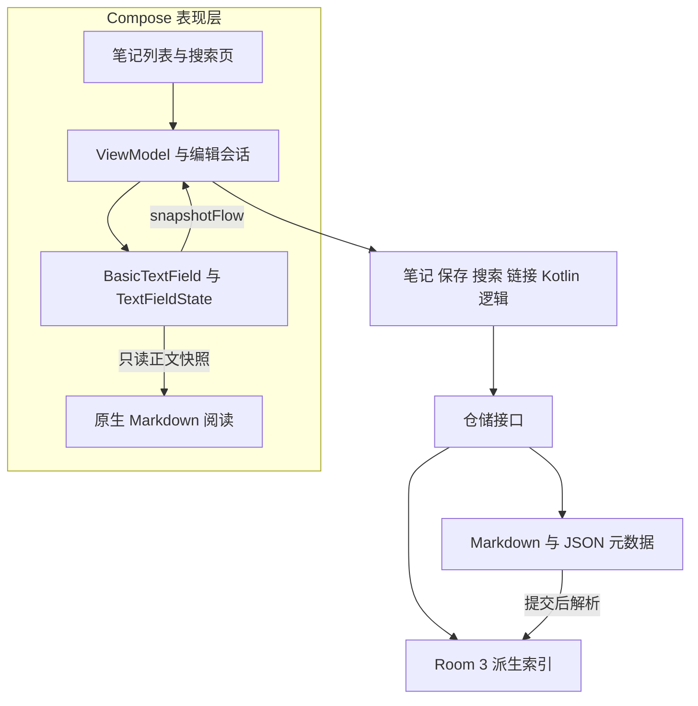
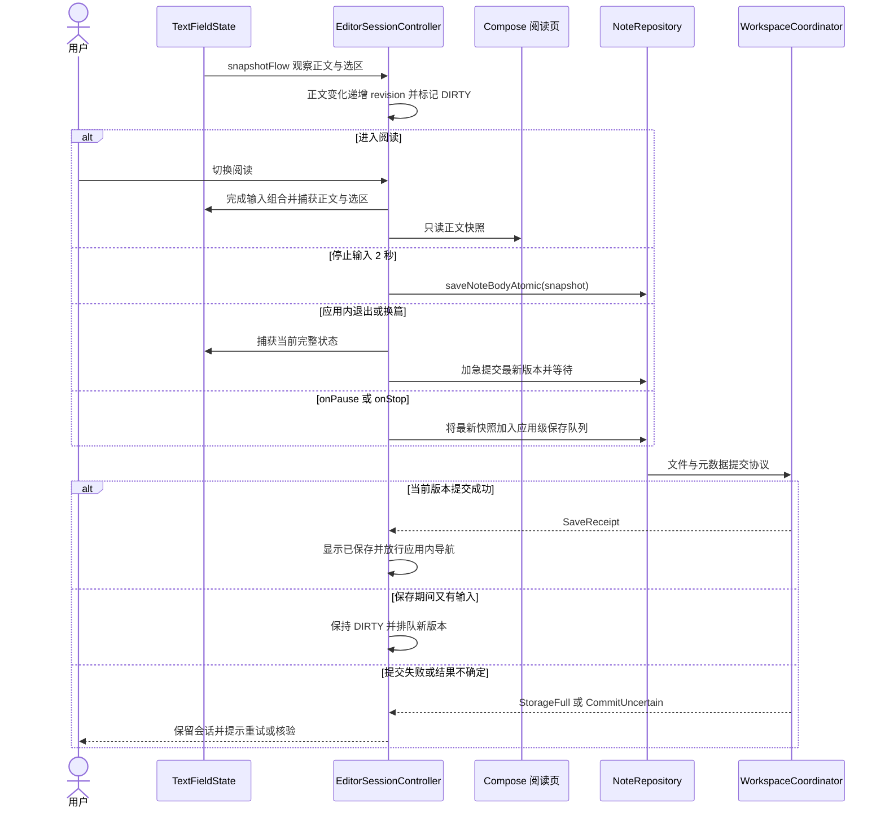
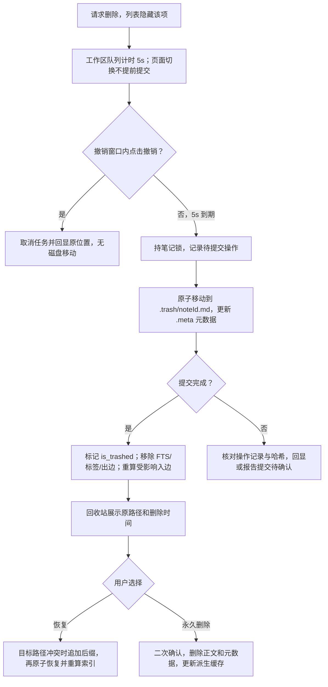
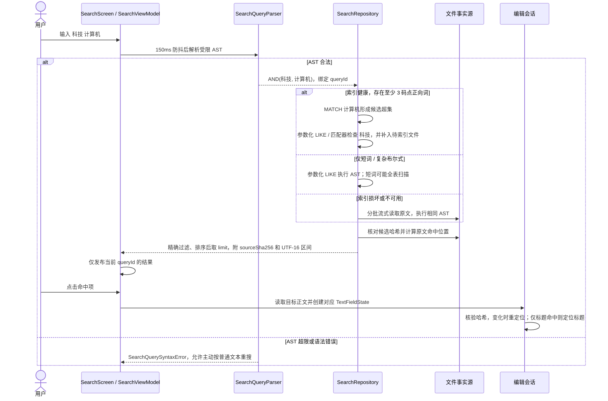
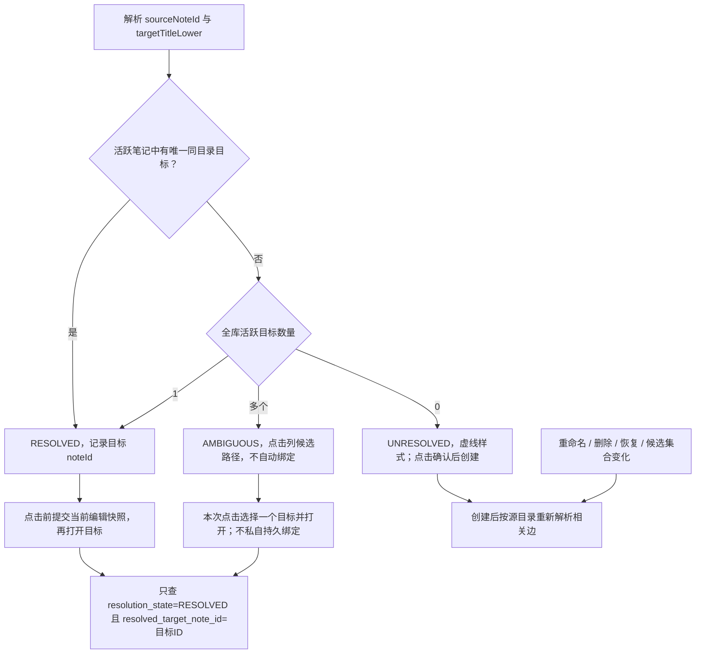
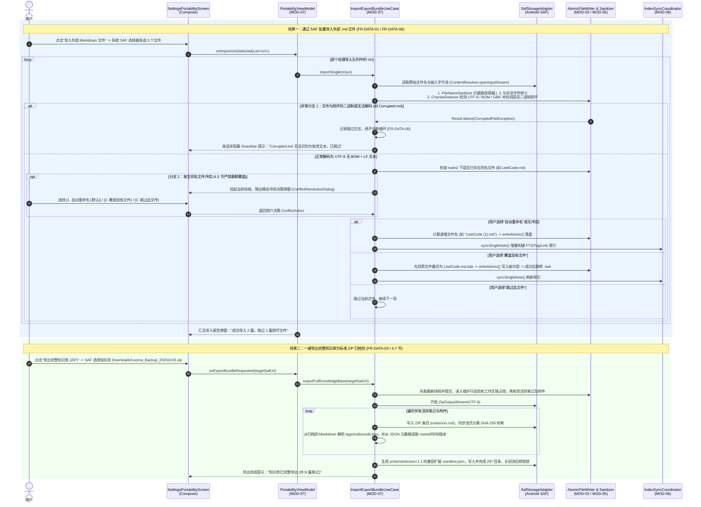
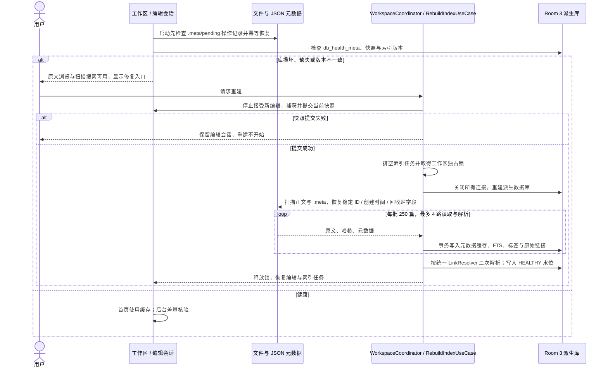
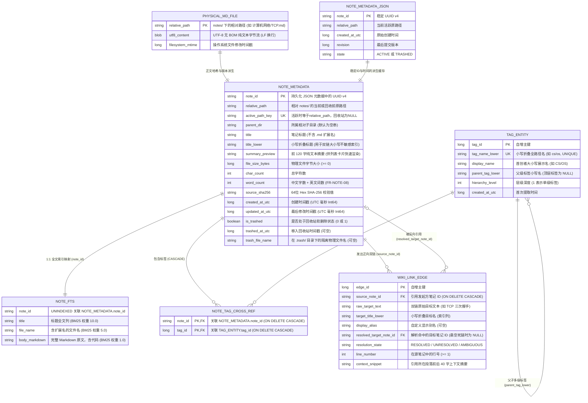
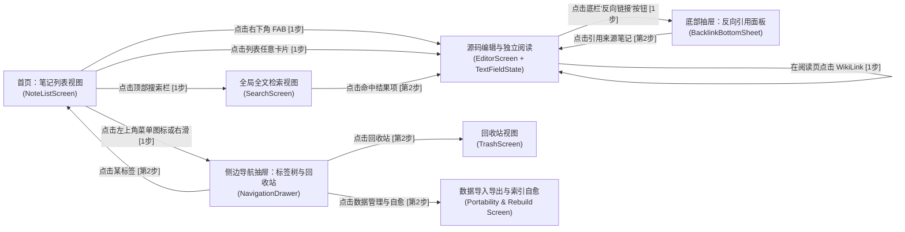

# Looma 个人 Markdown 笔记与知识管理工具软件设计规格说明书（架构设计与系统设计）

## 目录

1. [需求来源与变更说明（需求基线与演进记录）](#1-需求来源与变更说明需求基线与演进记录)
2. [总体架构设计（Architecture Design）](#2-总体架构设计architecture-design)
3. [详细模块设计（Module Design）](#3-详细模块设计module-design)
4. [关键流程设计（Key Process & Sequence Design）](#4-关键流程设计key-process--sequence-design)
5. [接口设计（Interface Design）](#5-接口设计interface-design)
6. [数据设计（Data Design）](#6-数据设计data-design)
7. [界面与交互设计要点（UI & Interaction Design）](#7-界面与交互设计要点ui--interaction-design)
8. [非功能需求应对设计（Non-Functional Design）](#8-非功能需求应对设计non-functional-design)
9. [异常与故障处理设计（Exception & Fault Handling Design）](#9-异常与故障处理设计exception--fault-handling-design)
10. [关键设计决策与权衡（Design Decisions & Trade-offs / ADRs）](#10-关键设计决策与权衡design-decisions--trade-offs--adrs)
11. [双向需求追溯矩阵（Requirements Traceability Matrix）](#11-双向需求追溯矩阵requirements-traceability-matrix)
12. [测试与验证考虑（Testing & Verification Considerations）](#12-测试与验证考虑testing--verification-considerations)
13. [技术资料与参考依据](#13-技术资料与参考依据)

---

## 1. 需求来源与变更说明（需求基线与演进记录）

### 1.1 需求基线来源声明

本设计对应更新后的 [需求分析](requirements-analysis.md)，保留需求编号。2026-10-28 根据原型与用户决策，采用纯 Kotlin Compose 源码编辑和独立阅读，取消本版即时渲染。本文描述正式方案，未实现部分仍是设计。技术取舍见 [技术选型](technical-selection.md)，实测状态见 [核实记录](verification-record.md)。

#### 1.1.1 核心问题与目标用户基线回顾
- **要解决的核心问题**：解决 Android 移动端 Markdown 记录工具在“移动端编辑与阅读不便（痛点 1.1）”、“数千篇规模下知识检索困难（痛点 1.2）”、“树状目录难以映射网状知识拓扑（痛点 1.3）”、“私有云格式绑定威胁数据所有权（痛点 1.4）”以及“弱网/无网环境下不可靠（痛点 1.5）”五大核心矛盾。
- **目标用户角色**：
  1. **主要用户——高校学生（计算机、理工科及文史类）**：高频课堂速记、地铁/自习室离线使用、期末按关键词与标签快速串联复习，诉求即开即写、防抖防丢与亚秒级中英文全文搜索。
  2. **次要用户——知识工作者（研发工程师、研究学者）**：长期积累原子化技术卡片、高度重视本地数据隐私、频繁使用 `[[WikiLink]]` 与反向链接（Backlinks）梳理文献网络，并有外接键盘与跨端 ZIP 导出归档需求。
  3. **包容性用户——视障与大字号辅助访问用户**：依赖 Android TalkBack 屏幕朗读、48dp 标准触控热区及 1.0x~2.0x 系统字体缩放。

#### 1.1.2 实验 1 需求基线编号对照总表

| 需求维度 | 编号范围 | 数量 | 核心内容摘要 | 优先级分布 |
| :--- | :--- | :---: | :--- | :--- |
| **产品目标** | `OBJ-01` ~ `OBJ-05` | 5 | 可靠记录与阅读、本地知识检索、网状知识联系、绝对数据自主、全功能离线闭环 | 全部核心基石 |
| **典型场景** | `SCN-01` ~ `SCN-06` | 6 | 课堂记录与找回、地铁全离线操作、跨设备迁移、索引自愈重建、深度网状导航、无障碍访问 | 全部核心场景 |
| **核心业务规则** | `BR-01` ~ `BR-12` | 12 | 单一事实源、索引派生性、自愈优于覆盖、写入原子性、保存语义真实性、语法宽容性、悬空链接合法、零网络可用、跨平台清洗、零账号、误删缓冲、最小授权 | 全部刚性约束 |
| **笔记管理域** | `FR-NOTE-01` ~ `08` | 8 | 新建、多维排序浏览、打开查看、修改标题同步重命名、删除与 5s 撤销及回收站、时间戳维护、回收站恢复/粉碎、字数阅读统计 | 5 高 / 2 中 / 1 低 |
| **Markdown 编辑域** | `FR-EDIT-01` ~ `10` | 10 | 源码编辑与独立阅读、CommonMark 与 GFM 基础语法、选区与历史交接、2s 防抖保存、应用内退出等待提交、生命周期加急保存、保存失败提示、中文 IME、100 步撤销目标、快捷工具栏、低优先级公式预览 | 7 高 / 2 中 / 1 低 |
| **标签分类域** | `FR-TAG-01` ~ `06` | 6 | 正文 `#Tag` 自动提取、排除标题与代码块及大小写折叠、异步增量更新索引、全局标签面板、按标签过滤、多级标签树展示 | 3 高 / 2 中 / 1 低 |
| **全文检索域** | `FR-SEARCH-01` ~ `07` | 7 | 单/多关键词检索、文件名+标题+正文全覆盖、中英文连续文本与前缀匹配、点击跳转并滚动定位、关键词高亮与 30 字上下文摘要、1s 内异步增量刷新、布尔逻辑检索 | 4 高 / 2 中 / 1 低 |
| **双链与反向引用域** | `FR-LINK-01` ~ `08` | 8 | `[[WikiLink]]` 与别名解析、可点击高亮视觉反馈、秒级打开目标笔记、死链 `unresolved` 降级渲染、点击死链一键创建、Backlinks 面板、反向跳转与段落预览、重命名级联更新引用 | 4 高 / 3 中 / 1 低 |
| **数据管理与迁移域** | `FR-DATA-01` ~ `07` | 7 | SAF 单/多选导入与冲突消解、单篇导出 `.md`、全库导出标准 ZIP（含 `manifest.json`）、100% 本地 CRUD 零外联、全库索引自愈重建、批量导入单文件损坏容错跳过、ZIP 逆向恢复 | 5 高 / 1 中 / 1 低 |
| **UI 与交互域** | `FR-UI-01` ~ `08` | 8 | $\ge 48\text{dp}\times 48\text{dp}$ 触控热区、破坏/异常操作即时反馈、核心操作 $\le 2$ 次点击、Edge-to-Edge 沉浸布局、深浅色主题切换、Android 14 预测性返回、Dynamic Color、大屏双栏布局 | 4 高 / 3 中 / 1 低 |
| **非功能需求** | `NFR-PERF-01` ~ `06`<br>`NFR-REL-01` ~ `05`<br>`NFR-USE-01` ~ `04`<br>`NFR-PORT-01` ~ `03`<br>`NFR-SEC-01` ~ `04`<br>`NFR-ACC-01` ~ `03`<br>`NFR-MAINT-01` ~ `02` | 27 | 冷启动 $\le 2.0\text{s}$、5000 篇检索 $\le 500\text{ms}$、普通笔记打开 $\le 500\text{ms}$、长文输入延迟 $\le 50\text{ms}$ / $\ge 55\text{FPS}$、主线程阻塞 $\le 50\text{ms}$、5000 篇自愈 $\le 60\text{s}$；原子落盘、派生隔离、单文件容错、MTBF $\ge 120\text{h}$、崩溃恢复 $\le 2\text{s}$；原生阅读与附件访问边界、零外联、编辑与存储分离、解析器单测覆盖率 $\ge 90\%$ | 全部量化受控 |

---

### 1.2 需求变更与设计期修正说明（Requirement Refinement Log）

以下记录已纳入现行需求的修正。需求编号不变，FR-EDIT-01、FR-EDIT-03 和安全要求按原生方案改写。性能数值仍为待验目标，本文不把原型通过扩大为产品验收。

| 变更编号 | 原基线或原设计问题 | 修正及原因 | 影响的需求与验收编号 |
| :---: | :--- | :--- | :--- |
| **CHG-01** | 第 5.2 节及核实记录误称 Room 2.6.x 原生支持 FTS5；原设计使用不存在的 sqlite-bundled:2.4.0，混用 OpenHelper 与新驱动。 | 采用 Room 3.0.3（androidx.room3）与 sqlite-bundled:2.7.1 作为集成候选，显式配置 BundledSQLiteDriver，使用 @Fts5 和驱动事务。第一轮原型已完成固定工具链构建及模拟器建表查询，正式应用集成和大规模性能仍待验证。 | FR-SEARCH-01~03、NFR-PERF-02、NFR-MAINT-01 |
| **CHG-02** | 文件可重建正文索引，但 UUID、原始创建时间、回收站原路径缺少独立恢复来源；“UUID 或路径 ID”未定。 | 正文事实源仍为 .md；新增开放 JSON 元数据 .meta/notes/{noteId}.json，持久化稳定 UUID、路径、创建时间、提交版本与回收站状态。数据库缓存这些字段。回收站文件改为 .trash/{noteId}.md，避免文件名超长。文件与元数据通过可恢复操作记录协调。 | FR-NOTE-04~07、FR-DATA-03/05/07、BR-01~04、AC-NOTE-03、AC-DATA-03 |
| **CHG-03** | 重命名后旧链接行为、同目录优先、候选选择与后台批量解析不一致。 | 共用 LinkResolver：唯一同目录目标优先，否则唯一全库目标；多个候选为 ambiguous，无目标为 unresolved。创建、删除、恢复和重命名后按源目录重算相关边。级联修改需用户确认，按原文解析位置修改并报告部分完成与重试结果。 | FR-NOTE-04、FR-LINK-01/03~08、BR-07 |
| **CHG-04** | FR-SEARCH-03 的中文“分词”语义不清；误认为两个汉字可用 trigram，代码块被排除出全文搜索。 | 普通搜索明确为 ASCII 英文大小写不敏感的连续文本子串匹配；中文一字、两字、多字及英文前缀均可命中，不承诺词干或语义搜索。FTS 只加速候选；至少 3 个 Unicode 码点才可用 trigram。短词和复杂布尔表达式走参数化 LIKE；坏库降级扫描原文件。代码与未知语法保留在搜索正文中。 | FR-SEARCH-01~07、FR-EDIT-02、AC-SEARCH-01/02 |
| **CHG-05** | FR-EDIT-05 的“同步持久化”与主线程不阻塞有歧义；AC-EDIT-02 将 2s 触发等同于写盘完成；删除提示先于移动。 | 停止输入 2s 后启动保存；当前版本提交成功才显示“已保存”。应用内退出先取最新快照并等待提交；onPause/onStop 只加急请求，不能保证终止前必然完成。异常退出恢复最近成功保存版本。删除等待期显示“将在 5 秒后移入回收站”，导航不提前终止撤销窗口。 | FR-EDIT-04~06、FR-NOTE-05、BR-05/11、NFR-PERF-05、NFR-REL-05、AC-EDIT-02、AC-NOTE-02 |
| **CHG-06** | 把文件 fsync 与原子 rename 描述为任意掉电下的数学保证，未区分替换前后失败。 | 区分进程中断原子性与掉电耐久性；同步文件及相关目录，不支持所需操作时明确失败，不回退截断写。NFR-REL-01 的零损坏保留为指定设备和故障样本下的验收目标。替换后错误需核对操作记录及哈希，不能承诺旧版本未变。 | BR-04/05、NFR-REL-01、AC-EDIT-02、Spike 6 |

| **CHG-07** | 原方案要求即时渲染，依赖 Vditor、WebView 与跨语言桥接。 | 用户确认改为 BasicTextField、TextFieldState 源码编辑和独立 Compose 阅读。移除 JS 协议、WebView 沙箱与预热方案。阅读不回写正文，未知语法保留。 | FR-EDIT-01/03、NFR-SEC-02~04、NFR-MAINT-01、AC-EDIT-01 |
| **CHG-08** | 界面风格与色彩来源未收敛。 | 选定方案 B，组件优先使用 Material Expressive，Android 12 起使用系统 Dynamic Color，旧系统静态回退。Dynamic Color 从低优先级提升为必需能力。 | FR-UI-04/05/07、NFR-ACC-03 |
| **CHG-09** | 误把库名等同于完整语法、100 步撤销和公式能力。 | 基础阅读逐项验收。数学公式移入低优先级扩展，不沿用 KaTeX。100 步撤销仍是目标。原型发现的阅读切换选区折叠列为待修复问题。 | FR-EDIT-02/03/08/10、AC-EDIT-01 |

### 1.3 本次设计的证据边界

已有两轮可运行 Android 研究原型，位于 `prototypes/`。原生编辑、基础 UI 操作、动态主题、Room 3 最小查询和一次正常文件替换均有局部证据。原型没有接通正式文件保存、元数据恢复、SAF、索引、标签与双链的完整链路。

原生 UI 在进入阅读时会折叠选区，尚未满足 FR-EDIT-03。中文候选输入、100 步撤销、进程恢复、真机性能和 TalkBack 仍待验收。细项与原始结果见 [核实记录](verification-record.md)。

---

### 1.4 项目统一命名（2026-10-19）

产品名称为 Looma。下表是正式应用的命名约定，尚未创建对应生产工程。研究原型仍使用 `edu.hust.looma` 包前缀，不据此宣称已经迁移。

| 命名对象 | 统一约定 |
| :--- | :--- |
| 项目与产品展示名 | Looma，保持此大小写，不写作 LOOMA、looma 或 Looma Notes |
| Android 包与 Kotlin 类型 | 包名前缀 com.looma，应用 ID 候选 com.looma.app；LoomaDatabase、LoomaNavHost、LoomaTheme |
| 编辑与阅读 | `EditorScreen`、`TextFieldState`、Compose Markdown 阅读组件，无 JS 全局对象 |
| 工作区与数据库 | LoomaWorkspace/；looma_derived.db |
| 导出文件与生成器 | Looma_Backup_{时间戳}.zip；manifest.generator 使用 Looma 加应用版本 |

正文、元数据和派生索引的命名约定保留。编辑器改为 Kotlin 状态调用，不保留旧的 JS 接口名称。

---

## 2. 总体架构设计（Architecture Design）

### 2.1 架构设计原则与规模匹配说明

Looma 是一款纯本地运行（Local-first）、单用户、无远程服务端的 Android 应用程序。为保证 **架构与选题规模高度匹配、不为炫技而过度设计**，本设计遵循以下四项核心架构准则：
1. **整洁分层与单向数据流（Clean Architecture + UDF）**：采用经典的 **Presentation（表现层）— Domain（领域层）— Data（数据层）** 三层架构，杜绝引入不必要的微服务拆分、事件总线（EventBus）或过度抽象的插件微内核。
2. **正文与派生索引分离**：物理文件系统（`.md` 纯文本）作为 **唯一事实源（Single Source of Truth, SSOT）** 承载全部正文写入与读取；Room SQLite 数据库仅作为 **派生可重建索引缓存（Derived Index Cache）** 承载列表排序、标签聚合、双链拓扑与 FTS5 全文检索。
3. **编辑与阅读分离**：全部界面采用 Compose，控件优先使用 Material Expressive。编辑页直接修改 Markdown 源码，阅读页只接收不可变快照。正文不经过 HTML 导出，不引入 WebView 或 JS 桥接。
4. **结构化并发与主线程零 I/O（Structured Concurrency）**：依托 Kotlin Coroutines & Flow，所有文件读写、AST 解析与 SQLite 事务严格限制在后台调度器执行，主线程仅负责 UI 状态订阅与手势分发。

### 2.2 系统分层与组件划分视图

下图是正式应用设计，当前原型仅实现编辑、阅读与主题部分。



### 2.3 各层职责与依赖

| 层次 | 职责 | 约束 |
|---|---|---|
| 表现层 | Compose 页面、Material 主题、TextFieldState、阅读快照、保存状态 | 不直接操作文件或 DAO。阅读只消费源码，不能改写编辑状态 |
| 业务逻辑 | 保存协调、搜索语义、标签提取、链接消解、路径校验 | 解析与匹配尽量使用不依赖 Android UI 的 Kotlin 函数 |
| 数据层 | Markdown 文件、JSON 元数据、Room 索引、SAF | 文件是正文事实源，索引只在提交后更新，故障不覆盖正文 |

原型的 `EditorPort` 用于对照两种引擎。正式应用已选定原生编辑，不保留双引擎切换或跨语言消息协议。

### 2.4 部署视图与运行时并发视图（Deployment & Runtime Views）

#### 2.4.1 部署视图

应用在单个 Android 进程内运行。APK 包含 Kotlin 代码、Compose 界面、原生 Markdown 阅读库和本地资源，不包含 Web 编辑器 JS。正文与开放 JSON 元数据存放在应用专属工作区，Room 数据库位于应用内部存储。用户通过 SAF 生成独立备份。

应用专属工作区会随卸载清除。它是运行数据目录，不是独立备份。正式保存、归档和恢复协议尚未实现。

#### 2.4.2 运行时线程与并发调度视图（Runtime Concurrency View）

1. **Android 主线程**：管理 Compose、TextFieldState、焦点、工具栏和快照捕获。语法解析、文件读写与索引工作放入后台任务。输入过程中不从外部重建或覆盖当前 TextFieldState。
2. **计算调度器 Dispatchers.Default**：运行查询语义解析、Markdown 元数据提取、原文精确匹配及摘要构造；长循环检查协程取消。
3. **I/O 调度器 Dispatchers.IO**：执行文件、元数据和数据库访问。WorkspaceCoordinator 统一协调正文保存、重命名、删除、导入与索引提交；每篇笔记用 computeIfAbsent(noteId) 获取唯一 Mutex。级联操作按 noteId 排序获取锁，防止反向加锁死锁。
4. **维护互斥与版本门槛**：索引更新核对 source_sha256 与 source_revision，旧任务不能覆盖新索引。重建/ZIP 快照开始前停止接受新编辑、捕获并提交当前快照、排空索引任务，再取得工作区独占锁；期间保留只读浏览与进度/取消入口。完成或失败都释放锁并恢复编辑。日常单篇写入持共享工作区锁与对应笔记锁。

---

## 3. 详细模块设计（Module Design）

系统按业务职责划分为 **7 个逻辑模块**，初始可在单个 app Gradle 模块内按包组织。表中的协作关系不表示 feature 可直接引用 DAO 或文件实现；编译依赖仍为 Presentation → Domain、Data → Domain，应用入口负责组装依赖。只有独立构建或复用需求出现后才拆分 Gradle 模块。

### 3.1 模块划分总览与耦合关系矩阵

| 模块编号 | 模块名称 | 所在包路径 (`com.looma.*`) | 核心职责概述 | 运行时协作模块 | 对外暴露接口 |
| :---: | :--- | :--- | :--- | :--- | :--- |
| **MOD-01** | **笔记管理与工作区模块** | `feature.note` / `domain.note` | 笔记列表展示、多维排序、新建/打开/重命名、左滑软删除与 5s Snackbar 撤销、回收站管理 | `MOD-03`, `MOD-05`, `MOD-06` | `NoteCrudUseCase`, `TrashManageUseCase` |
| **MOD-02** | **原生源码编辑与阅读模块** | `feature.editor` | TextFieldState、原生 Markdown 阅读、选区与撤销历史、中文输入、保存状态、快捷工具栏 | `MOD-01`、`MOD-03`、`MOD-05` | `EditorSessionController`、`EditorScreen` |
| **MOD-03** | **语法解析与双链/标签提取模块** | `domain.parser` | 纯 Kotlin 实现的 Markdown 代码块/标题剥离、`#Tag` 提取与大小写折叠、`[[WikiLink]]` 解析、文件名合法性清洗、字数统计 | **无（零依赖基础域）** | `MarkdownMetadataParser`, `FileNameSanitizer` |
| **MOD-04** | **全文检索与索引查询模块** | `feature.search` / `domain.search` | 关键词分词查询构造、FTS5 BM25 相关性排序、30 字上下文高亮摘要生成、Tag 过滤查询、Backlinks 反向引用查询 | `MOD-03`, `MOD-06` | `FullTextSearchUseCase`, `TagFilterUseCase`, `BacklinkQueryUseCase` |
| **MOD-05** | **原子文件存储与回收站模块** | `data.storage` | 维护 `notes/`、`.trash/`、`attachments/`、`.tmp/` 物理目录；执行 `.tmp -> fsync -> ATOMIC_MOVE` 原子落盘；编码检测与 LF 规范化 | `MOD-03` | `NoteFileDataSource`, `AtomicFileWriter` |
| **MOD-06** | **派生索引库与自愈重建模块** | `data.index` | Room + Bundled SQLite FTS5 数据库管理；笔记保存后的异步增量索引同步；数据库损坏检测与 5,000 篇全量并发自愈重建 | `MOD-03`, `MOD-05` | `IndexSyncCoordinator`, `RebuildIndexUseCase` |
| **MOD-07** | **导入导出与归档迁移模块** | `data.portability` | Android SAF 单/多文件导入、同名冲突三选一处理、坏文件容错跳过、单篇 `.md` 导出、全库标准 ZIP 归档（含 `manifest.json`）与逆向恢复 | `MOD-03`, `MOD-05`, `MOD-06` | `ImportExportBundleUseCase` |

---

### 3.2 各模块边界与内部结构详细设计

#### 3.2.1 MOD-01：笔记管理与工作区模块（feature.note & domain.note）

- NoteListViewModel 维护排序、标签过滤及界面状态，CRUD 经领域接口调用数据层。
- 新建、重命名与回收站操作统一经过 WorkspaceCoordinator。重命名前先提交最新正文，文件和元数据提交成功后再发布新路径。
- 删除采用两阶段机制：0~5s 时仅从列表隐藏，由工作区级 PendingDeleteController 计时，导航不会提前提交；Snackbar 显示“将在 5 秒后移入回收站”。撤销取消任务并回显列表。进程在此阶段终止时，未提交删除取消，原文件保留。
- 5s 到期后将正文移到 .trash/{noteId}.md，更新该笔记 JSON 元数据，再更新派生索引。失败时回显笔记并允许重试。回收站文件保留至少 30 天，在后续启动或维护任务中清理到期项；永久删除必须再次确认。

#### 3.2.2 MOD-02：原生源码编辑与阅读模块

每篇打开的笔记对应独立 `TextFieldState`，由编辑会话持有，避免页面重组或换篇时用正文覆盖同一状态。`BasicTextField` 显示源码，`state.edit` 执行格式化，`undoState` 管理实际撤销历史。原型已验证基础历史，100 步与连续输入分组仍须验收。

通过 `snapshotFlow` 观察文本和选区，按 `noteId`、`sessionId` 与 `revision` 生成不可变 `EditSnapshot`。正文变化递增版本，选区变化不触发文件保存。原生状态是当前编辑内容的来源，观察快照不能反向覆盖输入状态。

进入阅读时先完成当前输入组合，再取得正文与方向性 UTF-16 选区。阅读器只消费字符串快照，返回编辑时复用同一个 TextFieldState 和历史。原型在收起键盘时折叠选区，正式实现须明确保存并恢复两个选区端点，并验证输入法确认不会丢字。

保存状态区分 `LOADING`、`SAVED`、`DIRTY`、`SAVING` 和 `FAILED`。停止输入 2 秒后提交快照。旧版本保存完成时仍有新输入，状态保持 DIRTY，继续提交新版本。只有当前版本收到成功 SaveReceipt 才显示 **已保存**。

应用内退出、换篇和导出前，捕获当前状态并等待持久化结果。失败保留会话，允许重试或复制正文。onPause 和 onStop 只加急异步保存，系统终止可能丢失未提交输入。上述保存链路是正式设计，当前原型仅保留内存会话。

阅读页的 WikiLink 点击作为 Kotlin 回调交给 LinkResolver。原型当前显示字面 WikiLink，点击与源位置映射仍需实现。未知语法、HTML 和不支持的公式保留源码，不执行正文脚本或自动加载远程图片。

#### 3.2.3 MOD-03：语法解析与双链/标签提取模块（`domain.parser`）
- **职责边界**：作为纯函数式的领域核心模块，负责从 Markdown 纯文本中精确提取结构化元数据（标签、双向链接、纯文本正文、字数统计），并执行文件名与路径安全清洗。
- **两阶段抗干扰语法解析算法（解决标题与代码块误判 `FR-TAG-02` / `AC-TAG-02`）**：
  1. **第一阶段：非正文区域掩码剥离（Masking Pass）**：
     - 扫描并识别围栏代码块（`` ```...``` `` 或 `~~~...~~~`）与行内代码段（`` `...` ``），记录其字符区间 `[start, end)` 并用等长空白符掩码替换（保留原始行号与字符偏移量不变）；
     - 扫描 ATX 标题行（`^ {0,3}#{1,6}[ \t]+.*$`）与 HTML 注释（`<!--...-->`），同样排除其 `#` 符号触发标签识别。
  2. **第二阶段：正则与状态机扫描（Extraction Pass）**：
     - **标签提取（`MarkdownTagParser`）**：在掩码后的文本上匹配带前置定界符的规则：
       ```regex
       (?:^|[\s\p{P}&&[^/#]])(#[A-Za-z0-9_\-\u4e00-\u9fa5]+(?:/[A-Za-z0-9_\-\u4e00-\u9fa5]+)*)
       ```
       提取后按 `tagName.lowercase(Locale.ROOT)` 进行大小写不敏感折叠去重（`#Android` 与 `#android` 归并），同时保留首次出现的原始大小写作为 `displayName`，并按 `/` 拆解出多级父子层级（支撑 `FR-TAG-01/02/06`）。
     - **双向链接提取（`WikiLinkParser`）**：匹配非换行、无嵌套中括号的规则：
       ```regex
       \[\[([^\[\]\|\n#\^]+?)(?:\|([^\[\]\|\n]+?))?\]\]
       ```
       捕获组 1 为目标笔记名 `rawTarget`，捕获组 2 为可选显示别名 `displayAlias`；同时记录该双链所在的 **原文 UTF-16 半开区间 `sourceStartUtf16/sourceEndUtf16`**、**行号 `lineNumber`** 与 **所在段落上下文摘要 `contextSnippet`（前后各 40 字符）**，直接服务于 Backlinks 反向引用面板预览（`FR-LINK-01/06/07`）。
  - **文件名与路径安全清洗器（`FileNameSanitizer`）**：
    - 校验 UTF-8 字节长度 $1 \sim 255\text{ Bytes}$；
    - 拦截非法字符 `\/:*?"<>|\0` 及控制字符 `0x00~0x1F`，在生成物理文件时自动转义为 `_`；
    - 拦截 Windows 保留字（`CON`, `PRN`, `AUX`, `NUL`, `COM1~9`, `LPT1~9`，不区分大小写），自动追加 `_note` 后缀；
    - 清洗相对路径时，对所有路径段过滤 `.` 与 `..`，强制截断路径穿越企图（满足实验 1 第 4.2/4.3 节 与 `BR-09`）。

#### 3.2.4 MOD-04：全文检索与索引查询模块（feature.search & domain.search）

- **语义契约**：默认词、带引号短语均按连续原文匹配；空格连接表示文件级 AND，支持 OR、NOT 和括号。普通输入不作为正则执行。中文按 Unicode 码点匹配，不依赖词典；ASCII 英文忽略大小写，因此前缀与中段子串均可命中，不承诺词干推导。标题、完整文件名和完整 Markdown 原文分别参与匹配，含代码块、HTML 和未知语法。
- **查询编译与候选选择**：领域 SearchQueryParser 输出受限 AST；数据层 FtsQueryBuilder 将 AST 编译为参数化查询，用户输入不能直接拼成 SQL。只对含至少一个 3 码点正向词的普通 AND 查询使用 trigram MATCH；仅把合格词构造成双引号短语（内部引号加倍），形成候选超集，短词在候选上再判断。短词、纯否定和复杂布尔式用同一 AST 的参数化 LIKE 条件，每个原子条件覆盖 title、file_name、body_markdown，转义反斜杠、% 和 _，不可声称短词走倒排索引。
- **真实文本校验**：存在待索引文件或发现哈希过期时，本次查询改用统一扫描及标题/时间排序，避免混合不可比的评分。索引中的正文为原始 Markdown，不使用标签掩码或去标记文本。结果发布前按当前文件哈希核对并在原文计算命中；已保存但尚未完成索引的笔记并入候选。索引健康未知或损坏时，按目录清单流式扫描 .md/.markdown，沿用同一 AST 和匹配器。未保存编辑不混入全库结果，界面保存状态单独显示。
- **排序与定位**：FTS 评分使用 bm25(note_fts, 0.0, 10.0, 5.0, 1.0)，按列顺序对应 note_id、title、file_name、body_markdown；LIKE/扫描采用标题命中优先、更新时间降序、路径字典序。不同模式不把无意义的 BM25 分数混合比较。结果裁剪在候选精确校验和排序后执行，不先截断 50 个候选造成漏检。摘要从原文命中位置前后各取 30 码点，向界面转换成 UTF-16 半开区间；正文命中提供行号/偏移和 sourceSha256，打开时哈希变化则重新定位。仅标题/文件名命中时定位标题，不伪造正文高亮。
- **调用限制**：查询不超过 1,024 个 UTF-16 单元、32 个叶子词、8 层括号；limit 为 1~100，默认 50。语法错误返回 SearchQuerySyntaxError，用户可主动选择按普通文本重搜。150ms 输入防抖与取消旧任务，UI 只接受最新 queryId。短词扫描性能必须独立计入 NFR-PERF-02。
- **备选与验证**：原文件扫描借鉴 grep/rg 的文本匹配思路，可独立实现为 Kotlin 匹配器，也是索引正确性的对照。是否只用扫描由 5,000 篇真机基准决定；不预先断言扫描必然慢或 FTS 必然达标。详见 ADR-03。

#### 3.2.5 MOD-05：文件存储、持久元数据与回收站模块（data.storage）

所有文件操作通过 WorkspaceCoordinator，数据目录使用 getExternalFilesDir(DIRECTORY_DOCUMENTS)。该目录无需危险存储权限，但会随卸载删除；设置与备份页明确提示导出副本，不能把应用专属目录当作独立于应用的长期备份。

**提交协议**（保存、创建、重命名、移入/恢复回收站共用）：

1. 取得工作区共享锁及笔记锁，核验会话、当前路径、预期 revision 和目标冲突；跨多篇笔记时按 noteId 排序加锁。记录 .meta/pending/{operationId}.json，含操作类型、路径、前后哈希、版本与预期元数据，原子写并确认其耐久性。
2. 正文统一为 UTF-8 无 BOM 与 LF，写入同一文件系统的 .tmp/ 唯一临时文件；完整写入后校验长度及 SHA-256，调用 FileDescriptor.sync()。未知 Markdown 字符不做清洗。
3. 使用 ATOMIC_MOVE 原子替换/移动目标，并同步受影响的源/目标父目录。若文件系统不支持所需原子操作或目录同步，返回 StorageUnavailable；禁止回退成直接截断覆盖。上线支持范围由设备 Spike 确认。
4. 按操作记录原子更新 .meta/notes/{noteId}.json，正文哈希、原始创建时间、updatedAtUtc、revision 和路径一起提交；同步元数据目录后完成并删除操作记录，再同步 pending 目录，返回 SaveReceipt。文件系统与 JSON 不被描述为同一个数据库事务。
5. 正文替换前失败可清理该次临时文件并保留旧文；替换之后失败返回 CommitUncertain，不能承诺旧内容仍在或回退覆盖。恢复时先核对正文/临时文件哈希和操作记录，幂等补完已完整提交的新版本；无法确认则保留证据并提示用户。只有无对应操作记录的旧临时文件可以清理。

“已保存”仅代表当前版本已完成本协议；它不保证尚未提交的输入能在强杀后恢复。硬件掉电保证以文件系统能力和故障样本验证为边界，不作任意硬件的数学保证。

#### 3.2.6 MOD-06：派生索引库与自愈重建模块（data.index）

- **接入**：Room 3（androidx.room3）配置 BundledSQLiteDriver。FTS 实体用 @Fts5，常规表由 @Entity 管理；使用驱动支持的事务，不调用旧 SupportSQLiteOpenHelper。第 6.3.2 节 DDL 为等价结构示意，不与 Room 的建表流程重复执行。
- **增量索引**：保存回执产生后标记 noteId 为待索引，读取该提交版本与元数据。单次事务更新 note_metadata、note_fts、标签关联与出边；通过笔记锁和 source_sha256/source_revision 拦截旧任务。失败保留待索引标记并重试，保存正文成功不被索引故障回滚。下一次启动通过元数据版本/哈希与缓存对账重新排队，满足 FR-SEARCH-06 的目标延迟需要实测。
- **解析一致性**：LinkResolver 对每个源目录执行同一规则，更新影响到旧标题、新标题及候选集合的边。候选冲突不能用一条“按标题全局绑定”SQL 替代。active_path_key 在活跃状态等于 relative_path，回收站为 NULL，唯一索引允许重复删除同名后重新创建。回收站排除出搜索和有效目标，标签汇总排除已删除关联及零计数项。
- **检查与重建**：启动先恢复未完成文件操作，再检查 db_health_meta 与逐文件 (relativePath, mtime, size) 快照；发现差异后按哈希核验，不仅比较文件总数。坏库时仍可按文件浏览和原文扫描搜索。重建前提交编辑快照并进入维护只读态，排空 I/O 后独占工作区，关闭全部数据库连接后重建缓存，读取 .meta 保留 UUID/创建时间并两遍解析链接；结束后写入健康水位再恢复写入。

#### 3.2.7 MOD-07：导入导出与归档迁移模块（`data.portability`）
- **职责边界**：基于 Android SAF 框架实现零权限要求的外部文件导入、单篇导出及标准 ZIP 知识库备份归档。
- **核心设计**：
  - **编码自适应探测器（`CharsetDetector`）**：外部导入 `.md` 文件时，首先检查前 3 字节是否为 UTF-8 BOM（`0xEF,0xBB,0xBF`），若是则自动剥离 BOM；接着尝试以严格模式 `CodingErrorAction.REPORT` 解码 UTF-8；若抛出 `MalformedInputException`，自动回退尝试 `GB18030/GBK` 解码并转为标准 UTF-8 无 BOM；若包含不可识别二进制乱码（如空字节 `\0` 比例过高），判定为损坏文件，记录错误日志并跳过该文件，绝不中止批处理队列（满足 `4.1/4.3 节`、`FR-DATA-06`、`AC-DATA-02`）。
  - **一致性快照**：导出前提交当前编辑版本并持工作区独占锁，读取正文、元数据和附件形成一致快照。tags/outboundLinks 从归档的正文解析，不依赖可能滞后的 Room；导出 manifest 的 schemaVersion 为 1.1，追加稳定 noteId、createdAt、updatedAt、revision 字段。取消或失败时关闭流并尝试清理不完整 SAF 文件，无法删除则提示该归档未完成。ZIP 恢复先校验清单、哈希、规范化路径、展开总大小和文件数，再经提交协议逐项恢复；默认保留同名原件，不静默覆盖。
  - **流式 ZIP 归档器（`ZipBundleArchiver`）**：采用 `ZipOutputStream`（强制指定 `StandardCharsets.UTF_8` 编码文件名），边流式压缩 `notes/` 与 `attachments/` 边通过 `DigestInputStream(MessageDigest.getInstance("SHA-256"))` 计算每篇笔记的 SHA-256 哈希，最后在内存中组装符合实验 1 第 4.7 节及本文兼容扩展的 `manifest.json` 写入 ZIP 根目录（满足 `FR-DATA-03`、`NFR-PORT-03`）。

---

## 4. 关键流程设计（Key Process & Sequence Design）

本节针对系统的 **6 个核心业务场景** 给出完整的时序与流程设计，显式覆盖 **正常路径（Normal Path）、分支路径（Branch Path）与异常路径（Exception Path）**，并将所有判断条件、状态变更与数据读写精确锚定到具体模块、接口与数据表。

### 4.1 FLOW-01：编辑快照、阅读切换与保存

覆盖 FR-EDIT-01~08、FR-NOTE-01/06、BR-04/05 和 NFR-REL-05。下列持久化步骤尚未接入原型。



阅读切换不要求先写盘，也不显示虚假的保存成功。返回编辑保留原状态。应用内离开编辑会话才等待保存屏障。进程恢复使用最近成功提交的正文，不承诺恢复内存撤销历史。

### 4.2 FLOW-02：软删除、5s 撤销与回收站恢复

- **覆盖需求**：FR-NOTE-05/07、BR-11、FR-UI-02、AC-NOTE-02。



超过 30 天的回收站条目在下次维护时清理，不能早于保留期删除。恢复、永久删除与自动清理也须持相同笔记锁，不能与未完成保存并发。若应用在 5s 缓冲期退出进程，未提交的删除取消。

---

### 4.3 FLOW-03：全文检索、原文校验与点击定位

- **覆盖需求**：FR-SEARCH-01~07、NFR-PERF-02、AC-SEARCH-01/02。



“科技”是两个码点，不交给 trigram MATCH。代码块中的 TIME_WAIT 与含 %、_、引号的字面量都必须可搜。单字、双字、混合长短词和无匹配查询均纳入延迟统计，不能只测长词或只统计数据库执行时间。

---

### 4.4 FLOW-04：WikiLink 解析、同名消解与反向引用

- **覆盖需求**：FR-LINK-01~08、FR-NOTE-04、BR-07。



- 存在歧义时没有持久化“用户选择的唯一目标”；当前开放 WikiLink 语法只保存标题，Backlinks 因而不把歧义引用自动算入任一候选。若未来要记住选择，须另行设计可迁移的路径链接语法与需求变更。
- 重命名不级联时，重新解析指向旧标题和新标题的边，旧标题可能变为 unresolved，也可能解析到另一篇同名笔记，不能沿用旧 ID 冒充新语义。
- 用户确认级联时，依据重命名前实际解析到该 noteId 的边定位源文范围，按文件锁和哈希重新核验后替换 WikiLink 目标文本，不替换普通正文、代码或指向其他同名目标的链接。多文件批次不是全局原子事务，中断需报告已完成/未完成项并可幂等重试。

---

### 4.5 FLOW-05：外部文件批量导入（SAF）、同名冲突三选一与完整知识库 ZIP 导出流程
- **覆盖需求**：`FR-DATA-01~03`, `FR-DATA-06`, `4.1~4.3 节`, `4.7 节`, `NFR-PORT-01~03`, `AC-DATA-01/02`



---

### 4.6 FLOW-06：文件操作恢复与派生索引重建

- **覆盖需求**：FR-DATA-05、BR-01~04、NFR-REL-02/05、NFR-PERF-06。



取消或异常时把健康状态保持为 REBUILDING/FAILED，不把部分库标记为完整；下次重试可重新重建。缺失的 JSON 元数据不得凭空恢复创建时间：为孤立 .md 分配新 ID，暂以文件 mtime 作为可得时间并标记 metadata_origin=RECOVERED，提示哪些条目无法恢复原始元数据。重建只恢复派生索引，文件操作恢复是独立步骤，不能借“重建”任意改写 Markdown。

---

## 5. 接口设计（Interface Design）

本节定义正式应用的 Kotlin 接口与数据约束。这些是待实现的项目接口，不是第三方库已经提供的 API。原型实际接口位于 `prototypes/looma-editor-comparison/android/app/src/main/kotlin/edu/hust/looma/comparison/EditorContract.kt`。

### 5.1 统一错误约定与领域异常体系（`DomainError`）

系统内部所有可能失败的挂起函数接口统一采用 Kotlin 标准 `Result<T>` 返回；`DomainError` 继承 `Exception`，作为 `Result.failure(error)` 的受控错误值，**严禁向表现层裸露未捕获的底层 `IOException` 或 `SQLiteException`**（落实 `NFR-USE-04`）。

```kotlin
package com.looma.domain.model

sealed class DomainError(
	val errorCode: String,
	val userMessage: String,
	cause: Throwable? = null
) : Exception(userMessage, cause) {
	// 文件与存储类错误
	class StorageFull(cause: Throwable? = null) :
		DomainError("ERR_STORAGE_ENOSPC", "保存失败：设备外部存储空间不足，请清理空间后重试。", cause)
	class FileNotFound(val path: String) :
		DomainError("ERR_FILE_NOT_FOUND", "目标笔记文件不存在或已被外部程序移动：$path")
	class FileNameConflict(val conflictingName: String) :
		DomainError("ERR_FILENAME_CONFLICT", "已存在同名笔记「$conflictingName」，请选择处理方式。")
	class InvalidFileName(val reason: String) :
		DomainError("ERR_INVALID_FILENAME", "笔记标题包含非法字符或长度超限：$reason")
	class CorruptedMarkdownFile(val fileName: String, cause: Throwable? = null) :
		DomainError("ERR_CORRUPTED_FILE", "文件「$fileName」无法识别为有效文本编码，已安全跳过。", cause)
	class PathTraversalBlocked(val rawPath: String) :
		DomainError("ERR_PATH_TRAVERSAL", "检测到越界路径访问企图，已自动拦截并拉平至根目录。")

	class StorageUnavailable(cause: Throwable? = null) :
		DomainError("ERR_STORAGE_UNAVAILABLE", "当前存储位置无法安全保存，请重试或导出副本。", cause)
	class CommitUncertain(cause: Throwable? = null) :
		DomainError("ERR_COMMIT_UNCERTAIN", "保存结果需要核验，请保留当前编辑内容后重试。", cause)
	class StaleSnapshot :
		DomainError("ERR_STALE_SNAPSHOT", "编辑会话已变化，请重新获取当前内容。")
	class SnapshotUnavailable :
		DomainError("ERR_SNAPSHOT_UNAVAILABLE", "尚未取得最新编辑内容，请重试后再离开。")

	// 派生索引与数据库类错误
	class IndexDatabaseCorrupted(cause: Throwable? = null) :
		DomainError("ERR_INDEX_CORRUPTED", "本地检索索引库需要修复，您的笔记原件完好无损，请执行一键重建。", cause)
	class SearchQuerySyntaxError(val rawQuery: String) :
		DomainError("ERR_SEARCH_SYNTAX", "检索词格式有误，请修改或选择按普通文本搜索。")

	class PreviewFailed(cause: Throwable? = null) :
		DomainError("ERR_PREVIEW_FAILED", "暂时无法显示阅读排版，原文仍可编辑。", cause)
}
```

---

### 5.2 内部核心模块接口设计（Domain & Data Contracts）

#### 5.2.1 笔记管理与原子存储接口：`NoteRepository`
- **所属模块**：定义于 `domain.repository`，由 `data.repository.NoteRepositoryImpl` 实现。
- **用途**：管理笔记的增删改查、原子保存、重命名以及回收站生命周期。

```kotlin
package com.looma.domain.repository

data class EditSnapshot(
	val noteId: String,
	val sessionId: String,
	val revision: Long,
	val markdownBody: String,
	val selectionAnchor: Int,
	val selectionHead: Int
)

data class SaveReceipt(
	val noteId: String,
	val sessionId: String,
	val persistedRevision: Long,
	val sourceSha256: String,
	val savedAtUtc: Long
)

interface NoteRepository {
	/**
	 * 响应式观察活跃笔记列表（排除回收站内笔记）
	 * @param sortField 排序字段：UPDATED_AT | CREATED_AT | TITLE
	 * @param sortOrder 排序方向：ASC | DESC
	 * @param filterTagLower 可选过滤标签（小写折叠名），为 null 时返回全库活跃笔记
	 * @return Flow<List<NoteSummary>> 随索引更新实时推送
	 */
	fun observeActiveNotes(
		sortField: NoteSortField = NoteSortField.UPDATED_AT,
		sortOrder: SortOrder = SortOrder.DESC,
		filterTagLower: String? = null
	): Flow<List<NoteSummary>>

	/**
	 * 打开并读取单篇笔记完整内容（直接从本地 .md 物理事实源读取）
	 * @param noteId 笔记唯一标识 (UUID 字符串)
	 * @return Result<NoteDocument> 包含元数据与 UTF-8 正文字符串
	 */
	suspend fun getNoteDocument(noteId: String): Result<NoteDocument>

	/**
	 * 新建空白或带初始标题的笔记，立即执行首次原子落盘
	 * @param rawTitle 用户输入的初始标题（若为空则自动生成 "未命名笔记 (N)"）
	 * @param parentSubDir 可选相对子目录（默认为空即 notes/ 根目录）
	 * @param initialBody 初始 Markdown 正文
	 */
	suspend fun createNote(
		rawTitle: String,
		parentSubDir: String = "",
		initialBody: String = ""
	): Result<NoteDocument>

	/**
	 * 原子保存笔记正文并触发后台派生索引增量更新
	 * @param snapshot 当前会话完整快照，revision 为笔记级单调版本
	 * @param isForcedFlush 是否跳过防抖排队；不表示阻塞主线程
	 * @return Result<SaveReceipt> 仅在正文与 JSON 元数据提交协议完成后返回成功，携带提交版本 (BR-05)
	 */
	suspend fun saveNoteBodyAtomic(
		snapshot: EditSnapshot,
		isForcedFlush: Boolean = false
	): Result<SaveReceipt>

	/**
	 * 修改笔记标题并同步原子重命名底层 .md 文件 (FR-NOTE-04 / FR-LINK-08)
	 * @param noteId 笔记唯一 ID
	 * @param newRawTitle 新标题（内部经 FileNameSanitizer 清洗校验）
	 * @param cascadeUpdateLinks 是否同步更新其他笔记中指向旧标题的 [[WikiLink]] 文本
	 */
	suspend fun renameNoteTitle(
		noteId: String,
		newRawTitle: String,
		cascadeUpdateLinks: Boolean = false
	): Result<NoteDocument>

	/**
	 * 将指定笔记物理移入 .trash/ 回收站隔离区并清理活跃索引 (FR-NOTE-05)
	 */
	suspend fun moveNoteToTrash(noteId: String): Result<TrashReceipt>

	/**
	 * 从回收站还原笔记至原工作目录（若原路径存在同名新文件则自动追加后缀）(FR-NOTE-07)
	 */
	suspend fun restoreNoteFromTrash(noteId: String): Result<NoteDocument>

	/**
	 * 从回收站永久物理粉碎单篇笔记或清空超过 30 天的过期回收站文件 (FR-NOTE-07)
	 */
	suspend fun permanentlyDeleteFromTrash(noteId: String): Result<Unit>
}
```
- **调用限制与并发契约**：
  - 仓储实现内部切换到 `Dispatchers.IO`；保存、重命名、删除、恢复和导入共同使用工作区协调器，通过 `noteMutexMap.computeIfAbsent(noteId) { Mutex() }` 强制串行化同一篇笔记的并发写请求；
  - 单篇 `markdownBody` 建议大小 $\le 10\text{ MB}$；`newRawTitle` UTF-8 字节长度限制为 $1 \sim 250\text{ Bytes}$（预留 `.md` 3 字节扩展名满足 $\le 255\text{ Bytes}$ 文件系统限制）。

---

#### 5.2.2 领域语法解析与清洗接口：`MarkdownMetadataParser` & `FileNameSanitizer`
- **所属模块**：`domain.parser`（纯 Kotlin 无副作用纯函数接口）。

```kotlin
package com.looma.domain.parser

interface MarkdownMetadataParser {
	/**
	 * 单次扫描解析 Markdown 正文，提取标签、双向链接、去标记纯文本及字数统计
	 * @param markdown 原始 Markdown 正文
	 * @return ParsedNoteMetadata
	 */
	fun parseAll(markdown: String): ParsedNoteMetadata
}

data class ParsedNoteMetadata(
	val plainTextBody: String,               // 展示摘要与统计用文本；不用于全文索引
	val tags: List<ExtractedTag>,            // 按 lowercase 折叠去重后的标签集合
	val outboundLinks: List<ExtractedLink>,  // 正文中出现的所有 [[WikiLink]]
	val stats: NoteTextStats                 // 汉字数、英文单词数、字符总数、预估阅读分钟数 (FR-NOTE-08)
)

data class ExtractedTag(
	val normalizedLower: String,             // 如 "cs/os" 或 "android"
	val displayName: String,                 // 保留首次出现大小写，如 "CS/OS" 或 "Android"
	val hierarchySegments: List<String>      // 如 ["CS", "OS"]，支撑 FR-TAG-06 多级树
)

data class ExtractedLink(
	val rawTargetTitle: String,              // 如 "TCP 三次握手"
	val normalizedTargetLower: String,       // 如 "tcp 三次握手"
	val displayAlias: String?,               // 如 "三次握手过程"，无别名时为 null
	val sourceStartUtf16: Int,
	val sourceEndUtf16: Int,
	val lineNumber: Int,                     // 1-based 所在行号
	val contextSnippet: String               // 引用所在段落前后 40 字预览，支撑 FR-LINK-07
)
```

---

#### 5.2.3 全文检索与双链图谱接口：`SearchRepository` & `WikiLinkRepository`
- **所属模块**：定义于 `domain.repository`，由 `data.repository` 实现。

```kotlin
package com.looma.domain.repository

sealed interface SearchQuery {
	data class Literal(val value: String) : SearchQuery
	data class And(val children: List<SearchQuery>) : SearchQuery
	data class Or(val children: List<SearchQuery>) : SearchQuery
	data class Not(val child: SearchQuery) : SearchQuery
}

data class MatchRange(val startUtf16: Int, val endExclusiveUtf16: Int)
enum class MatchedField { TITLE, FILE_NAME, BODY }

interface SearchQueryParser {
	fun parse(rawQuery: String): Result<SearchQuery>
}

interface SearchRepository {
	/**
	 * 执行中英文混合全文检索 (FR-SEARCH-01 ~ 05)
	 * @param query SearchQueryParser 校验后的查询 AST，原子值按字面量处理
	 * @param limit 最大返回条数，默认 50
	 * @return Result<List<SearchHitItem>> 精确校验后的命中；按第 3.2.4 节所选模式排序
	 */
	suspend fun searchNotes(query: SearchQuery, limit: Int = 50): Result<List<SearchHitItem>>
}

data class SearchHitItem(
	val noteId: String,
	val title: String,
	val relativePath: String,
	val updatedAtUtc: Long,
	val matchedSnippet: String,              // 包含命中词前后 30 字的上下文摘要
	val highlightRanges: List<MatchRange>,   // 摘要中 UTF-16 半开区间
	val primaryMatchedTerm: String,          // 用于打开笔记后自动滚动定位的首发词 (FR-SEARCH-04)
	val relevanceScore: Double?,
	val sourceSha256: String,
	val sourceRange: MatchRange?,
	val sourceLine: Int?,
	val matchedField: MatchedField
)

interface WikiLinkRepository {
	/**
	 * 解析点击的 WikiLink 目标标题，返回精确匹配结果或同名候选列表 (4.6 节 / FR-LINK-03/04)
	 * @param sourceNoteId 当前发起点击的笔记 ID（用于优先匹配同目录同名笔记）
	 * @param targetTitle 目标笔记名称
	 */
	suspend fun resolveWikiLinkTarget(
		sourceNoteId: String,
		targetTitle: String
	): Result<LinkResolutionResult>

	/**
	 * 响应式获取指定笔记的所有反向引用列表 (Backlinks, FR-LINK-06/07)
	 */
	fun observeBacklinksForNote(noteId: String): Flow<List<BacklinkItem>>
}

sealed class LinkResolutionResult {
	data class ExactMatch(val targetNoteId: String, val targetPath: String) : LinkResolutionResult()
	data class AmbiguousMatches(val candidates: List<NoteSummary>) : LinkResolutionResult()
	data class Unresolved(val requestedTitle: String) : LinkResolutionResult()
}
```

---

#### 5.2.4 导入导出与索引自愈接口：`PortabilityRepository` & `IndexRebuildService`
- **所属模块**：`domain.repository` / `domain.service`。

```kotlin
package com.looma.domain.repository

interface PortabilityRepository {
	/**
	 * 批量从 SAF URI 列表导入 .md 文件，通过回调挂起函数询问同名文件冲突决策 (FR-DATA-01/06)
	 * @param sourceUris SAF 选择器返回的文档 URI 列表
	 * @param onConflictResolver 发生同名冲突时的挂起回调，返回 AUTO_RENAME | OVERWRITE | SKIP
	 * @return Flow<ImportBatchProgress> 实时推送进度与最終汇总报告
	 */
	fun importMarkdownFiles(
		sourceUris: List<String>,
		onConflictResolver: suspend (conflictingFileName: String) -> ConflictResolutionAction
	): Flow<ImportBatchProgress>

	/**
	 * 导出单篇笔记至 SAF 目标 URI (FR-DATA-02)
	 */
	suspend fun exportSingleNote(noteId: String, targetSafUri: String): Result<Unit>

	/**
	 * 导出完整知识库为标准 ZIP 归档包（含 notes/、attachments/ 与 manifest.json）(FR-DATA-03)
	 */
	fun exportFullKnowledgeBaseZip(targetSafUri: String): Flow<ExportZipProgress>

	/**
	 * 从标准备份 ZIP 包逆向恢复知识库 (FR-DATA-07)
	 */
	fun restoreFromBackupZip(sourceZipSafUri: String): Flow<ImportBatchProgress>
}

interface IndexRebuildService {
	/**
	 * 启动时快速检查派生数据库健康度与文件一致性 (NFR-REL-02)
	 */
	suspend fun checkHealth(): IndexHealthStatus

	/**
	 * 全量扫描 notes/ 物理目录，重建 Room FTS5、Tags 与 WikiLinks 索引 (FR-DATA-05)
	 */
	fun rebuildAllIndexesFromDisk(): Flow<RebuildProgress>
}
```

---

### 5.3 编辑状态与快照约定

正式方案使用 Kotlin 状态调用，不需要 EditorKernelContract、JSON 桥接、加载回执、正文 Base64 或 JS 超时协议。

| 操作 | 状态来源与结果 | 约束 |
|---|---|---|
| 打开笔记 | NoteRepository 读取正文，创建该笔记的 TextFieldState | 已有会话复用原状态，不能用旧文件覆盖未提交编辑 |
| 用户输入 | BasicTextField 修改 TextFieldState，snapshotFlow 发布观察值 | 不在组合输入期间重设整篇文本，不把观察快照反向注入控件 |
| 工具栏格式化 | `TextFieldState.edit` 修改目标范围 | 验证 UTF-16 选区端点，不拆分代理对，操作进入真实撤销历史 |
| 撤销与重做 | `TextFieldState.undoState` | 同篇会话保留历史，100 步与分组策略是待验目标 |
| 阅读切换 | 完成输入组合，取得正文和两个选区端点 | 不回写排版结果，不创建新编辑状态，返回恢复原方向性选区 |
| 捕获保存快照 | 从当前 TextFieldState 生成 EditSnapshot | 正文、noteId、sessionId、revision 对应同一捕获时刻，文件读写在后台执行 |
| 搜索定位 | 使用原文 UTF-16 范围及 sourceSha256 定位源码 | 文件变化后重新匹配，阅读定位需单独的块范围映射，不假定库已提供 |
| 主题变化 | MaterialTheme 更新色彩、字级与控件样式 | 不重置正文、版本、选区或撤销历史 |

选择偏移限定在当前源文本范围内，端点不能落在 UTF-16 代理对中间。阅读失败返回 PreviewFailed，保留源码编辑。原型的观察快照 DraftSnapshot 不等于落盘结果，正式保存仍以 SaveReceipt 为准。

### 5.4 Android 系统接口及依赖接入

1. **SAF**：用 OpenMultipleDocuments 选择 .md/.markdown，检查 MIME 与文件名后通过 ContentResolver 读取；单篇/ZIP 导出用 CreateDocument。一次性导入在授予的读权限内完成，不无条件请求持久化授权。应用被重建且授权失效时提示重新选择，不能缓存字符串 URI 就视为永久可读。
2. **本地附件与外链**：原生阅读器的附件加载器只读取工作区内通过路径规范化与类型检查的文件，拒绝越界路径，不自动下载远程图片。用户点击外链后仅允许 http 和 https，通过 ACTION_VIEW 打开并处理无浏览器错误。原型没有完整附件和链接导航实现。
3. **Room 3**：候选依赖为 androidx.room3:room3-runtime/room3-compiler:3.0.3（KSP）与 androidx.sqlite:sqlite-bundled:2.7.1；通过 setDriver(BundledSQLiteDriver()) 接入。使用 androidx.room3 注解、驱动回调与事务，不混入 Room 2 的 openHelper/SupportSQLiteDatabase；第一轮已用实际连接完成最小 FTS5 建表与查询，正式索引集成和性能仍需单独验证。
4. **返回与生命周期**：使用 PredictiveBackHandler 处理手势进度、提交和取消；手势开始可以预取快照，但不能承诺动画结束前 I/O 必成。手势取消不退出；最终提交返回时通过保存屏障后导航，失败保留编辑页。onPause/onStop 发送加急请求，不能 runBlocking 等待磁盘。
5. **原子文件操作**：Files.move(..., ATOMIC_MOVE)、FileDescriptor.sync() 与父目录同步封装在 FileSystemOperations。原子移动不支持、介质不可用、空间不足、替换后提交不确定分别映射领域错误；故障注入覆盖这些分支。

---

## 6. 数据设计（Data Design）

### 6.1 双轨存储架构与数据主权原则

为严格落实 `BR-01`（本地 `.md` 文件为唯一事实源）与 `BR-02`（Room 数据库纯属派生索引），系统的数据模型在物理上划分为 **持久化事实源层（File System SSOT）** 与 **派生索引层（Room SQLite Database）**。



---

### 6.2 物理文件系统与非派生元数据

根目录为 context.getExternalFilesDir(DIRECTORY_DOCUMENTS)/LoomaWorkspace/。正文、开放元数据与可丢弃缓存分开；“唯一正文事实源”不等于 UUID 和原始时间也能从正文推导。

```text
LoomaWorkspace/
├── notes/计算机网络/TCP.md
├── attachments/img_001.png
├── .meta/
│   ├── notes/{noteId}.json
│   └── pending/{operationId}.json
├── .trash/{noteId}.md
└── .tmp/{operationId}.md.tmp
```

每篇笔记 JSON 的 schemaVersion 为 1，字段如下：

| 字段 | 类型与约束 | 作用 |
| :--- | :--- | :--- |
| noteId、relativePath | UUID v4；相对 notes/ 的规范化路径，同一活跃路径唯一 | 稳定身份，重命名不改变 noteId |
| createdAtUtc、updatedAtUtc | UTC 毫秒 Long | 原始创建时间不随临时文件 inode 替换而改变；导出转 ISO-8601 |
| revision、contentSha256 | 非负 Long；64 位小写 Hex | 最后完成提交的正文版本和哈希 |
| state、trashedAtUtc、trashPath | ACTIVE/TRASHED；后两项仅 TRASHED 时有值 | 删除状态和恢复所需原路径，物理回收站路径固定 .trash/{noteId}.md |
| metadataOrigin | ORIGINAL/RECOVERED | 区分原始元数据与缺失后推定的数据 |

pending 操作记录包含 operationId、noteId、操作类型、旧/新路径、旧/新哈希、预期 revision、临时文件路径和目标元数据。先持久化记录，再提交正文/元数据；恢复按哈希幂等补完，不能仅凭记录的阶段字段推断文件已经落盘。元数据损坏不覆盖正文，隔离后报告并重建可得部分。

- UTF-8 无 BOM、LF 换行；导入兼容 .md/.markdown，内部和导出统一 .md。
- 标题对应文件名去扩展名，标题 1~250 UTF-8 字节；非法字符替换为 _，处理 Windows 保留字及首尾空格/句点。生成冲突后缀后再次检查文件名总字节数，不得静默覆盖。
- 路径经规范化后必须仍在允许根目录内；拒绝绝对路径、越界 ..、符号链接逃逸及重复归档条目。导入基线允许的安全拉平需显式报告新路径并重新做同名冲突判断。
- 备份清单 schemaVersion=1.1，在实验 1 的 notesIndex 条目上兼容追加 noteId、createdAt、updatedAt、revision、metadataOrigin；恢复旧 1.0 包时生成缺失元数据并标记 RECOVERED。标签与出链可由正文重建，不能替代身份/时间字段。正文可独立打开，元数据 JSON 不是私有正文格式。
- JSON 元数据也应备份；卸载会清除本工作区，导出的独立副本才是用户保留数据的途径。

---

### 6.3 派生索引数据库表结构与字段约束详细定义（Room Schema）

数据库文件名为 `looma_derived.db`，启用 WAL（Write-Ahead Logging）模式以支持并发读与低延迟事务写。

#### 6.3.1 表 1：笔记元数据主表 `note_metadata`
| 字段名 | SQLite 类型 | Kotlin 类型 | 必填/可空 | 索引与约束 | 业务含义与取值范围校验 |
| :--- | :--- | :--- | :---: | :--- | :--- |
| `note_id` | `TEXT` | `String` | NOT NULL | **PRIMARY KEY** | UUID v4 唯一标识符（格式：`^[0-9a-f]{8}-[0-9a-f]{4}-4[0-9a-f]{3}-[89ab][0-9a-f]{3}-[0-9a-f]{12}$`） |
| `relative_path` | `TEXT` | `String` | NOT NULL | INDEX `idx_note_rel_path` | 相对 notes/ 的当前或回收前原路径 |
| `active_path_key` | `TEXT` | `String?` | NULLABLE | UNIQUE INDEX `idx_note_active_path` | 活跃时为 relative_path，回收站为 NULL；允许多次删除同名笔记并重新创建 |
| `parent_dir` | `TEXT` | `String` | NOT NULL | INDEX `idx_note_parent_dir` | 所属子目录路径（根目录笔记为 `""`），用于同名双链同目录优先匹配 |
| `title` | `TEXT` | `String` | NOT NULL | - | 笔记显示标题（文件名去后缀），UTF-8 长度 $1 \sim 250$ 字节 |
| `title_lower` | `TEXT` | `String` | NOT NULL | **INDEX** `idx_note_title_lower` | `title.lowercase(Locale.ROOT)`，加速 `[[WikiLink]]` 大小写不敏感匹配 |
| `summary_preview` | `TEXT` | `String` | NOT NULL | - | 剥离 Markdown 标记后的前 120 字符摘要，供首页卡片零 I/O 渲染 |
| `file_size_bytes` | `INTEGER` | `Long` | NOT NULL | `CHECK(file_size_bytes >= 0)` | 物理文件字节大小 |
| `char_count` | `INTEGER` | `Int` | NOT NULL | `CHECK(char_count >= 0)` | 正文总字符数（支撑 `FR-NOTE-08`） |
| `word_count` | `INTEGER` | `Int` | NOT NULL | `CHECK(word_count >= 0)` | 汉字字数 + 英文单词数合计（支撑 `FR-NOTE-08`） |
| `source_sha256` | `TEXT` | `String` | NOT NULL | - | 此索引快照对应的正文哈希；导出哈希从实际归档字节计算 |
| `source_revision` | `INTEGER` | `Long` | NOT NULL | `CHECK(source_revision >= 0)` | 此缓存对应的提交版本，不得被更旧任务覆盖 |
| `metadata_origin` | `TEXT` | `String` | NOT NULL | ORIGINAL/RECOVERED | 来自 JSON 元数据的可信度标记 |
| `created_at_utc` | `INTEGER` | `Long` | NOT NULL | **INDEX** `idx_note_created` | 创建时间 UTC 毫秒时间戳（`> 0`，支撑 `FR-NOTE-02/06`） |
| `updated_at_utc` | `INTEGER` | `Long` | NOT NULL | **INDEX** `idx_note_updated` | 最后修改时间 UTC 毫秒时间戳（`>= created_at_utc`） |
| `is_trashed` | `INTEGER` | `Boolean` | NOT NULL | **INDEX** `idx_note_trashed` | `0` = 活跃笔记，`1` = 位于回收站 |
| `trashed_at_utc` | `INTEGER` | `Long?` | NULLABLE | - | 移入回收站的 UTC 毫秒时间戳，满 30 天（$2,592,000,000\text{ ms}$）自动清理 |
| `trash_file_name` | `TEXT` | `String?` | NULLABLE | - | 位于 `.trash/` 下的物理文件名 |

#### 6.3.2 表 2：全文索引 note_fts（Room 3 @Fts5）

以下为等价 DDL，用于解释模式和数据库探测；正式实现由 Room 3 @Fts5 实体生成，不在 OpenHelper 中重复建表。

```sql
CREATE VIRTUAL TABLE note_fts USING fts5(
    note_id UNINDEXED,
    title,
    file_name,
    body_markdown,
    tokenize = 'trigram'
);
```

- file_name 为包含 .md 扩展名的完整文件名；body_markdown 为完整原文，含代码、标题及未知语法。摘要用的 plainTextBody 不参与该列构造。
- FTS 虚拟表不能依赖普通 UNIQUE/FK 约束保护 note_id 的一对一关系；同一事务内按 note_id 删除旧行再写一行，更新其余派生表。重建检查重复、孤立与缺失行。
- BM25 列权重为 bm25(note_fts, 0.0, 10.0, 5.0, 1.0)，顺序与所有列一致，UNINDEXED 列仍占参数位置；FTS 排序分值越小越靠前。
- trigram 以 Unicode 码点形成三元组，两个汉字同样不足三元组。短词 LIKE 的最坏情况是全表扫描；如使用 ESCAPE 子句，不宣称 trigram 对 LIKE 提供索引加速。实际查询选择见第 3.2.4 节。
- 原文定位与高亮由统一字面量匹配器计算，不直接把 FTS token 偏移当作 Kotlin UTF-16 字符偏移。

#### 6.3.3 表 3 & 表 4：标签实体表 `tag_entity` 与多对多关联表 `note_tag_cross_ref`
| 表名.字段名 | SQLite 类型 | 必填/可空 | 索引与约束 | 业务含义与约束说明 |
| :--- | :--- | :---: | :--- | :--- |
| `tag_entity.tag_id` | `INTEGER` | NOT NULL | **PRIMARY KEY AUTOINCREMENT** | 标签内部主键 |
| `tag_entity.tag_name_lower` | `TEXT` | NOT NULL | **UNIQUE INDEX** `idx_tag_lower` | 折叠后的小写标签全名（如 `android`、`考研/复习计划`，满足实验 1 第 4.5 节） |
| `tag_entity.display_name` | `TEXT` | NOT NULL | - | 首次创建该标签时的原始大小写形式（如 `Android`） |
| `tag_entity.parent_tag_lower` | `TEXT` | NULLABLE | **INDEX** `idx_tag_parent` | 父级标签小写名（如 `考研`），用于构建多级标签树（`FR-TAG-06`） |
| `tag_entity.hierarchy_level` | `INTEGER` | NOT NULL | `CHECK(hierarchy_level >= 1)` | 标签深度（`#Android` 为 1，`#考研/复习计划` 为 2） |
| `note_tag_cross_ref.note_id` | `TEXT` | NOT NULL | **PK (复合), FK** -> `note_metadata(note_id) ON DELETE CASCADE` | 关联笔记 ID |
| `note_tag_cross_ref.tag_id` | `INTEGER` | NOT NULL | **PK (复合), FK** -> `tag_entity(tag_id) ON DELETE CASCADE` | 关联标签 ID，建立复合索引 `(tag_id, note_id)` 加速按标签筛选笔记 |

#### 6.3.4 表 5：双向链接与反向引用图谱表 `wiki_link_edge`
| 字段名 | SQLite 类型 | 必填/可空 | 索引与约束 | 业务含义与约束说明 |
| :--- | :--- | :---: | :--- | :--- |
| `edge_id` | `INTEGER` | NOT NULL | **PRIMARY KEY AUTOINCREMENT** | 有向引用边唯一 ID |
| `source_note_id` | `TEXT` | NOT NULL | **INDEX** `idx_link_source`, **FK** (`ON DELETE CASCADE`) | 发起引用的源笔记 ID |
| `raw_target_text` | `TEXT` | NOT NULL | - | `[[...]]` 内的原始目标笔记名 |
| `target_title_lower` | `TEXT` | NOT NULL | **INDEX** `idx_link_target_lower` | 目标笔记名小写形式，用于未解析死链转正及反向匹配 |
| `display_alias` | `TEXT` | NULLABLE | - | `[[目标\|别名]]` 中的自定义显示别名 |
| `resolved_target_note_id` | `TEXT` | NULLABLE | **INDEX** `idx_link_resolved_target`, **FK** (`ON DELETE SET NULL`) | 解析命中的目标笔记 `note_id`；若目标不存在（死链）则为 `NULL` |
| `resolution_state` | `TEXT` | NOT NULL | RESOLVED/UNRESOLVED/AMBIGUOUS | RESOLVED 时目标 ID 非空，其余为 NULL |
| `source_start_utf16` / `source_end_utf16` | `INTEGER` | NOT NULL | `0 <= start < end` | 原始 WikiLink 的 UTF-16 半开区间，用于定位与级联修改 |
| `line_number` | `INTEGER` | NOT NULL | `CHECK(line_number >= 1)` | 该双链在源笔记中的行号 |
| `context_snippet` | `TEXT` | NOT NULL | - | 引用所在段落摘要（前后 40 字），供 Backlinks 面板直接展示（`FR-LINK-07`） |

---

#### 6.3.5 表 6：索引健康水位 db_health_meta

| 字段 | 约束 | 含义 |
| :--- | :--- | :--- |
| singleton_id | INTEGER PRIMARY KEY，固定为 1 | 单行状态 |
| schema_version | INTEGER NOT NULL | 派生模式版本 |
| status | HEALTHY/REBUILDING/FAILED | 部分重建不能标为 HEALTHY |
| last_rebuild_utc、last_reconcile_utc | UTC 毫秒，可空 | 最近完成重建/对账的时间 |
| indexed_note_count | 非负 INTEGER | 活跃缓存数量，仅作信号，不代替逐文件对账 |

标签及边的外键指向 note_metadata。软删除不触发 ON DELETE：事务中需显式移除出边、标签关联、FTS 行并重算入边。目标物理移除时 ON DELETE SET NULL 也不会自动修改 resolution_state，必须在同一事务维护以下不变量：RESOLVED 当且仅当 resolved_target_note_id 非空且目标活跃；其他状态目标 ID 为空。同目录优先及候选数量由统一解析器决定。

### 6.4 数据一致性、恢复与事务范围

1. **事实源顺序**：先按第 3.2.5 节提交正文与 JSON 元数据，再在单个 Room 写事务更新所有派生表。文件系统与 SQLite 不具备跨介质原子事务，依靠 pending 操作记录、哈希和幂等重试恢复。
2. **版本一致**：同篇笔记的文件与索引任务使用相同锁；事务提交前核对 JSON 的 revision/hash，旧任务跳过。保存成功后待索引集合保持到事务完成；查询合并这些文件，索引延迟与正文保存状态分开。
3. **链接一致**：源目录、标题、回收站状态或候选集合改变时，重算相关边；Backlinks 仅按 RESOLVED 目标 ID 查询，禁止用 OR target_title_lower 扩大结果。歧义不是死链，也不自动绑定任一同名目标。
4. **维护与归档**：重建、ZIP 快照和批量恢复先提交编辑、排空任务并独占工作区；正文哈希校验、目录清单、JSON 元数据和归档条目来自同一冻结状态。导出标签/出链从归档原文解析，不能从旧索引拼装。失败/取消通过 finally 释放锁和恢复交互。
5. **启动核对**：先恢复 pending，再后台逐项比对路径、mtime、size、JSON 版本和缓存水位；差异项计算哈希。时间/大小相同不构成外部修改绝对未发生的证明，手动全量重建须重新读取全部正文。孤立文件或元数据不能静默删除，原始时间不可得时标为 RECOVERED。

---

### 6.5 数据模型—接口参数—界面字段三方对齐映射表

为确保设计内部无任何“数据模型与界面字段脱节、接口签名与流程不一致”，下表给出核心业务数据的端到端映射：

| 业务概念 | 界面展示组件与字段 (`Compose UI`) | 内部接口传输对象 (`Domain DTO`) | 底层存储映射 (`File SSOT / Room Table.Column`) | 格式与校验约束 |
| :--- | :--- | :--- | :--- | :--- |
| **笔记标题** | `NoteListCard.titleText`<br>`EditorTopBar.titleInput` | `NoteSummary.title`<br>`NoteDocument.title` | 文件名：`notes/{title}.md`<br>表字段：`note_metadata.title` & `title_lower` | 1~250 UTF-8 字节；禁止 `\/:*?"<>\|` |
| **笔记正文** | `BasicTextField` 源码与 Compose Markdown 阅读页 | `NoteDocument.markdownBody` | 物理文件：`notes/{relative_path}` 完整内容 | UTF-8 无 BOM；LF (`\n`) 换行；**不存入 Room 正文表** |
| **保存状态** | `EditorTopBar.SaveStatusBadge`<br>（“正在输入...” / “已保存” / “保存失败”） | `EditorUiState.saveState` (`SaveState` 枚举)<br>`SaveReceipt.persistedRevision`, `savedAtUtc` | 仅在正文与元数据提交完成且回执版本等于当前编辑版本时置为 `IDLE_SAVED` | 严禁在内存态或异步落盘前显示“已保存”（`BR-05`） |
| **创建/更新时间** | `NoteListCard.timestampText`<br>（如 `2026-10-19 14:30`） | `NoteSummary.createdAtUtc`<br>`NoteSummary.updatedAtUtc` | 表字段：`note_metadata.created_at_utc` / `updated_at_utc`<br>导出：`manifest.json` | 事实源为 .meta JSON，Room 仅缓存；内部 `Int64` UTC 毫秒；导出为 ISO-8601 `YYYY-MM-DDTHH:mm:ss±HH:mm` |
| **正文标签** | 编辑器内 `#标签` 胶囊样式<br>`TagOverviewSheet.tagChip (count)` | `ExtractedTag.displayName`<br>`TagWithCount.noteCount` | 正文内嵌 `#Tag` 文本<br>表：`tag_entity` + `note_tag_cross_ref` | 正则 `^#[A-Za-z0-9_\-\u4e00-\u9fa5]+(/...)*$`；大小写不敏感折叠 |
| **正向双链** | 编辑器内 `[[目标\|别名]]`（实线高亮 / 虚线灰色 `unresolved`） | `ExtractedLink`<br>`LinkResolutionResult` | 正文内嵌 `[[...]]` 文本<br>表：`wiki_link_edge.resolution_state` | 内部禁换行与嵌套 `[]`；RESOLVED 跳转、AMBIGUOUS 选候选、UNRESOLVED 创建确认 |
| **反向链接** | `BacklinkPanelSheet` 列表项（来源标题 + 行号 + 引用段落预览） | `BacklinkItem(sourceNoteId, sourceTitle, lineNumber, contextSnippet)` | 表字段：`wiki_link_edge.source_note_id`, `line_number`, `context_snippet` | 实时响应式 `Flow` 查询，点击跳转来源笔记对应行 |
| **全文检索结果** | `SearchScreen.ResultCard`（标题、主题色高亮关键词与上下文摘要） | `SearchHitItem(matchedSnippet, highlightRanges, primaryMatchedTerm)` | 虚拟表：`note_fts(title, file_name, body_markdown)`；FTS 或 LIKE/扫描排序 | 截取命中词前后 30 字；点击触发 源码选区与滚动定位 |
| **字数统计** | `EditorBottomBar / InfoSheet`（汉字数、单词数、预计阅读分钟） | `NoteTextStats(cjkCharCount, enWordCount, readingTimeMinutes)` | 表字段：`note_metadata.char_count`, `word_count` | 按 300 字/分钟估算阅读时长（`FR-NOTE-08`） |
| **导出清单** | `ExportProgressDialog`（打包进度、笔记数、附件数） | `ExportManifestDto` | ZIP 包内根目录 `/manifest.json` | 包含 `generator`, `exportTimestamp`, `totalNotes`, `notesIndex[].sha256` |


---

## 7. 界面与交互设计要点（UI & Interaction Design）

### 7.1 面向不同用户角色的差异化交互设计策略

根据实验 1 第 3.1 节用户画像与第 7.8/8.3/8.6 节需求，系统针对三类核心用户角色进行针对性交互优化：

| 目标用户角色 | 核心使用情境 | 专属界面与交互设计要点 | 对应需求 ID |
| :--- | :--- | :--- | :--- |
| **角色 1：高校学生**<br>（主要用户） | 课堂速记、地铁单手握持手机、弱网/无网自习室、考前高频检索复习 | 1. **1 步极速新建与检索**：首页右下角常驻 $56\text{dp}\times 56\text{dp}$ 大尺寸悬浮按钮（FAB），1 次点击直达空白笔记并自动弹出软键盘；首页顶部常驻固定搜索栏，1 次点击即激活全文搜索（操作步数 $= 1 \le 2$）；<br>2. **软键盘上方快捷语法栏（Quick Format Bar）**：悬浮于中文输入法候选框上方，提供 `[# 标签]`、`[[ 双链 ]]`、`**加粗**`、`- [ ] 待办`、`$公式$` 一键插入按钮，免去在手机符号键盘来回翻找；<br>3. **顶部微状态防丢指示灯**：编辑页顶栏右侧实时呈现 `● 已保存`（绿色）、`◌ 正在输入...`（琥珀色脉冲）、`▲ 保存失败`（红色可点击重试），消除丢稿焦虑。 | `FR-UI-03`<br>`FR-EDIT-09`<br>`NFR-USE-01/02`<br>`BR-05` |
| **角色 2：知识工作者**<br>（次要用户） | 卡片笔记深度串联、文献回溯、折叠屏/平板/外接物理键盘使用 | 1. **Backlinks 反向引用抽屉与一键穿梭**：编辑页底栏右侧常驻 ` 反向链接 (N)` 胶囊按钮，点击（1 步）呼出 `ModalBottomSheet` 展示所有引用当前笔记的来源卡片及上下文段落，点击即可在笔记网络中双向穿梭；<br>2. **大屏/折叠屏自适应双栏布局（Adaptive Two-Pane）**：当设备窗口宽度 `WindowWidthSizeClass == Expanded`（$\ge 840\text{dp}$）时，自动切换为左侧“笔记列表 + 标签树”、中间“源码编辑或阅读页”、右侧“实时 Backlinks 面板”同屏展示；<br>3. **外接硬件键盘快捷键映射**：在 Compose 页面和文本控件之间分发，避免双重消费，绑定 `Ctrl+S`（立即强制刷盘）、`Ctrl+F`（呼出全局检索）、`Ctrl+Z / Ctrl+Shift+Z`（撤销/重做）、`Ctrl+N`（新建笔记）。 | `FR-LINK-06/07`<br>`FR-UI-08`<br>`SCN-05`<br>`FR-EDIT-08` |
| **角色 3：视障与辅助访问用户**<br>（包容性无障碍角色） | 开启 Android TalkBack 屏幕朗读、手部震颤防误触、开启 1.5x~2.0x 系统超大字号 | 1. **全量语义化 `contentDescription` 与状态播报**：所有图标按钮均绑定动态无障碍描述，保存状态变化时通过 `liveRegion = LiveRegionMode.Polite` 自动柔和播报“笔记已保存”；<br>2. **严格 $\ge 48\text{dp}\times 48\text{dp}$ 触控热区**：工具栏图标、列表左滑删除按钮、标签胶囊均通过 `Modifier.minimumInteractiveComponentSize()` 强制保障不小于 $48\text{dp}\times 48\text{dp}$；<br>3. **高对比度与 2.0x 动态字号流式折行**：卡片列表与弹窗禁用固定 `height(xx.dp)`，改用 `heightIn(min = ...)` 与 `FlowRow`，在 2.0x 字体缩放下自动多行延展，零文字截断。 | `FR-UI-01`<br>`NFR-ACC-01`<br>`NFR-ACC-02`<br>`NFR-ACC-03`<br>`SCN-06` |

---

### 7.2 导航设计与操作步数目标

下图是正式应用的导航目标。原型未实现标签、回收站与完整双链导航，不把图中的路径视为已经操作验证。



- **操作步数目标（对应 `FR-UI-03` 与 `NFR-USE-02`）**：
  - 从首页进入“新建空白笔记写作态”：点击右下角 FAB $\rightarrow$ **共 1 步**（$\le 2$ 步）；
  - 从首页“激活全文检索输入框”：点击顶部 SearchBar $\rightarrow$ **共 1 步**（$\le 2$ 步）；
  - 在笔记编辑页“查看当前笔记反向链接”：点击底部工具栏右侧 Backlinks 按钮 $\rightarrow$ **共 1 步**（$\le 2$ 步）；
  - 按指定 `#标签` 过滤笔记列表：呼出侧边栏（1 步）+ 点击目标标签（1 步）$\rightarrow$ **共 2 步**（$\le 2$ 步）。

---

### 7.3 方案 B、动态配色与系统交互

沿用方案 B 的纸张内容区、圆角笔记卡片和列表层级。使用 MaterialExpressiveTheme，控件优先选择连接式 ToggleButton、HorizontalFloatingToolbar、FilledTonalIconButton 和 Extended FAB。原型已经使用这些组件，不把 Expressive 等同于固定颜色或额外装饰。

Android 12 起由 dynamicLightColorScheme 与 dynamicDarkColorScheme 提供系统色彩，旧版本使用静态回退。背景、正文、操作与选区使用 MaterialTheme 色彩角色，禁止为两种模式分别硬编码色板。原型验证了 API 37 的蓝绿系统色板与深浅色切换，旧版本和高对比度仍待验收。

阅读标题使用 headline 与 title 字级，正文使用 body 字级，源码使用等宽字体。原型的中文回退到系统字体，字号缩放和 TalkBack 仍须实际检查。

界面使用 enableEdgeToEdge，按容器处理系统栏和 IME 内边距。光标与工具栏必须保持可见，不能把布局修饰符的存在当作键盘避让已通过。预测性返回、手势取消、横屏和大屏适配仍为正式应用的待实现与待验项。

---

## 8. 非功能需求应对设计（Non-Functional Design）

本节针对实验 1 第 8 节提出的全部 7 大类、27 项非功能需求，逐一给出架构与工程层面的 **具体技术应对方案、量化目标指标与验证手段**。

### 8.1 性能设计与测量口径

本节保留实验 1 的验收目标，以下优化均为待验证方案，不是已获得的时延。基准为骁龙 778G / 6GB RAM 同级真机，记录 Android 与 Compose 版本、发布构建、数据大小与冷/热缓存状态；重复测试报告 Median 与 P95。

| 需求 ID | 验收目标 | 设计应对 | 验证口径 |
| :--- | :--- | :--- | :--- |
| NFR-PERF-01 | 冷启动交互就绪 P95 ≤2.0s，Median ≤1.5s | 首页使用元数据缓存，文件读取异步，避免首页创建无关编辑状态；Baseline Profile 按实测收益决定 | 至少 20 次冷启动。首帧时间单列；主列表加载且可响应触控后 reportFullyDrawn，配合交互探针测就绪时间，不能用 TTID 代替 TTI |
| NFR-PERF-02 | 5,000 篇、平均 1,500 字符，搜索 P95 ≤500ms，Median ≤300ms | FTS 候选、短词 LIKE、待索引文件合并、原文精确校验；150ms 防抖和取消旧查询 | 每类至少 20 次：单字、双字、长词、英文前缀、混合 AND、OR/NOT、代码、无命中及高命中。计时包含防抖、数据库/文件 I/O、排序、摘要和首屏绘制；分别报告模式与缓存条件，不能混合掩盖短词尾延迟 |
| NFR-PERF-03 | ≤50KB 且 <10,000 字笔记，可编辑就绪 P95 ≤500ms，Median ≤350ms | 按 noteId 持有 TextFieldState，后台读取正文，主线程安装目标状态 | 分别测试首次打开和会话返回，至少各 20 次。从点击到目标源码显示、焦点与输入连接可用；阅读排版时间单独记录 |
| NFR-PERF-04 | ≥50,000 字，输入延迟 P95 ≤50ms、FPS ≥55，连续 30min 无 ANR | 输入时只维护 TextFieldState；阅读解析在切换时执行，不持续重排全文；快照复制成本需要测量 | 真机中文 IME 以 5 字符/s 输入/删除，持续 30min；记录输入到上屏与光标延迟、Perfetto 帧数据、内存和 ANR。不能用短脚本或“局部渲染”假设代替结果 |
| NFR-PERF-05 | 自动保存主线程阻塞 P95 ≤50ms，峰值 ≤100ms | 文件/元数据 I/O 走 IO，解析走 Default；主线程处理 UI、输入状态和快照捕获 | StrictMode 检查自有代码磁盘 I/O，并用 Perfetto 测快照复制、阅读解析、重组与 UI 卡顿；无磁盘违规不等于无主线程卡顿 |
| NFR-PERF-06 | 5,000 篇索引重建 ≤60s | 最多 4 路读取，250 篇一批写事务，两遍解析链接 | 至少 3 次独立重建报告全量耗时与最大值；包含 JSON 元数据恢复、链接对齐与最终提交。文件操作恢复耗时另列；前后正文哈希相同 |

任一查询类别未达目标就记录为未通过，不改测试集或只报较快模式。若原文件扫描在同设备完整满足指标且复杂度更低，可按 ADR-03 修订主方案；目前没有足够测量数据证明任一候选必然达标。

---

### 8.2 可靠性、安全性、可移植性与可维护性设计

1. **可靠性与容错设计（`NFR-REL-01 ~ 05`）**：
   - **写入原子性与掉电验收（`NFR-REL-01`）**：执行正文、父目录与元数据提交协议。分阶段注入中断，验证可恢复到完整旧版或新版且不产生半写正文；突然掉电须在支持的文件系统和设备上单独测量，不将 kill -9 等同断电，不承诺任意硬件的绝对保证。
   - **崩溃与低内存状态恢复（`NFR-REL-05`）**：`SavedStateHandle` 仅保存 noteId 与光标等小状态，不保存整篇草稿。重新启动核验操作记录后恢复最近成功提交的正文，目标 ≤2.0s；尚未提交的输入可能丢失，不能把 onPause 排队请求视为完成保存。
2. **安全与隐私沙箱设计（`NFR-SEC-01 ~ 04`）**：
   - **Manifest 零网络权限（`NFR-SEC-01`、`BR-12`）**：在 `AndroidManifest.xml` 中 **不声明 `<uses-permission android:name="android.permission.INTERNET" />`**，限制本应用直接建立网络连接；核对合并后的 Manifest，并通过运行时网络监测验证。用户主动打开系统浏览器是显式跨应用动作，不计作本应用后台外联。
   - **原生阅读与附件边界**：不创建 WebView，不执行正文脚本或 HTML 事件，不自动访问远程图片。原文完整保留，展示失败允许回到源码。附件只从允许目录读取，路径穿越和异常类型直接拒绝。外链只在用户点击后校验协议并交给系统浏览器。对应 NFR-SEC-02~04，正式附件加载与恶意样例测试尚未完成。

3. **数据可移植性设计（`NFR-PORT-01 ~ 03`）**：
   - 严禁在 `.md` 文件头部强行注入私有 YAML Frontmatter 或私有块 ID；所有 `#Tag` 与 `[[WikiLink]]` 均为标准内联纯文本；导出的 ZIP 归档包强制使用 UTF-8 路径编码与正斜杠 `/` 分隔符，在 Windows / macOS / Linux / Obsidian / VS Code 下开箱即用。
4. **可维护性与可扩展性设计（`NFR-MAINT-01 ~ 02`）**：
   - TextFieldState 留在表现层，保存与业务逻辑只接收不可变 EditSnapshot，阅读器只接收源字符串；
   - `domain.parser` 模块为 100% 纯 Kotlin 无依赖模块，配备参数化边界单元测试集，确保行覆盖率 $\ge 90\%$。

---

### 8.3 运行约束与依赖

最低系统为 API 26，Dynamic Color 在 API 31 起启用。原型只运行于 API 37 模拟器，没有对低版本、物理设备或发布构建作兼容性结论。

原型已构建的组合为 AGP 9.1.1、Gradle 9.3.1、JDK 21、Java 字节码 17、Compose 插件 2.3.20、Compose BOM 2026.03.01、Material3 1.5.0-beta02 和 Markdown M3 renderer 0.39.2。实际 Foundation 为 1.12.0。Room 3.0.3、sqlite-bundled 2.7.1 和 KSP 2.3.12 在第一轮独立数据探针中构建通过，不代表第二轮编辑器已经连接索引。

正式工程应记录最终解析版本，并重新验证完整组合。Navigation、持久化、附件和公式模块尚未完成集成，不能把原型版本表视为产品依赖全部锁定。WebKit、Vditor、CodeMirror、KaTeX 不进入当前正式方案。

常规文档大小与知识库规模是测试输入条件，不能作为内存安全保证。外部程序修改文件时，应用内 Mutex 不能阻止冲突，提交前仍须核对哈希并保留冲突版本。

---

## 9. 异常与故障处理设计（Exception & Fault Handling Design）

为确保系统在极端移动环境下满足 `NFR-REL-01~05` 与 `BR-03~09`，本节建立完整的 **故障模式、检测机制、拦截处理路径与恢复策略矩阵（FMEA）**。

### 9.1 核心故障模式与恢复策略

| 编号 | 模式与检测 | 处理路径 | 恢复及验证 |
| :--- | :--- | :--- | :--- |
| FAULT-01 | 替换前 ENOSPC、只读或原子移动不可用 | 区分 StorageFull/StorageUnavailable，保留旧正文和当前会话；清理仅属于本次失败的临时文件，提示重试/复制全文 | 确认旧正文哈希未变；不将存储只读误报为空间不足 |
| FAULT-02 | 进程中止、掉电或替换后提交确认失败 | 替换后错误标为 CommitUncertain；重启先根据 pending 记录及正文/临时文件哈希恢复，不能一律删临时文件 | 分别覆盖写入中、fsync 后、rename 后、元数据提交前后；验证完整旧版/新版及相应元数据。kill -9、故障模拟和真实掉电分别记录 |
| FAULT-03 | 数据库损坏、缺失或索引版本落后 | 快速进入文件浏览/扫描搜索，提供重建；先排空编辑和索引任务，再独占关闭连接重建 | 前后正文哈希不变，ID/创建时间按 JSON 恢复，计入原性能目标；不在未测时提示“预计 <30 秒” |
| FAULT-04 | 导入编码损坏、ZIP 越界/重复路径/异常膨胀、单文件过大 | .md 编码错误按基线转码或跳过；ZIP 先校验目录、哈希与限额后写入，不静默覆盖；取消/失败报告已完成项与残留归档 | 验证后续文件可继续处理、无越界写；展开总量和数量由可用空间/预设限额控制，不信任压缩包声明的大小 |
| FAULT-05 | 阅读解析失败、选区折叠、超长行或输入组合异常 | 保留 TextFieldState 和源文本，阅读失败返回源码，不以空字符串覆盖正文；修复输入组合与选区交接 | 原型选区折叠仍待修复。每种输入法、长文和阅读失败单独验收，不能靠重建状态清除错误 |
| FAULT-06 | 链接缺失、同名歧义、重命名/级联中断 | UNRESOLVED 显示创建入口，AMBIGUOUS 列候选；共用 LinkResolver，按文件报告级联完成度，可重试 | A↔B 仅单跳解析；同目录目标、候选集合变化、取消和部分级联均有用例 |
| FAULT-07 | 保存完成时已有新编辑、旧会话回调、旧索引任务晚到 | 校验 sessionId/revision/hash，忽略旧消息；仍 dirty 时不得显示已保存，索引只提交当前版本 | 可控调度器制造乱序与保存中继续输入，检查正文、界面状态及索引最终一致 |
| FAULT-08 | 重建/导出被取消、元数据缺失或外部文件冲突 | finally 释放维护锁；部分库标记 FAILED。缺失元数据标为 RECOVERED，哈希冲突保留版本供选择 | 重试后可继续编辑；不凭 mtime 猜测原始创建时间，也不把未完成 ZIP 标成成功 |

---

## 10. 关键设计决策与权衡（Design Decisions & Trade-offs / ADRs）

本节采用架构决策记录（Architecture Decision Record, ADR）范式，对系统设计过程中的 **6 项关键技术选型** 给出备选方案多维度对比、最终决策以及 **被否决方案的具体否决理由**。

### 10.1 ADR-01：正文与派生索引的存储选型

| 方案 | 优点 | 成本与边界 | 决策 |
| :--- | :--- | :--- | :--- |
| .md 正文 + 开放 JSON 元数据 + Room 派生索引 | 满足 BR-01~03；正文可直接读，索引可重建 | 文件/元数据/索引需版本协调、恢复记录和备份 | 采纳，延续需求基线 |
| Room 保存全部正文，导出时生成 .md | 跨表事务清晰，实现可更简单；同样可以设计备份与恢复 | 不满足现有“.md 为正文事实源”约束，需显式修改需求基线 | 本版不采用；不以“数据库损坏必然全库丢失”否决 |
| .md + 元数据，全文直接扫描 | 无全文索引同步，原文匹配语义直观 | 列表、标签和双链仍需缓存；检索耗时依赖语料、缓存与设备 | 保留为搜索备选，比较见 ADR-03 |

本版选择源于产品数据模型和基线约束，不声称文件系统天然不会损坏，亦不声称数据库方案在其他产品中不合理。

---

### 10.2 ADR-02：采用原生源码编辑与独立阅读

2026-10-28 用户根据原型选择纯 Kotlin Compose。正式需求同步取消即时渲染，FR-EDIT-01 与 FR-EDIT-03 改为源码编辑、阅读切换及状态保留。

| 方案 | 原型结果与取舍 | 当前决定 |
|---|---|---|
| BasicTextField 与 TextFieldState，加独立 Compose 阅读 | 源码探针与基础 UI 操作通过，直接使用实际 undoState。选区交接仍需修复，中文 IME 和完整产品链路未验收 | 采用 |
| CodeMirror View 加 Compose | 相同基础操作可行，具有语法高亮和扩展能力；另需维护 WebView、JS、桥接与 CSS，曾出现绘制集成问题 | 保留对照原型，正式方案不采用 |
| Vditor IR | 第一轮发现引用链接标题丢失，7 个样例保真而 1 个失败，不满足源码保真要求 | 不采用 |
| 自研原生即时渲染 | 需要处理语法显示与源码位置、选区和输入组合的映射，已超出本版范围 | 不实现 |

这项选择不依赖性能高低结论。原型没有测量真机速度、内存或完整渲染兼容性。证据与后续验收见 [技术选型](technical-selection.md) 和 [核实记录](verification-record.md)。

---

### 10.3 ADR-03：全文索引与 grep 式扫描的取舍

**公开参考与可复刻范围**：

- Obsidian 官方帮助公开了词项 AND/OR、短语、file/path/content/tag 等限定与正则等用户行为，并区分普通全文匹配和排除代码的 tag 查询。本设计借鉴“文本查询与结构化元数据过滤分开”的语义；本文引用的帮助没有给出可据以复刻的内部索引、缓存和调度实现，不能推断 Obsidian 使用 SQLite、trigram 或 rg。暂不新增完整 Obsidian 查询语言及正则作为本项目必需功能。
- ripgrep 可检查的实现使用正则/字面量优化、UTF-8 匹配、目录遍历和流式读取/内存映射等手段检索文件，不要求先为个人笔记建立持久全文索引。连续中文子串匹配不需要语言学分词，但耗时仍随扫描字节量、文件打开次数、查询和缓存变化。rg 的命令行 -e 多个模式通常是 OR，不能直接当本应用的文件级 AND/NOT。
- 比较时限定相同的 notes/ 文件清单，包含合法隐藏笔记并排除 .trash/.tmp/.meta，统一大小写与编码规则。rg 默认忽略规则、逐行输出和字节偏移不能直接代替应用语义、排名或 UTF-16 编辑器定位。

| 方案 | 正确性与中文短词 | 复杂度及性能边界 | 本版决策 |
| :--- | :--- | :--- | :--- |
| Room 3 + bundled SQLite FTS5，短词 LIKE + 原文校验 | 长词用倒排候选；一/两字和复杂布尔式可扫描，精确语义由统一匹配器保证 | 需要增量索引及版本一致性；短词不保证索引加速；体积、内存、时延均待实测 | 主候选，符合已有索引需求 |
| Kotlin 原文件扫描，分批 I/O + 取消 + 有界缓存 | 字面量子串直接支持中文一/两字，无分词字典；同一 AST 在文件级求值 | 无全文索引同步；冷读、反复检索和大库耗时/电量待测；缓存必须有版本与内存上限 | 降级实现及正确性对照；若独立达标且更简单，可改为主方案，但须显式记录 FR-SEARCH-06、NFR-PERF-06 等受影响需求与设计的变更 |
| Rust grep-searcher/grep-regex 或 rg 引擎经 JNI | 可借用成熟的匹配与缓冲读取实现；需适配文件级组合语义与定位 | 增加 Android ABI 构建、JNI、取消和错误映射成本；不要求用户安装 Termux 或桌面 rg | 暂不纳入 APK；先以桌面 rg 作同语料参考，有真机性能缺口再评估 |
| 系统 FTS4 unicode61 直接处理未预切中文 | 英文词查询简单；不能据此保证连续中文任意子串命中 | 中文预切词/自定义 tokenizer 可另行设计，但属于新增解析与索引工作 | 不采用“默认 tokenizer 自动解决中文”的假设 |

**决策门槛**：对 5,000 篇/750 万字符语料，分别统计冷/热缓存、一字、两字、长词、混合词、高命中、无命中、代码和取消的端到端 Median/P95，额外记录内存峰值、索引体积与构建时间。桌面 rg 仅给算法和结果参考，不能证明 Android ≤500ms；Kotlin 扫描也不能因未测就被写成“必然 >8s”。比较保留原验收目标，不给候选填入无来源的“P95 <180ms”或固定 APK 增量。

---

### 10.4 ADR-04：物理文件持久化写入机制选型
- **背景与问题**：需严格满足 `BR-04`（写入原子性原则）与 `NFR-REL-01`（指定设备与故障样本下不出现半写损坏；进程终止与真实掉电分别验收）。
- **备选方案对比**：
  - **方案 A（采纳）**：**写临时文件 `.tmp/{id}.tmp` $\rightarrow$ `FileDescriptor.sync()` 刷盘 $\rightarrow$ `Files.move(..., ATOMIC_MOVE)` 原子替换**。
  - **方案 B（否决）**：直接使用 `File(path).writeText(markdown)`（底层为 `FileOutputStream(file, false)` 直接截断覆写原文件）。
- **否决方案 B 的理由**：`FileOutputStream(file, false)` 在打开文件的一瞬间就会由操作系统内核将原文件长度截断为 0 字节（`O_TRUNC`）。若此时恰好发生进程被杀、ANR 强退或断电，用户原本辛辛苦苦写了几万字的笔记将直接变成 **0 字节空文件**，彻底违反 `BR-04` 与 `NFR-REL-01`。方案 A 通过 POSIX 目录项原子重命名，缩小了直接覆盖的截断风险；掉电耐久性与恢复按第 3.2.5 节单独验证。

---

### 10.5 ADR-05：外部存储空间与导入导出权限架构选型
- **背景与问题**：需平衡“数据直接驻留本地文件系统（`OBJ-04`）”、“零危险权限无感安装使用（`BR-12`, `NFR-USE-01`）”与“Android 10~14 分区存储（Scoped Storage）合规性（`5.3 节`）”。
- **备选方案对比**：
  - **方案 A（采纳）**：**应用专属外部存储目录（`getExternalFilesDir(DIRECTORY_DOCUMENTS)`）+ Android SAF（`Storage Access Framework`）导入导出**。
  - **方案 B（否决）**：申请 `MANAGE_EXTERNAL_STORAGE`（所有文件访问权限）直接读写 `/sdcard/MyNotes/` 根目录。
- **否决方案 B 的理由**：`MANAGE_EXTERNAL_STORAGE` 属于特殊的“所有文件访问”权限，首次启动需强行跳转系统设置页让用户手动开启授权，严重破坏 `NFR-USE-01`（零门槛即开即用），本选题没有全盘访问的必要，增加授权与发布审查成本，不符合 BR-12 的最小授权目标。方案 A 在应用内无需危险存储权限；外部访问与 USB 可见性随系统变化，不作保证。卸载会清除专属目录，SAF 导出的独立副本用于跨应用与跨设备保留。

---

### 10.6 ADR-06：编辑器自动保存与并发控制模型选型
- **背景与问题**：需同时处理“用户连续输入 2 秒防抖保存（`FR-EDIT-04`）”与“应用内返回等待提交、切后台加急异步保存（`FR-EDIT-05`）”，防止两者并发写入同一文件造成冲突。
- **备选方案对比**：
  - **方案 A（采纳）**：**2s 防抖 + 显式快照/版本回执 + 应用级保存队列 + 工作区协调器及单篇 Mutex**。
  - **方案 B（否决）**：使用传统 `Handler.postDelayed()` 或 `java.util.Timer` 配合 `synchronized` 阻塞主线程。
- **否决方案 B 的理由**：`synchronized` 若在 `onPause` 生命周期内阻塞等待磁盘 I/O，极易触发主线程阻塞 $> 100\text{ ms}$（违反 `NFR-PERF-05`）甚至引发 Android 系统 ANR；协程 Mutex 支持挂起等待，但它只负责互斥，不能代替快照捕获、版本排序、退出屏障和进程终止恢复；这些契约见第 3.2.2/3.2.5 节。

---

## 11. 双向需求追溯矩阵（Requirements Traceability Matrix）

本节提供完整的 **正向追溯矩阵（需求 $\rightarrow$ 设计元素 $\rightarrow$ 验证测试）** 与 **反向追溯矩阵（设计模块 $\rightarrow$ 支撑需求）**，覆盖实验 1 的 54 项功能需求、27 项非功能需求及 12 项业务规则的设计定位。表内测试编号为后续验证计划，不表示已有实现、测试通过或性能达标；编号覆盖也不代替各接口的不变量检查。

### 11.1 正向追溯矩阵（一）：功能需求（Functional Requirements）全集追溯表

| 需求 ID | 需求名称摘要 | 优先级 | 所属模块 (`MOD`) | 关联关键流程 (`FLOW`) | 实现接口契约 (`Interface.Method`) | 涉及数据存储 (`File / Table.Column`) | 对应 UI 组件 (`Screen / Widget`) | 验收与测试编号 (`AC / TEST`) |
| :---: | :--- | :---: | :---: | :---: | :--- | :--- | :--- | :--- |
| **FR-NOTE-01** | 新建空白 Markdown 笔记并实时录入标题与正文 | **高** | `MOD-01`<br>`MOD-02` | `FLOW-01` | `NoteRepository.createNote()`<br>`TextFieldState` | `notes/{title}.md`<br>`note_metadata` | `NoteListScreen.FAB`<br>`EditorScreen` | `AC-NOTE-01`<br>`IT-NOTE-01` |
| **FR-NOTE-02** | 按更新时间、创建时间或文件名升/降序浏览列表 | **高** | `MOD-01`<br>`MOD-06` | `FLOW-01` | `NoteRepository.observeActiveNotes(sortField, sortOrder)` | `note_metadata` (`updated_at_utc`, `created_at_utc`, `title_lower` 索引) | `NoteListScreen.SortMenu`<br>`NoteCardList` | `AC-NOTE-01`<br>`UT-NOTE-02` |
| **FR-NOTE-03** | 打开已有笔记并进行源码编辑或独立阅读 | **高** | `MOD-01`、`MOD-02` | `FLOW-01` | `NoteRepository.getNoteDocument()` | `notes/{relative_path}` | `EditorScreen`、`BasicTextField`、Compose 阅读页 | `AC-NOTE-01`、`AC-PERF-01` |
| **FR-NOTE-04** | 修改标题并自动同步重命名底层 `.md` 文件 | **高** | `MOD-01`<br>`MOD-03`<br>`MOD-05` | `FLOW-01` | `NoteRepository.renameNoteTitle()`<br>`FileNameSanitizer.sanitize()` | `notes/{old}.md -> {new}.md`<br>`note_metadata.title`, `relative_path` | `EditorTopBar.TitleField` | `AC-NOTE-03`<br>`IT-NOTE-03` |
| **FR-NOTE-05** | 删除笔记提供 5s Snackbar 撤销，超时移入回收站保留 30 天 | **高** | `MOD-01`<br>`MOD-05`<br>`MOD-06` | `FLOW-02` | `TrashManageUseCase.commitMoveToTrash()`<br>`NoteRepository.moveNoteToTrash()` | `.trash/{noteId}.md`、`.meta/notes/{noteId}.json`<br>缓存 `is_trashed`, `trashed_at_utc` | `NoteListScreen.SwipeToDismiss`<br>`UndoSnackbar` | `AC-NOTE-02`<br>`IT-NOTE-02` |
| **FR-NOTE-06** | 自动记录并维护笔记创建时间与最后修改时间戳 | **中** | `MOD-05`<br>`MOD-06` | `FLOW-01` | `AtomicFileWriter.writeAtomic()` | `.meta/notes/{noteId}.json`<br>缓存 `note_metadata.created_at_utc`, `updated_at_utc` | `NoteListCard.TimestampText` | `AC-NOTE-01`<br>`UT-STORAGE-01` |
| **FR-NOTE-07** | 回收站视图支持查看、单篇彻底粉碎与一键恢复 | **中** | `MOD-01`<br>`MOD-05` | `FLOW-02` | `NoteRepository.restoreNoteFromTrash()`<br>`permanentlyDeleteFromTrash()` | `.trash/*`<br>`note_metadata.is_trashed` | `TrashScreen`<br>`ConfirmShredDialog` | `AC-NOTE-02`<br>`IT-NOTE-04` |
| **FR-NOTE-08** | 查看当前笔记实时统计信息（汉字、单词、阅读耗时） | **低** | `MOD-02`<br>`MOD-03` | `FLOW-01` | `MarkdownMetadataParser.parseAll().stats` | `note_metadata.char_count`, `word_count` | `EditorTopBar.StatsSheet` | `UT-PARSER-05` |
| **FR-EDIT-01** | 原生源码编辑与独立阅读 | **高** | `MOD-02` | `FLOW-01` | `TextFieldState`、阅读快照 | Markdown 原文 | `BasicTextField`、Compose 阅读页 | `AC-EDIT-01`、`E2E-EDIT-01` |
| **FR-EDIT-02** | 基础 Markdown 与 GFM 阅读、未知语法保留 | **高** | `MOD-02` | `FLOW-01` | Compose Markdown 组件与附件加载器 | `notes/*.md` | 原生阅读页 | `AC-EDIT-01`、`E2E-EDIT-02` |
| **FR-EDIT-03** | 源码标记可见，切换阅读后保留选区与历史 | **高** | `MOD-02` | `FLOW-01` | `TextFieldState.selection`、`undoState` | 每篇笔记的内存状态 | `EditorScreen` | `AC-EDIT-01`、`E2E-EDIT-01` |
| **FR-EDIT-04** | 智能防抖（Debounce）自动保存：停止输入满 2s 异步原子落盘 | **高** | `MOD-02`<br>`MOD-05` | `FLOW-01` | `AutoSaveDebounceController`<br>`NoteRepository.saveNoteBodyAtomic()` | `.tmp/*.tmp` $\rightarrow$ `notes/*.md` | `EditorTopBar.SaveStatusBadge` | `AC-EDIT-02`<br>`UT-EDIT-01` |
| **FR-EDIT-05** | 应用内退出等待保存，生命周期加急异步保存 | **高** | `MOD-02`、`MOD-05` | `FLOW-01` | `saveNoteBodyAtomic()`、SaveReceipt | `EditSnapshot`、操作记录 | 保存状态与退出错误提示 | `AC-EDIT-02`、`IT-EDIT-02` |
| **FR-EDIT-06** | 保存失败保留会话，不显示已保存，不确定结果需核验 | **高** | `MOD-02`、`MOD-05` | `FLOW-01`、`FAULT-01/02` | `DomainError.StorageFull`、`CommitUncertain` | 替换前保留旧文件，替换后按 pending 记录核验 | 保存失败与重试提示 | `AC-EDIT-02`、`IT-FAULT-01/02` |
| **FR-EDIT-07** | 中文候选、选词、光标与剪贴板兼容 | **高** | `MOD-02` | `FLOW-01` | `BasicTextField`、输入连接 | `TextFieldState` 的文本、选区与组合态 | 系统输入法和文本选择控件 | `AC-EDIT-03`、`E2E-EDIT-03` |
| **FR-EDIT-08** | 本次会话内撤销与重做，100 步目标待验 | **中** | `MOD-02` | `FLOW-01` | `TextFieldState.undoState` | 每篇编辑状态的历史 | 快捷工具栏 | `E2E-EDIT-04` |
| **FR-EDIT-09** | 提供 Markdown 常用语法快速输入辅助工具栏 | **中** | `MOD-02` | `FLOW-01` | `TextFieldState.edit` | - | `QuickFormatBar` (悬浮于输入法上方) | `E2E-EDIT-04` |
| **FR-EDIT-10** | 独立数学公式预览，原生组件另行评估 | **低** | `MOD-02` | `FLOW-01` | 待选原生公式组件 | 原始公式文本 | 可选预览窗口 | `E2E-EDIT-05` |
| **FR-TAG-01** | 自动从正文提取单级 `#标签` 与多级 `#父/子标签` | **高** | `MOD-03` | `FLOW-01` | `MarkdownMetadataParser.parseAll().tags` | `tag_entity`, `note_tag_cross_ref` | `EditorScreen` / `TagOverviewSheet` | `AC-TAG-01`<br>`UT-PARSER-01` |
| **FR-TAG-02** | 标签提取严格排除 Markdown 标题与代码块，大小写折叠去重 | **高** | `MOD-03` | `FLOW-01` | `MarkdownTagParser.extractTags()` | `tag_entity.tag_name_lower` (UNIQUE)<br>`display_name` | `TagOverviewSheet` | `AC-TAG-01/02`<br>`UT-PARSER-02` |
| **FR-TAG-03** | 笔记保存后异步增量更新本地 Room Tag 关系索引库 | **高** | `MOD-06` | `FLOW-01` | `IndexSyncCoordinator.syncSingleNote()`<br>`TagIndexDao.upsertTagsForNote()` | `tag_entity`, `note_tag_cross_ref` | - | `AC-TAG-01`<br>`IT-INDEX-01` |
| **FR-TAG-04** | 提供全局标签总览面板，展示所有标签及关联笔记数量 | **中** | `MOD-04`<br>`MOD-06` | - | `TagRepository.observeAllTagsWithCount()` | `SELECT t.*, COUNT(r.note_id) FROM tag_entity...` | `TagOverviewSheet` (侧边抽屉) | `AC-TAG-01`<br>`IT-TAG-01` |
| **FR-TAG-05** | 点击指定标签快速过滤展示所有相关笔记清单 | **中** | `MOD-01`<br>`MOD-04` | - | `NoteRepository.observeActiveNotes(filterTagLower)` | `note_tag_cross_ref` JOIN `note_metadata` | `NoteListScreen` (顶部过滤胶囊) | `AC-TAG-01`<br>`IT-TAG-01` |
| **FR-TAG-06** | 多级标签（`#课业/软工/复习`）按树状折叠目录树展示 | **低** | `MOD-03`<br>`MOD-04` | - | `ExtractedTag.hierarchySegments` | `tag_entity.parent_tag_lower`, `hierarchy_level` | `TagOverviewSheet.TreeItem` | `AC-TAG-02`<br>`UT-PARSER-02` |
| **FR-SEARCH-01** | 支持输入单关键词或多关键词（空格分隔）全文检索 | **高** | `MOD-04`<br>`MOD-06` | `FLOW-03` | `SearchRepository.searchNotes(query)`<br>`SearchQueryParser.parse()` / 数据层查询编译 | `note_fts` (`USING fts5`) | `SearchScreen.SearchBar` | `AC-SEARCH-01/02`<br>`IT-SEARCH-01` |
| **FR-SEARCH-02** | 检索覆盖文件名、标题及正文，按相关性合理评分排序 | **高** | `MOD-04`<br>`MOD-06` | `FLOW-03` | `FtsSearchDao.searchByFts5()` | `note_fts(title, file_name, body_markdown)`<br>`bm25(note_fts, 0.0, 10.0, 5.0, 1.0)` | `SearchScreen.ResultList` | `AC-SEARCH-01`<br>`IT-SEARCH-01` |
| **FR-SEARCH-03** | 中文单字、两字、多字及 ASCII 英文连续文本匹配 | **高** | `MOD-04`、`MOD-06` | `FLOW-03` | 搜索 AST、trigram 候选、转义 LIKE、原文匹配器 | `note_fts` 与原文 | 搜索页 | `AC-SEARCH-01/02`、`IT-SEARCH-01/02` |
| **FR-SEARCH-04** | 点击检索结果直接打开目标笔记并平滑滚动定位至关键词位置 | **高** | `MOD-02`<br>`MOD-04` | `FLOW-03` | `按 sourceRange 设置源码选区并滚动定位` | `SearchHitItem.sourceRange`, `sourceSha256` | `SearchScreen` $\rightarrow$ `EditorScreen` | `AC-SEARCH-01`<br>`E2E-SEARCH-01` |
| **FR-SEARCH-05** | 搜索结果显式高亮匹配关键词，截取前后 30 字上下文摘要 | **中** | `MOD-04` | `FLOW-03` | `SnippetExtractor.extract30CharContext()` | `SearchHitItem.matchedSnippet`, `highlightRanges` | `SearchResultCard` (`AnnotatedString`) | `AC-SEARCH-01`<br>`UT-SEARCH-01` |
| **FR-SEARCH-06** | 笔记落盘后后台异步协程自动增量刷新 FTS 索引（延迟 $\le 1\text{s}$） | **中** | `MOD-06` | `FLOW-01` | `IndexSyncCoordinator.syncSingleNote()` | `note_fts` | - | `IT-INDEX-01` |
| **FR-SEARCH-07** | 支持基础布尔逻辑操作符（AND/OR/NOT）及引号短语匹配 | **低** | `MOD-04` | `FLOW-03` | `SearchQueryParser.parse()` | 查询 AST 的参数化 LIKE；普通 AND 可用 FTS 候选 | `SearchScreen` | `UT-SEARCH-02` |
| **FR-LINK-01** | 提取 WikiLink 及别名，阅读页展示链接 | **高** | `MOD-02`、`MOD-03` | `FLOW-04` | `WikiLinkParser.extractLinks()` | `wiki_link_edge` | 原生阅读扩展 | `AC-LINK-01`、`UT-PARSER-03` |
| **FR-LINK-02** | 阅读页展示可点击链接，源码页保留标记 | **高** | `MOD-02` | `FLOW-04` | Kotlin 链接回调与状态 | resolved、unresolved、ambiguous | Compose 阅读组件 | `AC-LINK-01`、`E2E-LINK-01` |
| **FR-LINK-03** | 点击链接并打开目标笔记 | **高** | `MOD-02`、`MOD-04` | `FLOW-04` | `LinkResolver`、Kotlin 导航回调 | `wiki_link_edge.resolved_target_note_id` | 阅读页、歧义选择窗口 | `AC-LINK-01`、`IT-LINK-01` |
| **FR-LINK-04** | 不存在的目标以 unresolved 状态呈现 | **高** | `MOD-02`、`MOD-06` | `FLOW-04`、`FAULT-06` | `LinkResolutionResult.Unresolved` | `wiki_link_edge.resolution_state` | 原生阅读链接组件 | `AC-LINK-02`、`IT-LINK-02` |
| **FR-LINK-05** | 点击 `unresolved` 双链弹出确认框，支持一键基于该名称创建新笔记 | **中** | `MOD-01`<br>`MOD-02` | `FLOW-04` | `NoteRepository.createNote(rawTitle)` | `notes/{target}.md` + 激活 `wiki_link_edge` | `CreateUnresolvedNoteDialog` | `AC-LINK-02`<br>`E2E-LINK-02` |
| **FR-LINK-06** | 底部或侧边提供独立 Backlinks 反向引用面板列出所有来源笔记 | **中** | `MOD-04`<br>`MOD-06` | `FLOW-04` | `WikiLinkRepository.observeBacklinksForNote()` | `wiki_link_edge`（RESOLVED 且目标 ID 匹配） | `BacklinkPanelSheet` | `AC-LINK-01`<br>`IT-LINK-01` |
| **FR-LINK-07** | 点击 Backlinks 列表项直接反查跳转来源笔记并展示引用段落预览 | **中** | `MOD-02`<br>`MOD-04` | `FLOW-04` | `BacklinkItem.contextSnippet`, `lineNumber`<br>`按 sourceRange 设置源码选区并滚动定位` | `wiki_link_edge.context_snippet`, `line_number` | `BacklinkPanelSheet` $\rightarrow$ `EditorScreen` | `AC-LINK-01`<br>`E2E-LINK-01` |
| **FR-LINK-08** | 重命名笔记标题时提示是否级联更新其他笔记中的 `[[旧标题]]` 引用 | **低** | `MOD-01`<br>`MOD-06` | `CHG-03` | `NoteRepository.renameNoteTitle(cascadeUpdateLinks=true)` | 批量原子更新引用方 `.md` 与 `wiki_link_edge` | `RenameCascadeConfirmDialog` | `IT-LINK-03` |
| **FR-DATA-01** | 通过 Android SAF 单选/多选外部 `.md` 导入，同名冲突三选一 | **高** | `MOD-07` | `FLOW-05` | `PortabilityRepository.importMarkdownFiles()` | `notes/*.md`, `.md.bak` | `SettingsPortabilityScreen`<br>`ConflictResolutionDialog` | `AC-DATA-02`<br>`IT-DATA-01` |
| **FR-DATA-02** | 导出单篇笔记为标准 `.md` 文件至系统公共目录 | **高** | `MOD-07` | `FLOW-05` | `PortabilityRepository.exportSingleNote()` | SAF OutputStream (`UTF-8` 无 BOM + `LF`) | `EditorTopBar.ExportMenu` | `AC-UI-02`<br>`IT-DATA-02` |
| **FR-DATA-03** | 一键导出完整知识库为标准 ZIP 包（含 `notes/`、`attachments/`、`manifest.json`） | **高** | `MOD-07` | `FLOW-05` | `PortabilityRepository.exportFullKnowledgeBaseZip()` | `Looma_Backup_*.zip`<br>`manifest.json` (含 SHA-256) | `SettingsPortabilityScreen`<br>`ExportProgressDialog` | `AC-DATA-01`<br>`IT-DATA-03` |
| **FR-DATA-04** | 所有笔记 CRUD 100% 基于本地物理介质，严禁未授权外联上传 | **高** | `MOD-05` | `FLOW-01` | `AtomicFileWriter` / Manifest 零网络权限 | `getExternalFilesDir/Documents/notes/` | 全应用离线运行 | `AC-UI-02`<br>`SEC-AUDIT-01` |
| **FR-DATA-05** | 提供“索引全库自愈重建”功能，从本地 Markdown 重新全量生成索引 | **高** | `MOD-06` | `FLOW-06`<br>`FAULT-03` | `IndexRebuildService.rebuildAllIndexesFromDisk()` | 扫描 `notes/*.md` $\rightarrow$ 重建 `looma_derived.db` | `SelfHealingGuideScreen`<br>`SettingsPortabilityScreen` | `AC-DATA-03`<br>`IT-DATA-04` |
| **FR-DATA-06** | 批量导入时单篇文件损坏或编码异常自动跳过并记日志，不中断整体导入 | **中** | `MOD-07` | `FLOW-05`<br>`FAULT-04` | `CharsetDetector.decodeSafe()`<br>`DomainError.CorruptedMarkdownFile` | 导入汇总报告 `ImportBatchProgress` | `ImportSummarySnackbar` | `AC-DATA-02`<br>`IT-DATA-01` |
| **FR-DATA-07** | 支持从标准备份 ZIP 包完整解压并逆向恢复知识库与附件 | **低** | `MOD-07` | `FLOW-05` | `PortabilityRepository.restoreFromBackupZip()` | 校验、限额与冲突处理后恢复 `notes/` 与 `attachments/` 并校验 `manifest.json` | `SettingsPortabilityScreen` | `IT-DATA-05` |
| **FR-UI-01** | 所有可点击控件最小触控热区 $\ge 48\text{dp} \times 48\text{dp}$ | **高** | `MOD-01`<br>`MOD-02` | - | `Modifier.minimumInteractiveComponentSize()` | - | 全局所有 `IconButton`, `FAB`, `Chip` | `AC-UI-01`<br>`UI-A11Y-01` |
| **FR-UI-02** | 关键破坏性与异常操作（删除、保存失败、导入异常）提供即时明确反馈 | **高** | `MOD-01`<br>`MOD-02`<br>`MOD-07` | `FLOW-01`<br>`FLOW-02`<br>`FLOW-05` | `UiEffect.ShowSnackbar` / `ShowAlertDialog` | - | `UndoSnackbar`, `StorageFullRetryDialog`, `ConflictResolutionDialog` | `AC-NOTE-02`<br>`AC-EDIT-02`<br>`AC-DATA-02` |
| **FR-UI-03** | 从主界面出发完成“新建笔记”或“激活检索框”点击次数 $\le 2$ 次 | **高** | `MOD-01`<br>`MOD-04` | `7.2 节` | `LoomaNavHost` | - | `NoteListScreen.FAB` (1步)<br>`TopSearchBar` (1步) | `UI-NAV-01` |
| **FR-UI-04** | 适配 Android Edge-to-Edge 沉浸布局，避让状态栏、挖孔与手势条 | **中** | `MOD-01`<br>`MOD-02` | `7.3 节` | `enableEdgeToEdge()` + `WindowInsets` | - | `Scaffold` + `imePadding()` | `UI-LAYOUT-01` |
| **FR-UI-05** | 方案 B、Expressive 组件与系统深浅色主题 | **中** | `MOD-01`、`MOD-02` | `7.3 节` | `MaterialTheme` | 系统主题状态 | 全局 Compose | `UI-THEME-01` |
| **FR-UI-06** | 适配 Android 14 Predictive Back（预测性返回手势）与过渡动画 | **中** | `MOD-01`<br>`MOD-02` | `5.4 节` | `PredictiveBackHandler` + `flushImmediately()` | - | `EditorScreen` / `SearchScreen` | `UI-NAV-02` |
| **FR-UI-07** | Android 12 起默认使用 Dynamic Color，旧版本静态回退 | **高** | `MOD-01`、`MOD-02` | `7.3 节` | `dynamicDarkColorScheme`、`dynamicLightColorScheme` | 系统色板 | 编辑、阅读与全局控件 | `UI-THEME-02` |
| **FR-UI-08** | 针对折叠屏与平板大屏自动适配双栏/三栏自适应布局 | **低** | `MOD-01`<br>`MOD-02` | `7.1 节` | `calculateWindowSizeClass()` | - | `AdaptiveNoteWorkspacePane` | `UI-LAYOUT-02` |

---

### 11.2 正向追溯矩阵（二）：非功能需求（NFR）与业务规则（BR）追溯表

| 需求/规则编号 | 核心要求简述 | 落地设计章节与模块 | 核心保障机制与设计元素 | 对应验证测试项 |
| :---: | :--- | :--- | :--- | :--- |
| **NFR-PERF-01** | 冷启动 $\text{TTI} \le 2.0\text{s (P95)}$ | 第 8.1 节 / `MOD-01`, `MOD-06` | 主线程零 I/O、首页直接查询 `note_metadata` 索引表、Baseline Profile | `BM-PERF-01` |
| **NFR-PERF-02** | 5,000 篇全文检索 $\le 500\text{ms (P95)}$ | 第 6.3.2 节 & 8.1 节 / `MOD-04` | FTS 候选或 LIKE/扫描、原文校验后取首屏、150ms 防抖 | `AC-PERF-03` |
| **NFR-PERF-03** | 普通笔记（$\le 50\text{KB}$）打开 $\le 500\text{ms}$ | 第 8.1 节 / `MOD-02` | `TextFieldState` 按笔记保留，后台读取正文，实际输入就绪探针 | `AC-PERF-01` |
| **NFR-PERF-04** | 5 万字长文输入延迟 $\le 50\text{ms}$，帧率 $\ge 55\text{FPS}$ | 第 2.4.2 节 & 8.1 节 / `MOD-02` | 原生输入状态、按需阅读解析、快照与重组成本测量 | `AC-PERF-02` |
| **NFR-PERF-05** | 自动保存主线程阻塞 $\le 50\text{ms}$ | 第 2.4.2 节 & 4.1 节 / `MOD-05` | `Dispatchers.IO` 异步落盘 + `StrictMode` 磁盘读写零容忍检测 | `IT-PERF-05` |
| **NFR-PERF-06** | 5,000 篇全库索引自愈 $\le 60\text{s}$ | 第 4.6 节 & 8.1 节 / `MOD-06` | `limitedParallelism(4)` 并发读取 + 每 250 篇单事务批量写入 WAL | `AC-DATA-03` |
| **NFR-REL-01 / BR-04** | 文件提交与指定故障下的完整版本恢复 | 第 3.2.5 节 & 9.1 节 / `MOD-05` | 文件与元数据提交协议、父目录同步、分阶段恢复与掉电验收 | `IT-FAULT-02` |
| **NFR-REL-02 / BR-01~03** | 单一事实源、派生隔离与 $\le 5\text{s}$ 自愈引导 | 第 4.6 节 & 6.1 节 / `MOD-06` | 物理 `.md` 与 Room 库分离；`checkHealth()` 异常捕获与 `SelfHealingGuideScreen` | `AC-DATA-03` |
| **NFR-REL-03 / BR-06~07** | 单文件异常隔离、语法宽容与死链容忍 | 第 3.2.3 节 & 9.1 节 / `MOD-03` | 超长行正则熔断降级纯文本、未知语法原样保留、`resolution_state='UNRESOLVED'` 虚线死链 | `AC-LINK-02`, `AC-DATA-02` |
| **NFR-REL-04 / 05** | $\text{MTBF} \ge 120\text{h}$，崩溃恢复 $\le 2.0\text{s}$ | 第 8.2 节 & 9.1 节 / `MOD-02` | 小型 UI 状态 + 应用级保存队列 + 最近成功提交版本恢复 | `STABILITY-MONKEY-01` |
| **NFR-USE-01~04 / BR-10~11** | 零账号即开即用、$\le 2$ 步直达、5s 撤销、零堆栈裸露 | 第 5.1 节 & 7.1~7.2 节 | 密封类 `DomainError.userMessage`、5s 协程撤销缓冲、二级确认框 | `AC-NOTE-02`, `UI-NAV-01` |
| **NFR-PORT-01~03 / BR-09** | 纯文本正文、开放 JSON 元数据、标准 UTF-8 ZIP | 第 3.2.7 节 & 6.2 节 / `MOD-07` | UTF-8 无 BOM + LF、内联 `#Tag`/`[[]]`、`FileNameSanitizer` 跨平台清洗 | `AC-DATA-01` |
| **NFR-SEC-01~04 / BR-08,12** | 零网络外联、原生阅读内容安全、附件路径边界、外链协议限制 | 第 5.3 节 & 8.2 节 / `MOD-02` | Manifest 不含 `INTERNET`，不执行正文脚本，附件路径校验，用户点击后打开安全外链 | `AC-UI-02`, `SEC-TEST-01` |
| **NFR-ACC-01~03** | TalkBack 适配、$\ge 48\text{dp}$ 热区、对比度与 2.0x 缩放 | 第 7.1 节 & 7.3 节 / `MOD-01/02` | 语义化 `contentDescription`、`minimumInteractiveComponentSize`、流式自适应布局 | `AC-UI-01` |
| **NFR-MAINT-01~02** | Clean Architecture 解耦、解析器单测覆盖率 $\ge 90\%$ | 第 2.2 节 & 3.2.3 节 / `MOD-03` | 纯 Kotlin `domain.parser` 零 Android 依赖、不可变编辑快照与仓储边界 | `UT-COVERAGE-JACOCO` |

---

### 11.3 反向追溯矩阵（设计元素 → 需求与技术原因）

| 设计元素 | 支撑需求或技术原因 | 可检查的必要性 |
| :--- | :--- | :--- |
| TextFieldState、不可变 EditSnapshot 与保存版本回执 | FR-EDIT-04~07、BR-05、NFR-MAINT-01 | 防止旧回调污染新文档，保存中输入不能误报已保存 |
| 原子正文 + JSON 元数据 + pending 恢复记录 | BR-01~05、FR-NOTE-04~07、NFR-REL-01 | 文件与元数据不能靠 Room 事务一起提交，需可检查的恢复顺序 |
| FTS 候选、LIKE 与原文扫描 | FR-SEARCH-01~07、NFR-PERF-02 | 分开处理长词加速、中文短词和坏库降级，正确性共用查询契约 |
| 语法掩码与原文索引分离 | FR-TAG-02、FR-SEARCH-02、BR-06 | 标签不误识别代码，搜索仍保留代码与未知语法 |
| LinkResolver 和三态边 | FR-LINK-03~08、BR-07 | 同名解析、重命名、Backlinks 使用相同语义 |
| WorkspaceCoordinator | FR-DATA-03/05/07、NFR-REL-02 | 重建/导出不能与写入或索引连接关闭互相踩踏 |
| 每篇笔记的 TextFieldState 与阅读快照 | FR-EDIT-01/03/08 | 避免换篇覆盖正文与历史，阅读不反向修改源码 |

---

## 12. 测试与验证考虑（Testing & Verification Considerations）

为确保本设计文档的所有架构边界、接口契约、数据约束与性能指标均可被客观检验，本节制定系统的 **可测试性架构设计** 与 **四层验证方案**。

### 12.1 面向可测试性的设计

- 纯 Kotlin 查询解析、字面量匹配、Markdown 元数据与路径校验接受明确输入并返回结果，可在 JVM 验证；JaCoCo 目标保留 ≥90%，不预填测试数量与运行时长。
- 注入 CoroutineDispatcher、时钟与可控 I/O 屏障，用虚拟时间和乱序完成测试 2s 防抖、5s 撤销、版本回执及会话切换，不能仅测试“恰好同时请求”。
- FileSystemOperations 支持按提交阶段故障注入；在 rename 后失败必须测试 CommitUncertain 与恢复，不只模拟临时文件写满。硬件掉电、桌面 SQL、JVM 单测和 Android 仪器化证据分别报告。
- 索引搜索与独立全量原文匹配器比较命中集合、匹配字段和位置；桌面 rg 可作额外结果参考，需显式对齐文件清单、忽略规则、大小写、逐行/跨行语义与字节/UTF-16 偏移。

---

### 12.2 分层测试与验收计划

下表是正式产品验收计划。已有 Android 原型构建、源码探针与基础 UI 操作记录，证据见 [核实记录](verification-record.md)，但尚无真机中文输入、性能、正式保存或掉电验收。原型结果不能替代下表全部用例。

| 层级与编号 | 覆盖需求/验收 | 输入与步骤 | 通过判据 |
| :--- | :--- | :--- | :--- |
| L1 UT-PARSER-01~05 | FR-TAG-01/02、FR-LINK-01、BR-06/09、AC-TAG-01/02 | 标题、围栏/行内/缩进代码、转义、中文标签、别名、同一行多处 WikiLink、非法路径与文件名 | 标签/链接提取不误报，位置映射正确，文件名与路径校验符合基线；搜索保留代码。覆盖率 ≥90% |
| L1 UT-SEARCH-01/02 | FR-SEARCH-01/03/05/07 | 一/两/三字、ASCII 前缀、带空格短语、%/_/引号、emoji、AND/OR/NOT、超限表达式 | AST 无歧义，字面量不变成通配符或 SQL，所有 UTF-16 半开范围可回指原文；语法错误可理解 |
| L1 UT-EDIT-01、IT-EDIT-02 | FR-EDIT-04~06、BR-05、AC-EDIT-02 | 虚拟时间 1999/2000ms；保存 A 时继续输入 B；A 回执晚到；当前输入组合尚未结束时返回 | 2s 开始保存而非必然已完成；应用内退出等待最新快照/回执，旧回执不能清 dirty |
| L2 IT-FAULT-01/02 | NFR-REL-01、BR-04、AC-EDIT-02 | 写入中、fsync 后、rename 后、元数据更新中、目录同步失败、ENOSPC/原子移动不可用分别注入 | 替换前保留旧哈希；替换后明确待核验，重启恢复完整正文/元数据；不盲删待恢复临时文件 |
| L2 IT-INDEX-01~03 | FR-TAG-03、FR-SEARCH-06、NFR-REL-02 | 新旧索引任务乱序、文件已保存索引未完成、数据库损坏、重建时尝试保存/取消 | 旧任务不覆盖新版本；正常增量目标 ≤1s；待索引文件可被查到；维护锁释放后可继续编辑 |
| L2 IT-SEARCH-01/02 | AC-SEARCH-01/02、FR-SEARCH-01~07 | 笔记含“华中科技大学软件学院”“计算机”、代码 TIME_WAIT、字面量 a_b/100%；执行 科技、软件、科技 计算机、长词 OR 短词、NOT 和文件名搜索 | 命中集合与独立原文匹配器相同；两字不交给 MATCH；4 列权重正确；摘要/仅标题命中/哈希变化定位符合契约 |
| L2 IT-LINK-01~03 | FR-LINK-03~08、AC-LINK-01/02 | 两目录各有同名 B；新增同目录 B、删除、恢复、重命名、歧义候选、级联中断 | 三态与同目录优先一致；Backlinks 不混入其他同名目标；级联只改解析到的 WikiLink，部分结果可重试 |
| L2 IT-DATA-01~05 | FR-DATA-01~07、AC-DATA-01~03 | 同名导入与坏文件；长标题反复删除后同名新建；备份/恢复 1.0 与 1.1；缺失 JSON；ZIP 越界/重复条目；并发编辑后导出 | 不覆盖原件、不越界；回收站路径和活跃唯一键不冲突；归档哈希对应实际字节；稳定 ID/原始时间可得时保留，不可得时明确标记 |
| L3 E2E-EDIT-01~05、E2E-LINK-01/02 | FR-EDIT-01~10、FR-LINK-01~07、AC-EDIT-01/03、AC-NOTE-02 | 真机中文输入、编辑阅读切换的选区与历史、未知源码保真、100 步撤销、低优先级公式预览、换篇、5s 撤销 | 无吞字与原文静默损坏；旧会话回调被拒绝；失败保留文本。任一候选能力未通过不得宣称需求完成 |
| L3 SEC-TEST-01、UI-A11Y-01、UI-NAV-01/02 | NFR-SEC/ACC、FR-UI、AC-UI-01/02 | 离线全闭环；脚本/事件属性/iframe/外链样本；TalkBack 实际编辑、1x~2x 字体、主题/大屏、返回取消/提交 | 无非预期外联、脚本执行或越界附件访问；原文保留且恶意内容不执行；触控/对比度/朗读和编辑可用；返回失败不丢会话 |
| L4 BM-PERF-01~04、IT-PERF-05 | NFR-PERF-01~06、AC-PERF-01~03 | 按第 8.1 节分模式测试，含冷/热缓存、首次打开与会话返回、30min 中文输入、5,000 篇搜索/重建 | 各类分别满足原目标；记录样本、端到端测点与原始日志，不把首帧当交互就绪 |
| L4 STABILITY-MONKEY-01 | NFR-REL-04/05 | 高频编辑/检索/后台切换长时间运行，记录运行时长、故障和恢复版本 | MTBF ≥120h 需足够累计观测；短时 Monkey 无崩溃不能证明。恢复最近成功提交版本目标 ≤2s |

### 12.3 搜索候选的独立比较

使用相同 5,000 篇 UTF-8 语料与查询集合对比 FTS 混合查询、Kotlin 原文扫描；先验证召回集合一致，再测性能。若使用 rg 辅助，字面量查询用 -F、限定 notes/ 文件清单并显式处理隐藏/忽略规则，文件级 AND/NOT 由对照程序组合结果，跨行短语另测，UTF-8 字节范围转换后才比较位置。Android 不依赖宿主机 rg；桌面实验只证明其测试环境中的行为，不能充当真机验收。

## 13. 技术资料与参考依据

原设计引用的资料用于说明接口能力与约束。2026-10-28 的选型与实际依赖以两轮原型的固定版本和证据为准，不把历史资料日期当作重新检索日期。

| 资料 | 支撑内容 |
| :--- | :--- |
| [Room 3 发布说明](https://developer.android.com/jetpack/androidx/releases/room3) | androidx.room3、@Fts5、驱动接口与 KSP |
| [Room 驱动配置](https://developer.android.com/kotlin/multiplatform/room) 与 [SQLite 发布说明](https://developer.android.com/jetpack/androidx/releases/sqlite) | BundledSQLiteDriver 接入及候选版本来源 |
| [SQLite FTS5](https://sqlite.org/fts5.html) | trigram 的三字符门槛、LIKE 限制、BM25 列权重 |
| [Android 生命周期](https://developer.android.com/guide/components/activities/activity-lifecycle) 与 [应用专属存储](https://developer.android.com/training/data-storage/app-specific) | 生命周期保存边界、卸载清理行为 |
| [fsync 手册](https://man7.org/linux/man-pages/man2/fsync.2.html) | 文件同步不代替目录项同步 |
| [Obsidian Search](https://help.obsidian.md/plugins/search) | 可借鉴的查询行为、文本与 tag 查询区分；未据此断言内部实现 |
| [ripgrep 源码与 README](https://github.com/BurntSushi/ripgrep) 及 [使用指南](https://github.com/BurntSushi/ripgrep/blob/master/GUIDE.md) | 字面量/正则、文件遍历、流式读取和默认忽略规则 |
| [StartupTimingMetric](https://developer.android.com/reference/androidx/benchmark/macro/StartupTimingMetric) | 区分首帧和完整显示测点 |

| [技术选型](technical-selection.md) 与 [核实记录](verification-record.md) | 当前原生方案、已验证范围与待验收项 |
| [第二轮原型报告](../prototypes/looma-editor-comparison/research-report.md) | TextFieldState、Compose 阅读、动态主题和包检查的实际证据 |
