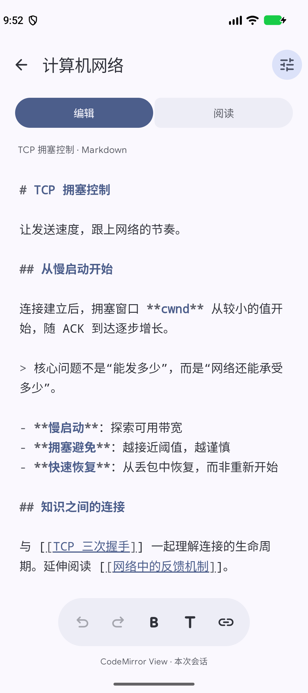
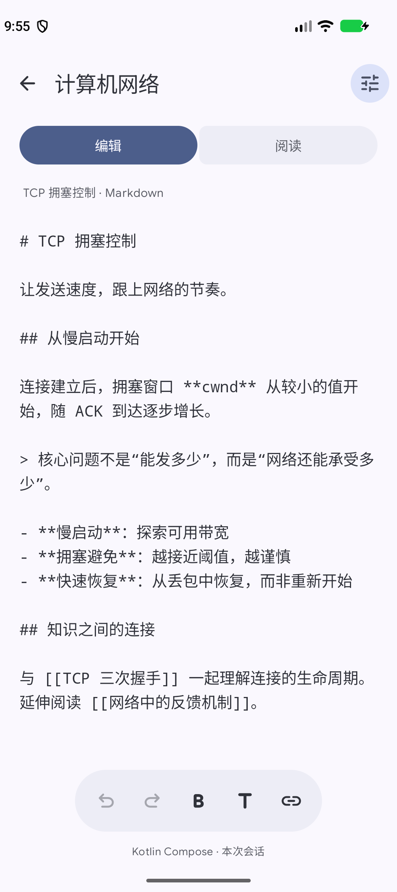
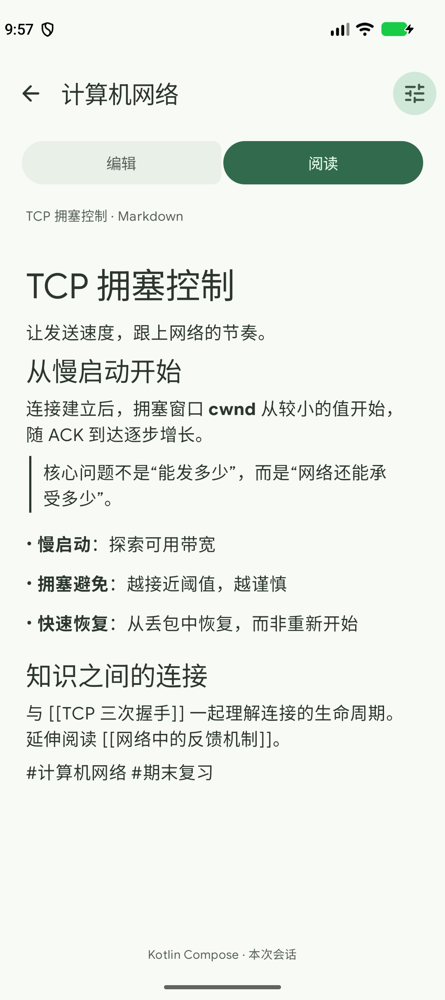
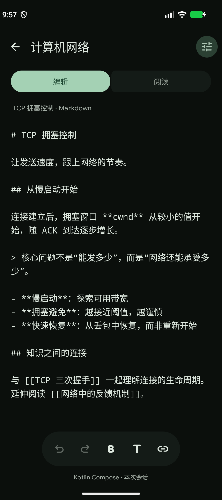

# Looma 第二轮：编辑器技术栈选型

本轮沿用方案 B，要求 Dynamic Color 和 Material Expressive；将实时渲染暂时移出比较范围。两个候选都显示 Markdown 源码，再切换到相同的原生阅读页。这里的代码是可丢弃的 prototype。

## 建议

优先推进 **纯 Kotlin Compose 源码编辑 + 独立原生阅读**。用户已经接受编辑与阅读分离，此时 CodeMirror 的语法高亮、成熟事务与扩展能力仍有价值，但需要额外维护 WebView 生命周期、异步消息、输入组合结束和 CSS 配色。原生方案已经用 TextFieldState 自带的撤销历史完成本轮核心编辑操作，无须自建富文本模型。

这不是即时渲染方案的选型结论。若未来恢复“隐藏标记、光标所在段落展开”的要求，需要另开实验；本轮 CodeMirror 也没有实现这种交互。

## 与 docs 的关系

需求文档仍将 Instant Rendering 列为产品目标，原候选为 Vditor；本轮按照用户的新指示接受独立阅读模式，因此属于一次有意缩小需求的技术实验。正式采纳时，应同步更新 FR-EDIT、相关验收条件和依赖图，不能把源码编辑冒充为已满足原 IR 基线。

Markdown 仍是事实源；阅读器只消费源文本快照，不把渲染结果写回。沿用文档“实际落盘才显示已保存”的规则，本 prototype 只显示“本次会话”，没有宣称保存成功。Room/FTS、SAF、标签和双链索引不是本轮重复验证的对象；第一轮证据保留在 `../looma-research/`。

## 两条实际实现

| 项目 | CodeMirror + Compose | 纯 Kotlin Compose |
|---|---|---|
| 外壳 | 相同 B 布局、MaterialExpressiveTheme、动态系统配色 | 相同 |
| 编辑 | AndroidView → WebView → CodeMirror 6 | BasicTextField + TextFieldState |
| 语法显示 | 源码与 Markdown 高亮 | 等宽源码，暂不做语法着色 |
| 阅读 | mikepenz 原生 Compose Markdown | 相同 |
| 撤销 | CM history，每篇 EditorState 保留 | TextFieldState.undoState，每篇状态保留 |
| 主题 | Compose 色彩角色经桥接写入 CSS 变量 | 直接使用 MaterialTheme 色彩角色 |
| 切换阅读 | 等待 flush/ack，结束输入组合 | 读取当前 TextFieldState |
| 集成负担 | JS 打包、WebView、协议与超时 | Kotlin/Compose 单一编辑路径 |

引擎分别位于两个可同时安装的 flavor APK。这样可以检查原生 APK 是否实际排除了 CodeMirror JS 和 WebKit，而不只是把 WebView 隐藏。两个应用不迁移撤销历史。

## 参考项目核查

| 项目 | 可借鉴的部分 | 容易误判的部分 |
|---|---|---|
| MarkReader | Compose 源码编辑、动态主题、Markwon 原生预览 | 通用 Markdown 阅读仍有 WebView 路径 |
| Markleaf | Compose 编辑、CommonMark AST 转为原生预览组件 | 预览适配器和自定义历史实现较多，不适合整套照搬 |
| Kori | state-based BasicTextField、OutputTransformation、Expressive 与动态配色 | Android MarkdownViewer 仍是 WebView |

精确固定版本、文件和证据链接见 [native-projects.md](research/native-projects.md)。这轮采用现成的 Compose Markdown 阅读库，避免为实验复制 Markleaf 的完整 AST 适配层。

## 已观察到的源码行为

在 API 37 模拟器上，两条实际编辑端口各运行 8 个样例：基本 Markdown、引用链接标题、未知扩展、HTML、中文/emoji/组合字符、GFM、CRLF、约 5 万字符长文。每个样例检查载入、包含 emoji 的反向 UTF-16 选区、加粗、撤销、重做、阅读快照、换篇再打开、保留历史、追加 Unicode 再撤销，打印的 11 项布尔条件均为 true。

结果保留在 [native-editor-probes.json](evidence/native-editor-probes.json) 和 [cm-editor-probes.json](evidence/cm-editor-probes.json)。这是通过实际 TextFieldState / CM transaction 操作的后端探针，不能代替真实键盘或中文候选词测试。CRLF/CR 在文档入口规范化为 LF，因此不宣称逐字节保留所有换行格式。

## 实际界面验证

两个 flavor 均通过实际 EditText 点击、ADB 键盘事件输入 `UI42`、原生工具栏加粗、撤销、重做、进入阅读、返回编辑、换篇再打开、系统深浅色切换和再次撤销检查。源文本与预期相符，阅读界面不暴露可访问的 EditText。操作序列相同，点击正文中央后光标所在字符位置不同；相同偏移的精确比较由前述源码探针完成。

快照、布局树和逐项结果见 [ui-journeys.json](evidence/ui-journeys.json)。这是实际输入控件的 ASCII 键盘事件，仍然不代表拼音候选或真实中文输入法验收。

发现一个原生细节。UI 加粗后的选区 `[116,118]` 在收起键盘进入阅读时变为 `[118,118]`。文本与历史正确，之后换篇和切换主题保留的是这个折叠后的选区。不能把后端选区探针通过扩大为所有 UI 选区均保持不变。见 [issues.md](issues.md) E03。

CodeMirror 最初出现“DOM 与可访问树有文字，实际画面空白”。软件绘制、透明度和可见性修改均没有单独解决问题。最终把编辑器根节点固定到嵌入式 WebView 的视口，并提高正文样式选择器优先级；移除诊断覆盖后，默认硬件绘制、阅读返回和最终 UI 操作均能正常显示。确切 Chromium 内部原因未被证明，仍需真机覆盖。完整实验见 [cm-paint-investigation.md](evidence/cm-paint-investigation.md)。

## Dynamic Color 与截图

主题使用系统动态色彩角色，没有在应用内用固定绿色模拟 Dynamic Color。实验通过 [AOSP 记录的系统色板设置](https://source.android.com/docs/core/display/material) 临时切换模拟器的系统色板，然后调用相同的 Android 动态主题 API。模拟器原设置为 `null`、夜间模式为 `no`；结束后均已恢复，见 [恢复记录](evidence/emulator-restored-state.json)。系统重新生成的蓝色色值与初始默认值有轻微差异，因此只宣称设置恢复，不宣称系统资源逐色完全相同。

| 系统主题 | 实际 primary | 证据 |
|---|---|---|
| 初始蓝色浅色 | `#4C5E8B` | [palette-original](evidence/native-palette-original.json) |
| 绿色系统色板，浅色 | `#326A4D`，两者一致 | [native](evidence/native-palette-green.json)、[CM](evidence/cm-palette-green.json) |
| 绿色系统色板，深色 | `#A4D1B4`，两者一致 | [native](evidence/native-palette-green-dark.json)、[CM](evidence/cm-palette-green-dark.json) |
| 恢复原设置后 | `#4E5E8B` | [palette-restored](evidence/native-palette-restored.json) |

外壳实际使用 `MaterialExpressiveTheme`、expressive motion、连接式 ToggleButton、HorizontalFloatingToolbar、FilledTonalIconButton、Extended FAB 和 LoadingIndicator。保留方案 B 的纸张内容区、列表层级与卡片布局；配色由系统决定。

打开 [可切换的截图比较页](comparison.html) 查看两条路线。源码页使用初始蓝色色板，阅读页与深色页使用绿色系统色板。所有截图来自 API 37 模拟器，每次截取后均已目视检查。

| CodeMirror 源码编辑 | Compose 源码编辑 |
|---|---|
|  |  |

| 相同的原生阅读器 | Compose 绿色动态深色 |
|---|---|
|  |  |

## 包与依赖检查

最终 debug 构建均通过。原生 APK 为 15,404,758 bytes，CM 为 15,777,129 bytes；这里只记录实验产物，不用 debug 体积推导发布包体积或运行内存。系统 WebView 引擎不包含在 APK 中。

[APK 检查](evidence/apk-inspection.json) 确认 native 没有 editor JS 资源、CodeMirrorPort 或 AndroidX WebKit 类描述符；CM 包含对应资源与适配器。两条 [实际运行时依赖](evidence/native-runtime-dependencies.txt) / [CM 依赖](evidence/cm-runtime-dependencies.txt) 也显示 WebKit 仅进入 CM。`inspect-apks.py` 可重跑 ZIP 与 DEX 检查。

正式推进建议保留原生状态式源码编辑和独立阅读，先完善中文 IME、选区交接、可靠保存与文档功能。若语法扩展、复杂快捷键和 CodeMirror 生态插件成为明确需求，可重新评估 CM。当前没有测量性能，不能据此断言哪条路线更快。

## 构建环境与边界

实际使用 AGP 9.1.1、Gradle 9.3.1、Compose 编译插件 2.3.20、JDK 21，目标字节码 17，compile/target SDK 37、min SDK 26。Material3 1.5.0-beta02 提供 Expressive 组件，Markdown M3 renderer 0.39.2。实际依赖解析到 Foundation 1.12.0，不能将调研时读取的 1.10.x 源码版本当成本轮运行版本。

Dynamic Color 使用 Android 12+ 的 dynamicLightColorScheme / dynamicDarkColorScheme，旧版本有静态回退。本轮只在 API 37 模拟器运行，实际系统 WebView 为 156.0.8078.47，键盘为 Gboard Latin，见 [环境记录](evidence/device-environment.json)。不宣称已覆盖所有支持系统或真机 WebView。

尚未验收：中文拼音候选组合、多厂商键盘、超大文件性能、TalkBack、进程死亡恢复、正式保存、完整 Markdown/HTML/数学公式/图表渲染一致性。长文源码探针通过不等于长文输入性能通过。

独立的 gpt-6-sol 已核查本轮对话记录、决策日志与产物证据，见 [evidence-review.md](evidence/evidence-review.md)。需保留的关注点为原生选区交接、CodeMirror 绘制修复的设备覆盖，以及本次结论只适用于缩小后的源码编辑与独立阅读范围。
